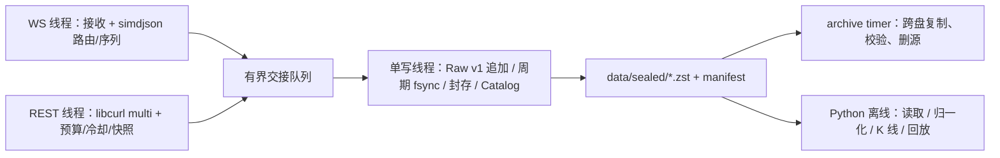
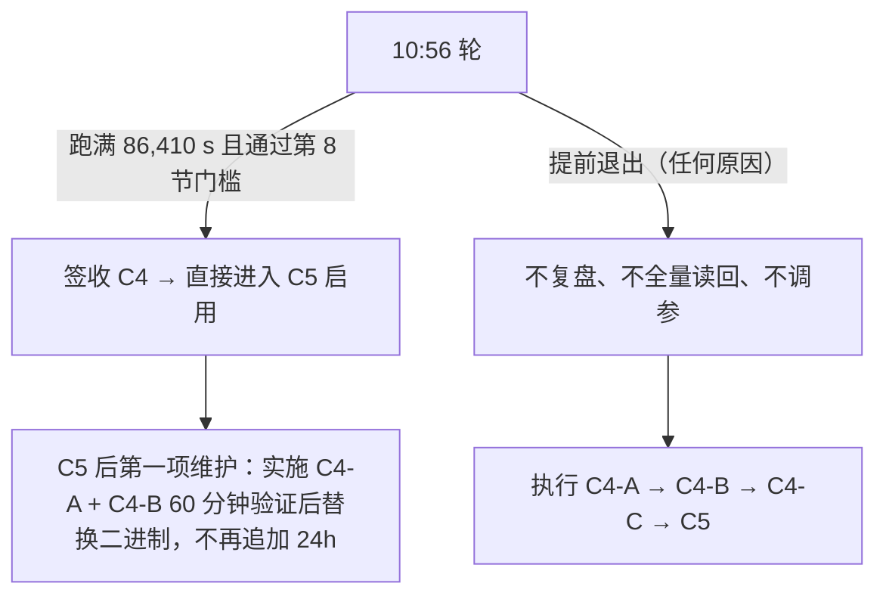

# Binance Market Data Recorder — C++ 重写里程碑计划（定稿）

> **定稿：2026-11-09。** 本文件是团队的**唯一执行依据**，替代此前文件中并存的原计划、11.23 指令、V2、V3 各版本。旧全文（含 11.1–11.22 运行日志、各轮失败证据）逐字保存在 [cpp_rewrite_plan_history.md](cpp_rewrite_plan_history.md)，只供查证，不再作为任务来源。
>
> **当前状态（2026-11-09 更新）：** C0、C1（单源）、C2（精简）、C3（四币对）已签收；C4 的归档、Parquet 归一化、离线 K 线、历史下载已验证通过。10:56 轮已于 **11:15:11 提前退出**（USD-M 运行 18m56s，exit 1），按第 5 节直接进入 C4-A。C4-A 代码已实施并通过原生 Release 13/13、ASan/UBSan 9/9、TSan 9/9，新二进制已安装为 `current`。**C4-B 60 分钟公网验证正在运行（T0 2026-11-09 22:02:29 上海时间），C4-C 24h 资格与 C5 启用尚未开始。** 第 5 节给出 10:56 轮的处理规则与结果。

---

## 1. 目标与范围

### 1.1 目标

用 C++20 实现 Binance Spot 与 USD-M 永续的公开行情采集核心，在 4 vCPU / ~5.8 GiB 的 GreenCloud VPS 上长期无人值守运行，为回测、策略和交易模块留出至少一半整机资源。

只录制**事后无法从官方归档免费下载**的实时数据；可离线构造或下载的数据一律不在实时进程中录制。

### 1.2 固定范围（本轮不改）

| 项目 | 固定值 |
| --- | --- |
| 标的 | 显式白名单 10 个 USDT 对：BTC、ETH、SOL、BNB、ZEC、XRP、NEAR、UNI、DOGE、LINK（[config/c4-mainstream.json](config/c4-mainstream.json)）。Spot + USD-M 共 20 个产品。 |
| Spot WS | `depth@100ms`、`bookTicker`、`aggTrade`（每 symbol 3 流，一条组合连接） |
| USD-M WS | `/public`：`depth@100ms`、`bookTicker`；`/market`：`aggTrade`、`markPrice@1s`、`forceOrder`（每 symbol 5 流，两条组合连接） |
| REST | 启动 `exchangeInfo`；启动/断层时 `depth` 快照；USD-M 五路 300 秒错峰轮询（`openInterest`、三种多空比、`takerBuySellVol`） |
| 存储 | Raw v1 + 封存 Zstd + manifest + SQLite Catalog（WAL/NORMAL）；分片 900 秒 / 16 MiB 轮换 |
| 进程结构 | 每市场一个进程；每进程 WS 线程（Spot 1、USD-M 2）+ REST 线程 + **单写线程** |
| 部署 | systemd `sbmdr-recorder@{spot,usdm}` + `sbmdr-archive.timer`；slice 配额 175%、归档 25%、CPUWeight 100/200 |
| 离线 | 继续复用冻结 Python 基线 `38acb1d0` 的 reader、归一化、回放、K 线合成与历史下载 |

### 1.3 永久不做（本重写阶段）

多周期 K 线 / `S12` K 线 / 实时 K 线补齐；`ticker@24hr` 与滚动窗口统计；冷门法币与边缘稳定币对；自动 Top-N；COIN-M；GUI / Web API / 交易执行 / 其他交易所；微服务、消息总线、插件框架、依赖注入。

---

## 2. 执行规则（防止过度设计与死循环）

### 2.1 改动规则

1. **只做本文件列出的任务。** 任务清单之外的改进写进第 10 节候选清单，不实施。
2. **一个问题一次改到位。** 第 6 节已经给出具体数值和做法，照做即可，不再开“先测量再讨论”的新一轮。只有第 9 节列出的情况才回到所有者决策。
3. **禁止的调参方式：** 继续缩小分片（< 16 MiB）、减少币对、微调 systemd 配额或权重、扩大线程数，用来“碰运气”通过 24h。
4. **不为理论风险加机制。** 不加 watchdog、重试层、优先级队列、状态机、额外线程、新配置系统。
5. 正常实现细节（变量名、函数拆分、测试写法）由实现者决定，不需要请示。

### 2.2 测试规则（按变更范围，不一刀切）

| 变更类型 | 必跑 | 不跑 |
| --- | --- | --- |
| C++ 队列 / 写线程 / 存储（C4-A） | Release 全部 13 项 CTest（含新增 `c4-ingress-drop`）+ ASan/UBSan + TSan 各一次 | — |
| 仅配置 / systemd / 部署脚本 | `c3-configured` + `systemd-analyze verify` + 启停一次 | sanitizer、C++ 重编译矩阵 |
| 仅 Python 离线工具 | 对应 `c4-candles` / `c4-normalize-adapter` 等 | C++ 测试 |
| 仅文档 | `git diff --check`、链接检查 | 任何运行测试 |

所有可执行测试在 GreenCloud 原生 Linux x86_64 上运行；开发机只做编辑与静态检查。性能数字只取 Release、无 sanitizer、无 strace 的运行。

### 2.3 失败轮与记录规则

- **中途失败的运行不做全量读回。** 只保留日志、status 摘要和失败原因；只有怀疑数据损坏时才校验受影响的文件。全量独立读回只对最终通过的那一轮做一次。
- **运行文档只写三件事：** 最终采纳的代码改动（提交号 + 二进制 SHA-256）、最终 24h 起止时间、最终验收结果。不再为中间试验写“不拼接时长、不冒称重跑”类声明；失败轮在 `c3-c5-deployment.md` 用一行记录（时间、原因、处理）。
- 验收脚本本身出错（不是记录器出错）时，修脚本后在**同一份已闭合数据**上重跑验收，不重新采集。

---

## 3. 架构与数据合同（现有实现，保持不变）

数据合同（沿用，不重新设计）：

1. WS 保留应用层 payload 原字节；REST 保留 HTTP body 与请求参数、状态、必要响应头（provenance）。
2. 保留接收 UTC / monotonic 时间、交易所时间、序列字段；金额不经 double。
3. 正常封存：写入时计算 CRC32C / SHA-256 → fsync → 同盘原子 rename → 目录同步 → manifest → Catalog。无封存后回读、无后台重验、无启动空分片。
4. 崩溃后由 `ExecStartPre` 的 `recover_raw.py` 截尾/隔离；不完整区间不得标为 complete。
5. **周期耐久同步：公网配置模式为 5 秒**（C4-A 由原 900 ms 调整，理由见 6.3）。崩溃最多丢失每个文件约 5 秒未同步数据，由恢复流程截到最后完整帧并标记缺口。正常停止和封存仍完整 fsync。
6. 磁盘：启动要求可用 ≥ 15 GiB（C4-A 由 18 GiB 调整），运行中 ≤ 13 GiB 触发 `DISK_EMERGENCY_STOP` 排空封存后停止。未完成归档验证的数据不删除。
7. 缺口如实记录：断线重连、序列断层、本地丢弃都要在数据（`capture_flags`/`sequence_gap`）、manifest（`complete=false`）和 Catalog 事件中可查。**文件 CRC/SHA 正确只说明存储完整，不说明行情覆盖完整。**

---

## 4. 已完成里程碑（不重开）

| 阶段 | 结论 | 证据 |
| --- | --- | --- |
| C0 基线与原型 | Python 基线固定；保留 Raw v1、Zstd 封存、libcurl multi；预算冻结。 | [c0.1-baseline.md](c0.1-baseline.md)、[c0-prototype-and-budget.md](c0-prototype-and-budget.md) |
| C1 单源端到端 | 单源 2,760 s、30,360 条完整读回；延迟原门槛未达，所有者接受 VPS 实测表现。合成容量压测失败结论保留，不再为其改造。 | [c1-recorder.md](c1-recorder.md)、[c1-closeout-20261107.json](c1-closeout-20261107.json) |
| C2 精简可靠性 | 退避期 SIGTERM、depth 快照与 U/u/pu 桥接、五路错峰 REST 与 429/418 冷却、十例文件恢复边界。 | [c2-reliability.md](c2-reliability.md)、[c2-core-qualification-20261108.json](c2-core-qualification-20261108.json) |
| C3 四币对 | 二进制 `234264…` 公网 3,605 s，155 分片 / 2,502,622 条全部读回；CPU 合计 27.41% 单核，RSS 合计 64.31 MiB。 | [c3-c5-deployment.md](c3-c5-deployment.md)、[c3-c5-qualification-20261109.json](c3-c5-qualification-20261109.json) |
| C4 离线部分 | 跨盘归档（含复制中断/目标损坏保源）、combined WS 归一化 `invalid=0`、Decimal OHLCV、官方历史 CHECKSUM 下载均已通过。 | 同上 |

---

## 5. 当前运行轮（10:56 轮）的处理规则

当前轮：release `20261109-fb2d2501`，二进制 `40df2dc2…`，T0 `2026-11-09 10:56:12.8`（上海时间），16 MiB、队列 8,192 条。本计划定稿时**没有核实**它的实时状态。

- **跑满且通过：** 不中断、不改代码，按第 8 节验收后进入 C5。由于旧二进制在 2 秒以上写入停顿时仍会退出，而 `StartLimitBurst=3/300s` 可能让服务在连续退出后停摆，C4-A 仍要做，但作为 C5 后的维护：通过 C4-A 测试与 C4-B 60 分钟验证后替换，**不再追加 24h**。
- **提前退出：** 只在 `c3-c5-deployment.md` 记一行，立即开始 C4-A。
- **实际结果（2026-11-09 11:15:11 上海时间）：** 该轮提前退出；USD-M 运行 18m56s 后以 exit 1 结束，Spot 同时停止。按本节未做全量读回、未调参，C4-A 已随后实施并完成回环/原生回归；C4-B/C4-C/C5 尚未开始。

---

## 6. C4-A：写路径修复（一次改到位，约 1 天）

### 6.1 要解决的问题（已有证据）

此前 7 轮扩容失败都是同一模式：USD-M 写线程停顿约 2 秒以上 → 8,192 条队列打满 → WS 等 250 ms 后抛 `IngressOverload` → 整个进程退出 → 24h 重新计时。

- USD-M 实测约 **3,600 条/秒**（11.21：1,464 s 内 5,223,377 条），8,192 条只能缓冲约 **2.3 秒**。
- 写线程每 900 ms 对所有有未同步数据的文件逐个 `fsync`（[recorder_storage.hpp:354-362](prototype/recorder_storage.hpp#L354-L362)）。所配流几乎每秒都有消息，因此 USD-M 每轮约 40–50 个文件、Spot 约 30 个文件都要同步，两个进程合计**每秒约 80 次 fsync**，落在同一块共享 VPS 系统盘上。
- 180 秒隔离诊断中单次 fsync 最慢只有 74 ms，但 USD-M 队列峰值仍达 6,607 条（约 1.8 秒积压）。单次 fsync 解释不了这个积压；更合理的解释是一轮内几十次 fsync 的累计耗时，再叠加同步封存。缩小分片不会减少这部分开销，反而增加文件打开、header fsync 和目录同步次数。这和 128→32→16 MiB 都没有解决问题的结果一致。

### 6.2 改动清单（只改这 5 项）

“配置模式”指带白名单配置文件运行的模式，包括公网生产以及 `c3-configured`、`c4-rotation-burst`、`c4-overload-catalog` 等回环测试。旧的单源回环模式（C1/C2 测试）保持原有常数与行为，原有测试含义不变。

| # | 改动 | 位置 | 具体做法 |
| --- | --- | --- | --- |
| A1 | **队列按内存计费并放大** | [main.cpp:56-57](prototype/main.cpp#L56-L57)、[`Handoff`](prototype/main.cpp#L504-L582) | 每条消息计费 `body.size() + 1024`（1 KiB 是 Message 结构、JSON 字段、deque 节点的固定开销估计）；`push/pop/take/rest_admissible` 统一使用该计费。字节上限保持 **64 MiB**，在配置模式下就是该队列的内存上界。条数上限在配置模式下设为 **65,536**（只作保险），单源模式保持 8,192。按 USD-M 实测平均帧大小，可缓冲约 **9 秒以上**输入。 |
| A2 | **DepthBridge 上限与队列解耦** | [recorder_core.hpp:223](prototype/recorder_core.hpp#L223)、[:327](prototype/recorder_core.hpp#L327) | 新增独立常量 `depth_pending_limit = 8192`，替换这里对 `queue_records` 的引用。放大队列后，每个 symbol 的桥接缓存不能跟着变大。 |
| A3 | **满队列：丢弃当前帧、标记缺口、进程继续** | [`Handoff::push`](prototype/main.cpp#L506-L528)、[`read_ws`](prototype/main.cpp#L694)、[`run_core_rest`](prototype/recorder_run.hpp#L113-L131)、[`launch_ws`](prototype/recorder_run.hpp#L367-L370) | 配置模式下 `push` 改为**不等待**的 `try_push`，返回成功/失败，不抛 `IngressOverload`。**WS 失败时：** 丢弃当前帧，按 `(symbol, stream)` 累计丢弃数与首末丢弃时间；同一流下一条被接受的消息带上 `sequence_gap`、`ingress_drop` 标志和 `sequence["ingressDropped"]=n`；每连接最多每秒一条 `INGRESS_DROP` status_line（含累计数）。**写线程**追加到带 `ingress_drop` 的消息时，写一行 Catalog `operational_events`：`event_type='INGRESS_DROP'`，范围写入 `evidence_json`，身份列留 NULL（沿用 11.13 修正）。**`diff_depth`** 的丢弃会让下一条消息序列不连续，现有 [`DepthBridge::reset()`](prototype/recorder_core.hpp#L139-L144) 会自动请求快照并重新桥接，无需新代码，只需测试确认。**REST 失败时：** 丢弃该响应并写 status_line；depth 快照不标记完成（沿用 1 秒后重试）；周期轮询进入下一周期。**保持不变：** 队列关闭、写入/fsync 失败、磁盘紧急停止仍按原逻辑退出。 |
| A4 | **周期耐久同步改为 5 秒** | [recorder_storage.hpp:361](prototype/recorder_storage.hpp#L361) | `milliseconds(900)` 改为构造参数：配置模式 **5,000 ms**，单源模式保持 900 ms。fsync 次数约降为原来的 1/5（两个进程合计约 80 次/秒降到约 15 次/秒）。封存、退出时的同步不变。 |
| A5 | **启动磁盘门槛 18 → 15 GiB** | [recorder_run.hpp:206-207](prototype/recorder_run.hpp#L206-L207) | 运行中 13 GiB 紧急停止不变。理由：系统盘总可用约 19.4 GiB；18 GiB 的启动门槛意味着只要有超过约 1.4 GiB 尚未归档的数据，`Restart=on-failure` 就拉不起进程。 |

另在现有每秒 status_line 中加 **3 个常驻字段**（不放在 `#ifdef` 里）：`writer_sync_ms`（本秒累计周期 fsync 耗时）、`writer_seal_ms`（本秒累计 `rotate()` 耗时）、`dropped_total`（WS+REST 累计丢弃数，原子计数）。这就是全部诊断，不加 perf、strace 或事件追踪。

### 6.3 明确不改（之前提过，但已判定无效或不必要）

| 不改项 | 理由 |
| --- | --- |
| `take()` 批大小 32→256、把 `tick()` 移出逐条循环 | `tick()` 在同步未到期时只做一次时钟比较，几乎无开销；32 条一批时每秒约 110 次加锁，不是瓶颈。 |
| WS 满队列等待 3–5 秒 | WS 线程等待期间不读 socket、不处理 ping/pong，等待只是把积压挪到内核缓冲区和交易所端。 |
| 按流优先级丢帧 | 没有研究需求说明应该牺牲哪种流；淘汰已入队消息需要扫描队列，还会破坏顺序。 |
| 分片大小 | 保持 16 MiB，不再缩小，也不改回 32 MiB（避免再改一个变量）。 |
| 异步封存线程、合并物理分片、`syncfs`、Raw v2、无锁队列 | 第 10 节候选清单；只有 C4-B 失败且所有者决定时才考虑。 |
| SQLite `busy_timeout=30s`、`BEGIN IMMEDIATE` | 没有持锁阻塞证据；归档事务短。 |
| `Retry-After > 1 天` 时退出 | Binance 封禁可达 3 天，提前重试不是容错；退出后交给操作者处理是正确行为。 |
| CPU 配额 / 权重、币对名单 | 固定，见 1.2。 |

### 6.4 测试

**修改已有测试：**

- `c4-overload-catalog`（`--stall-one`，单次 3.5 秒封存阻塞）：断言由“进程过载退出”改为“**进程不退出、无丢弃、30,000 条全部按原字节读回**”。
- `c2-handoff-limit`：单源模式原断言保留；新增配置模式断言：满时 `try_push` 立即返回失败，不阻塞、不抛异常。

**新增一项丢弃路径测试**（可作为 `verify_rotation_burst.py` 的新参数）：回环配置模式下，用仅测试可用的参数把队列条数设为 1,024（公网模式不读取该参数），注入 3.5 秒阻塞。断言：

1. 进程持续运行，并在收到 SIGTERM 后正常排空。
2. 发送数 = 读回数 + `dropped_total`。
3. 丢弃后每个受影响流的下一条消息带 `ingress_drop` 与 `sequence_gap`。
4. Catalog 中有 `INGRESS_DROP` 事件，冻结 Python Catalog 能正常打开。
5. `diff_depth` 丢弃后发出了新的快照请求，桥接恢复。

**执行：** 第 2.2 节 C4-A 行，Release **13 项**（原 12 项 + 新增 `c4-ingress-drop`）+ ASan/UBSan + TSan **各跑一次**，结果绑定提交号与二进制 SHA-256。

### 6.5 完成标准

- 6.2 的 5 项改动和 3 个 status 字段已合入；6.4 全部通过。
- 出一份简短变更说明（写在 `c3-c5-deployment.md` 新小节）：改了什么、提交号、二进制 SHA-256、测试结果。

---

## 7. C4-B：60 分钟公网验证 + 发布准备（约半天）

### 7.1 60 分钟公网短测

用 C4-A 的二进制，按正式部署方式（systemd 两个实例 + archive timer，`Restart=no`）、十币对配置在独立根上运行 **3,600 秒**，然后 SIGTERM。

| 检查 | 通过条件 |
| --- | --- |
| 进程 | 两个实例全程同 PID，不退出 |
| 丢弃 | `dropped_total = 0`（两个市场） |
| 队列 | `queued_payload_bytes` 峰值 ≤ 32 MiB（计费上限的 50%） |
| 内存 | 两个记录器 + 归档峰值 RSS 合计 ≤ 256 MiB |
| 数据 | 冻结 Python 能打开 Catalog；每个市场抽 3 个封存分片用 `operations.py verify` 读回通过；排空后无 `.partial` |
| 归档 | timer 至少成功执行一次跨盘事务 |

另外记录（不作门槛）：`writer_sync_ms`、`writer_seal_ms` 的均值和最大值，CPU 均值与峰值。

**通过：** 不重编译，同一二进制直接进入 C4-C。**不通过：** 按第 9 节处理，不自行调参重跑。

### 7.2 发布准备（可与 7.1 并行）

现有 `install.py` + staging 目录的部署方式保留，不改成 submodule、wheel 或 CI。只补以下事项：

1. **运行手册** `deployment/RUNBOOK.md`（1–2 页），列出实际命令：原生构建（含 `PYTHON_BASELINE`）、运行 CTest、准备 staging、`install.py` 安装、启动/停止/状态、日志位置、`operations.py verify`、手动归档、回退到上一个 release、磁盘紧急停止后的处理。
2. **CMake 明确报错**：需要 Python 基线的测试在 `PYTHON_BASELINE` 为空时，在 configure 阶段给出清晰错误，不要等到运行时才失败。
3. **Python 基线已内联**：`vendor/python-baseline` 固定 main 提交 `38acb1d0`，包含 `BASELINE.json` 树哈希；`prototype/CMakeLists.txt` 默认使用该目录，`deployment/install.py` 只从该目录复制到 release，不再读取 `source/python/src`。

---

## 8. C4-C：一次 24h 资格与数据闭环（24h + 半天收尾）

### 8.1 运行

固定 C4-B 的二进制、配置、unit，在新的独立根上运行 **86,410 秒**（24h + 10 s），archive timer 同时运行，资格期 `Restart=no`。满时长后 SIGTERM 两个实例并排空。

### 8.2 验收门槛（只有这些，冻结不再改）

| 项目 | 门槛 |
| --- | --- |
| 进程 | 两个实例各自同一 PID 跑满 86,410 s，`NRestarts=0`，正常排空退出 |
| 数据完整性 | 对本轮全部封存分片（已归档 + 本地）做**一次**全量 `operations.py verify`：CRC32C / SHA-256 / 记录数 100% 通过；冻结 Python 可打开 Catalog；无 `.partial` |
| 本地丢弃 | 每个市场 `dropped_total` ≤ 已接受 WS 记录数的 **0.01%**（目标为 0）；每次丢弃都有 `ingress_drop` 标志和 Catalog 事件 |
| 网络缺口 | 断线自动重连，重连后有 `sequence_gap` 标记；depth 重新桥接。**不设逐流断线秒数门槛**；`forceOrder` 没有消息不算断流 |
| 连接换新 | 每条 WS 连接至少一次 23h 主动换连，换连后各 symbol depth 已重新桥接 |
| CPU / 内存 | 沿用所有者 11.20 口径：整机平均忙碌 ≤ 50%，整机最小可用内存 ≥ 50%；两个记录器 + 归档峰值 RSS 合计 ≤ 256 MiB |
| 磁盘 / 归档 | 系统盘可用全程 ≥ 13 GiB；结束后归档积压归零，源文件按目标校验后回收 |
| 离线冒烟 | 每个市场取 1 个 symbol 的 1 小时数据：归一化 `invalid=0`；用 `aggTrade` 合成 1m K 线成功。复用现有工具，不写新代码 |

### 8.3 报告（只记录，不作门槛）

每个进程的 CPU 均值/峰值、append p99、最大 receive→fsync、`writer_sync_ms` / `writer_seal_ms` 分布、压缩后 GB/天、分片数/天、按归档盘容量算出的可保留天数。原 1.25 s 耐久和单核 30–50% CPU 目标照常列出“达到/未达到”，不影响签收。

### 8.4 失败处理

| 失败类型 | 处理 |
| --- | --- |
| 记录器崩溃、异常退出、数据错误 | 定位 bug，补一个能复现它的测试，修复后重跑 C4-C。失败轮不做全量读回 |
| 丢弃超过 0.01%，或队列持续打满 | **停止**，按第 9 节交所有者决定 |
| 验收脚本出错 | 修脚本，在同一份已闭合数据上重跑验收，不重新采集 |
| 操作者主动中断（部署修正等） | 记一行，重新计时，不算记录器失败 |

---

## 9. 升级规则（防止死循环）

出现以下任一情况，团队**停止自行改动**，把 status_line 中的 `queued_*`、`writer_sync_ms`、`writer_seal_ms`、`dropped_total`、CPU 和 steal 数据整理成一页交给所有者：

- C4-B 未通过；
- C4-C 因丢弃或队列持续打满失败；
- 同一类 bug 修复后在 C4-C 中再次出现。

所有者从以下选项中选一个，团队只实施选中的那一项：

1. 接受实测结果签收（丢弃视为已诚实记录的缺口）。
2. 若 `writer_seal_ms` 占主导：增加一个封存线程（写线程只移交已关闭分片，压缩与发布在封存线程完成）。
3. 若 `writer_sync_ms` 仍占主导：周期同步改用 Linux `syncfs` 一次调用完成。
4. 缩小币对范围（违背 10–20 对目标，需所有者明确同意）。

---

## 10. C5：正式启用与交接（约半天）

### 10.1 任务

1. 用 C4-C 同一发布物，把 unit 改为 `Restart=on-failure`（保留现有 `RestartSec=10`、`StartLimitBurst=3/300s`），`systemctl enable` 两个记录器和 archive timer。
2. 受控重启验证一次：`systemctl restart sbmdr-recorder@spot sbmdr-recorder@usdm`，确认 `ExecStartPre` 恢复、启动、继续写入和归档都正常。崩溃恢复已由 `c2-recovery-boundaries` 覆盖，**不在生产根上做 SIGKILL 演练**。
3. 保留上一个 release 目录；按 RUNBOOK 演练一次回退命令（只切换 `current` 链接后启动，验证能启动即可）。
4. 在 `c3-c5-deployment.md` 写签收记录：二进制 SHA-256、配置 SHA-256、24h 起止时间、第 8.2 节逐项结果、第 8.3 节报告数据。

### 10.2 完成标准

两个实例与 archive timer 已 enable 并正常运行，回退命令已演练，RUNBOOK 已入库，签收记录已写。**满足即签收 C4 与 C5，重写阶段结束。** 不设 72 小时观察门禁、每日全量校验或新的监控平台；之后的异常按日常运维处理。

---

## 11. 候选清单（不是任务，C5 之后按实际需要再评估）

| 候选 | 什么时候才考虑 |
| --- | --- |
| 独立封存线程 / `syncfs` | 第 9 节所有者选中时 |
| 扩到 11–20 对 | 策略确有需要；先跑 C4-B 同款 60 分钟验证 |
| 代码整理为 `src/` `include/` `tests/`、加 namespace | 需要多人协作或新增模块时 |
| Python 基线改为 submodule 或固定 wheel、`build-release.sh`、CI | 需要在第二台机器部署，或有新成员加入时 |
| Catalog schema 版本检查、事务 RAII 回滚 | 再次出现跨语言 Catalog 契约问题时 |
| 物理分片合并、Raw v2、流式压缩、无锁队列、内存池、绑核 | 同口径测量证明它是主要瓶颈时 |
| 自动 Top-N、COIN-M | 策略明确需要时 |

无论是否出现性能问题，都不恢复：封存后全量回读、后台重验、启动空分片、内部防篡改深拷贝、多周期实时 K 线。

---

## 12. 对此前各版意见的最终取舍

以下结论已定，团队不再重新讨论。

| 来源 | 建议 | 定稿处理 | 理由 |
| --- | --- | --- | --- |
| 11.23 | 队列条数提到 131K/262K | **改**：按 `body+1KiB` 计费、上限 64 MiB，条数 65,536 只作保险（A1） | 只计 body 时，26 万条的 Message 开销不受控 |
| 11.23 | `take` 32→256、把 `tick` 移出逐条循环 | **不做** | 未到期的 `tick` 只是一次时钟比较，不是瓶颈 |
| 11.23 | WS 满队列等待 3–5 s | **不做**，改为立即丢弃并标记（A3） | 等待期间不读 socket、不回 ping |
| 11.23 | 失败轮不做全量读回、按变更范围测试、文档精简 | **采纳**（2.2、2.3） | — |
| 11.23 | 当前轮跑满即签收 | **采纳**，C4-A 改为上线后维护（第 5 节） | 旧二进制遇停顿仍会退出，可能触发 `StartLimitBurst` |
| V2 | 按流优先级丢帧 | **不做** | 无业务依据，复杂度高 |
| V2 | 先测 fsync 扇出，再限每轮最多刷 32 个文件 | **改**：同步周期直接改为 5 s（A4）+ 常驻计时字段 | 证据已足够；限刷数量会推迟低频文件的耐久 |
| V2 | SQLite 1 s 超时 + 三次重试 | **不做** | 无持锁证据，反而会增加新的退出路径 |
| V2 | `Retry-After` 截断到 24h | **不做** | 封禁可达 3 天，提前重试不是容错 |
| V2 | 2h soak + 2–4h 故障 soak | **合并**为 C4-B 60 分钟 | 已知故障由回环夹具覆盖 |
| V2 | 逐流 30/120 s、0.1%/0.5% 缺口门槛 | **不做**，只设本地丢弃 ≤ 0.01% 一项 | 公网断线由交易所侧决定，只要求如实记录 |
| V2 | 72h 观察门禁 + 自动回滚触发器 | **不做** | 启用后转日常运维 |
| V2 | submodule/wheel、`build-release.sh`、CI、schema hash | **推迟**到候选清单；C5 只交 RUNBOOK 与 CMake 报错 | 单 VPS 部署已可用 |
| V2 | 启动磁盘门槛改为配置项 | **改**为固定 15 GiB（A5） | 18 GiB 会让自动重启在常态下失败；不需要新配置项 |
| V3 | “sync 会跳过干净文件，所以 fsync 扇出不成立” | **不同意** | 所配流几乎每秒都有消息，每轮约 70 个文件都需要同步 |
| V3 | “依据实测确定一次队列容量”、“核实丢弃影响后再定” | **改为本文给出的固定数值与门槛** | 避免再开一轮测量和讨论 |
| V3 | 独立的小型缺口摘要通道 | **简化**：缺口挂在同流下一条被接受的消息上 + Catalog 事件（A3） | 不需要新通道 |
| V3 | 不追加 72h、不强制 submodule、保持 SQLite 与 Retry-After 现状 | **采纳** | — |

---

## 13. 依据

- 历史全文与各轮失败证据：[cpp_rewrite_plan_history.md](cpp_rewrite_plan_history.md)、[c3-c5-deployment.md](c3-c5-deployment.md)
- Python 生产计划与当前状态：[production_milestone_plan.md](https://github.com/tomohikoAmada/BinanceMarketDataRecorder/blob/main/docs/production_milestone_plan.md)、[CURRENT_PRODUCTION_STATE.md](https://github.com/tomohikoAmada/BinanceMarketDataRecorder/blob/main/docs/CURRENT_PRODUCTION_STATE.md)
- 存储与消费者契约：[storage_contract.md](https://github.com/tomohikoAmada/BinanceMarketDataRecorder/blob/main/docs/storage_contract.md)、[consumer_contract.md](https://github.com/tomohikoAmada/BinanceMarketDataRecorder/blob/main/docs/consumer_contract.md)
- Binance 限流与流定义：[IP 限制](https://developers.binance.com/en/docs/products/spot/rest-api#ip-limits)、[USD-M 强平流](https://developers.binance.com/en/docs/catalog/core-trading-derivatives-trading-usd-s-m-futures/api/ws-streams/market#liquidation-order-streams)
- 库语义：[libcurl multi](https://curl.se/libcurl/c/libcurl-multi.html)、[SQLite busy_timeout](https://www.sqlite.org/c3ref/busy_timeout.html)、[syncfs(2)](https://man7.org/linux/man-pages/man2/syncfs.2.html)
