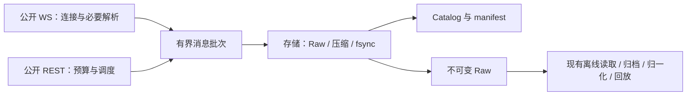

# Binance Market Data Recorder — C++ 重写里程碑计划

> **版本：中文定稿，2026-11-03；实现复核更新，2026-11-04。编写与评审：GPT-6 Astra。**
>
> **状态：C0 已完成并提交；C1 主体已实现，有历史本地验收，当前版本待修正及 GreenCloud 验收；C2 部分实现、尚未通过；C3–C5 未开始。详见[本次代码审查](#cpp-review-20261104)。**
>
> 本文件整合并替代此前的 C++ 草案与评审，作为同一仓库新分支上的独立重写计划。Python 的现行计划、运行记录和历史数据继续保留；服务切换属于 C5，不因计划定稿自动发生。

## 一、目标与执行原则

### 1.1 目标

使用现代 C++20 实现 Binance Spot、USD-M、COIN-M 公开行情采集核心，在保证数据语义、耐久性和缺口可解释的前提下：

1. 降低相同采集范围下的 CPU、内存、磁盘 I/O 和调度开销。
2. 在明确的资源、网络和接口预算内，逐步扩大数据家族与产品覆盖。
3. 保持模块职责清楚、依赖单向、实现简单，复用现有契约、测试与离线工具。
4. 在目标 VPS 上完成同一次连续运行的 `2h → 12h → 24h` 资格验收。

业务实现统一使用 **C++20**；成熟库通过其 C/C++ API 使用，不为了“C&C++”额外拆出一套 C 业务框架。Python 保留用于现有离线读取、归一化、回放、研究辅助和测试工具。

决策顺序固定为：**守住必需数据和真实缺口 → 在预算内增加独有信息 → 在相同范围下继续降低成本**。减少必需源、放宽新鲜度判定或隐藏失败，不算性能优化。

### 1.2 KISS / YAGNI 执行合同

- **优先复用**：能复用现有模块、契约、算法、夹具或成熟库，就不新建等价机制。跨语言时迁移必要实现，不逐类翻译 Python，也不让 C++ 实时路径依赖 Python 解释器。
- **只做当前阶段**：每个里程碑完成其任务与退出标准即可。后续能力、候选优化、顺手整理不进入当前变更。
- **新增机制须有四项说明**：可复现问题、最小实现方案、资源成本、验收标准。写在对应任务或变更说明中即可，不建立新的审批服务、设计登记系统或文档流水线。
- **没有证据就保持简单**：只有实测瓶颈、可复现故障或当前阶段明确要求的能力，才构成新增机制的理由。理论上的极低概率风险不构成增加复杂防御的理由。
- **不做预留式架构**：不新增微服务、通用事件总线、插件框架、依赖注入容器、通用状态机引擎或为其他交易所预留的抽象层。职责模块不是必须新增的类层次。
- **延续已有状态语义**：复用现有连接、源健康、缺口和分片生命周期；不为相同事实维护第二套状态机或重复持久化日志。
- **不重复验证可信内部数据**：受控进程内不做防篡改深拷贝，不层层重验相同字段。外部输入长度、缓冲区寿命、实际 I/O 结果和已有耐久规则仍须正确处理。
- **不追求形式上的零开销**：不把全面零分配、零拷贝、无锁或绑核设成目标。一次有界复制、一个短临界区或标准容器，只要满足预算就可以使用。
- **验收失败先定位**：先复现、分段测量、修复最小原因。不能通过扩大线程池、增加队列或重试层来掩盖持续过载。

正常实现选择不需要反复请求确认。超出当前里程碑的改进记入第八节候选清单；候选条目不是实施任务。

### 1.3 项目边界

保留项目名称、仓库、数据路径及正式 CLI `binance-market-recorder`。当前实际重写分支为同一仓库的 **`S-BMDR`**，计划位于仓库根目录；可使用独立 worktree。当前实验程序名为 `sbmdr-c0`，正式 CLI 对齐仍属于后续交付工作，不为本次评审单独改名。

仅访问公开、免密钥、免签名市场数据接口；不读密钥、凭据库，不调用账户或订单接口，不输出原始代理 URL。市场数据目录中的接口不一定免密钥，权限须逐接口确认。

继续遵守现有生产数据根目录规则。实验与 Python 实例使用独立数据子目录和 Catalog；不并发写同一数据集。正式采集数据不放在仓库、Desktop、Documents、iCloud 或 `/tmp`。

本计划不增加 GUI、Web API、交易执行、其他交易所、Kafka、Kubernetes 或新的部署平台。

## 二、复用基线与已确认事实

规划依据为 `main@38acb1d0ee1e` 的源码与保留记录。C0 启动时固定实际使用的最新基线，不把本文件中的历史数值当作实时状态。

Python 已完成多项去冗余优化，正常封存后的全文件解压回读、后台实时重验及启动空分片已移除。第二轮 M4 的 CPU 109.16%、RSS 366.10–617.90 MiB 和 seal 最大 13.602s 是历史观测，不能单独证明所有延迟来自 GIL，也不能推导 C++ 必然降到某个百分比。详见 [生产计划](https://github.com/tomohikoAmada/BinanceMarketDataRecorder/blob/main/docs/production_milestone_plan.md) 和 [状态记录](https://github.com/tomohikoAmada/BinanceMarketDataRecorder/blob/main/docs/CURRENT_PRODUCTION_STATE.md)。

| 现有成果 | 重写中的处理 | 参考 |
| --- | --- | --- |
| 产品发现、公开源清单、共享请求与适用性 | 迁移必要逻辑和固定样本；不重新设计通用数据源框架。 | [产品与源定义](https://github.com/tomohikoAmada/BinanceMarketDataRecorder/blob/main/src/binance_market_data_recorder/binance/public_sources.py)、[覆盖矩阵](https://github.com/tomohikoAmada/BinanceMarketDataRecorder/blob/main/docs/milestones/P0/coverage.md) |
| WS 分组、热流隔离、REST 预算与到期调度 | 复用规则和故障案例，以 C++ 异步实现替换必要路径。 | [WS 实现](https://github.com/tomohikoAmada/BinanceMarketDataRecorder/blob/main/src/binance_market_data_recorder/binance/public_websocket.py)、[请求预算](https://github.com/tomohikoAmada/BinanceMarketDataRecorder/blob/main/src/binance_market_data_recorder/binance/request_budget.py) |
| 闭合 K 线、S12 去重、断线 REST 补齐 | 保留既定语义，不重新订阅等价数据。 | [ADR-0058](https://github.com/tomohikoAmada/BinanceMarketDataRecorder/blob/main/docs/adr/0058-kline-closed-bar-persistence-and-backfill.md) |
| 快照桥接与深度序列检查 | 迁移实时所需的小范围逻辑；全量盘口重建保持离线。 | [ADR-0052](https://github.com/tomohikoAmada/BinanceMarketDataRecorder/blob/main/docs/adr/0052-bounded-raw-batches-and-sequence-only-capture-health.md) |
| Raw v1、manifest、CRC/hash、恢复与归档 | 默认兼容现有格式和生命周期；格式变更仅按 C0 的证据选择执行。 | [ADR-0010](https://github.com/tomohikoAmada/BinanceMarketDataRecorder/blob/main/docs/adr/0010-raw-chunk-v1-byte-format.md)、[存储契约](https://github.com/tomohikoAmada/BinanceMarketDataRecorder/blob/main/docs/storage_contract.md) |
| Catalog、状态转换与共同水位 | 复用现有必要表与语义；WAL + NORMAL、预编译 SQL 和批量更新。 | [Catalog](https://github.com/tomohikoAmada/BinanceMarketDataRecorder/tree/main/src/binance_market_data_recorder/storage/catalog)、[ADR-0059](https://github.com/tomohikoAmada/BinanceMarketDataRecorder/blob/main/docs/adr/0059-catalog-wal-normal-sync-and-watermark-checkpoint.md) |
| Raw 读取、归一化、确定性回放、历史导入 | 优先继续使用现有 Python 模块，按所选格式补最小适配。 | [消费者契约](https://github.com/tomohikoAmada/BinanceMarketDataRecorder/blob/main/docs/consumer_contract.md)、[数据契约](https://github.com/tomohikoAmada/BinanceMarketDataRecorder/blob/main/docs/data_contract.md) |
| 回放基准、golden vectors、故障与兼容测试 | 直接复用可适用部分；只补 C++ 特有的内存、线程和字节兼容测试。 | [三方基准工具](https://github.com/tomohikoAmada/BinanceMarketDataRecorder/blob/main/tools/benchmark_m3_three_way.py)、[测试目录](https://github.com/tomohikoAmada/BinanceMarketDataRecorder/tree/main/tests) |

4,038 个活跃逻辑源、50 个产品、85/89 个 WS 组来自特定快照，属于不同统计维度。后续分别报告逻辑源、连接、帧率、打开文件和压缩上下文数量，不按逻辑源数分配线程或文件。

## 三、默认架构与技术选择

### 3.1 最小运行结构

一个采集进程，默认三个有明确职责的工作线程：

- **WS 线程**：Asio/Beast 连接、必要解析与 WS 源状态。
- **REST 线程**：libcurl multi、多窗口预算和到期请求；空闲时等待，不定时全速扫描。
- **存储线程**：消费有界消息批次，处理 Raw、压缩、fsync、manifest 和 Catalog。

这是网络与存储分工，不是三个新服务。入口线程按需处理进程生命周期，不参与逐帧处理。每个可变对象有明确的写入线程；跨线程传递拥有型消息或小型完成通知，避免共享可变对象图。存储水位和请求结果只通过必要交接返回，不引入消息总线。

模块继续沿用 `binance / collector / spool / storage / tools` 的职责边界；可以用少量源文件实现，不要求每项职责都有抽象基类。

`spool/storage` 不依赖 Binance 解析器；`binance/collector` 不直接写 SQLite。离线消费者只依赖发布契约。热流先复用已证明必要的独立连接分组，是否再分线程留到瓶颈实测后。

### 3.2 技术栈

| 部分 | 默认选择 | 选择理由与约束 |
| --- | --- | --- |
| 语言与构建 | C++20、CMake、CTest、vcpkg manifest | 使用已验证工具链，固定 baseline 和必要版本约束；依赖随当前任务引入。 |
| WS/TLS | Boost.Asio、Boost.Beast、OpenSSL | 复用成熟连接与 TLS 实现；明确连接所属 executor。 |
| REST | libcurl multi | 复用并发请求、连接复用和代理能力；不自研 HTTP 连接池。 |
| JSON | simdjson | 复用 parser，提取路由、过滤、序列和水位所需字段，保留原始主体。 |
| 队列与内存 | 标准拥有型缓冲区、批量队列、mutex/condition_variable | 同时限制记录数和字节数；默认不用无锁队列或自研内存池。 |
| 压缩与摘要 | libzstd、Abseil CRC32C、OpenSSL EVP | C0 已采用 Abseil 并通过既有 golden，继续复用，不为匹配早期候选名称改换 CRC 库；保留既有 CRC 和必要文件摘要。 |
| Catalog | SQLite C API，加少量 RAII 资源管理 | 复用既有 SQL/表；不再同时引入 SQLiteCpp 或 ORM。 |
| CLI、配置与日志 | CLI11、toml++、spdlog | 保留原命令与配置含义；日志记录状态和错误，不逐帧输出。 |
| 单测与诊断 | 现有 CTest + Python 夹具、ASan/UBSan、独立 TSan 构建 | 先复用已实现入口，不为形式统一额外引入 GoogleTest；性能只测不带 sanitizer 的 Release。 |

Raw v1 的 C++ 编码使用成熟 CBOR 库及必要的固定 schema 适配；C0 验证 canonical 字节与现有 golden 一致，不手写通用 CBOR 解析器。

上述默认方案不要求提前开发替代实现。只有默认方案出现可复现问题，才在对应里程碑内做一个针对性对照；不长期维护 Beast/libcurl 两套 REST 栈。

### 3.3 现代 C++ 实施规则

- 优先普通结构体、值语义、标准容器、RAII、move 与 `unique_ptr`；实际需要共享生命周期时才用 `shared_ptr`。
- `span/string_view` 只借用内存。消息跨线程后，原始 buffer 必须继续有效；先用拥有型 buffer，允许一次必要复制。
- simdjson 输入保留所需 padding，parser 与返回 view 的寿命明确；按需提取不等于验证了整份 JSON。
- 使用现成协程/回调 API，不开发自己的协程运行时。正常解析和网络错误用清楚的结果返回，初始化失败在应用边界处理。
- 资源析构负责释放；关键 `finish/seal` 显式返回 I/O 结果，不在析构里隐藏写入失败。
- 密集状态可用 `vector` 和进程内 `uint32_t` 下标；磁盘仍保留可还原的身份。没有必要为了去掉一次字符串查找增加独立连接。
- 发行构建采用目标架构基线，默认不使用 `-march=native`。CPU 专用调优、LTO 和额外线程均以测量为依据。
- 模块入口执行必要检查，内部信任明确的类型与所有权约定；不复制 Python 的动态字典层、模型导出链或防篡改副本。

## 四、数据、存储与覆盖合同

### 4.1 原始数据与持久化

1. WS 保留所选消息的应用层 payload 字节。REST 每个响应保留一个主体表示；新 C++ 路径默认保留 HTTP 库交付的 body，说明是否解压，并保存必要请求参数、状态和响应头。HTTP body 不称为完整网络 wire bytes。
2. 保留价格/数量精度、产品与源身份、连接/进程身份、真实接收 UTC/monotonic 时间、交易所时间及其单位、必要序列和缺口标记；不将金额经 double 改写，不伪造缺失时间。
3. 合法 `k.x == false` 只更新存活/过滤计数；闭合 bar 持久化。畸形消息保留并标记，不能被误判为形成中 K 线丢弃。
4. 默认保持 `15 分钟 / 128 MiB` 轮换和独立的 `1 秒` 耐久周期。统计 receive → 成功 fsync 的实际延迟；仅触发 timer 不等于耐久完成。
5. 正常封存使用写入/压缩过程中的 CRC32C、必要 SHA-256、成功写入、fsync、同文件系统原子 rename 和目录同步。无 live 封存回读、无后台重验、无启动空 chunk 或额外边界文件。
6. 文件、manifest 与 Catalog 按既有顺序发布并在启动对账；Catalog 不是市场 payload 的第二份存储。WAL + NORMAL 下的近期元数据可按现有规则恢复；跨盘删除前保留既有耐久提交屏障。
7. 全文件读取仅用于崩溃恢复、跨盘复制目标校验和手动 `verify-raw`。截尾/损坏按现有规则恢复或隔离，不能标成完整，不能跳过损坏后假装连续。
8. 不删除未完成归档的数据。接近磁盘硬保留时停止新采集、尽可能排空并封存，记录 `DISK_EMERGENCY_STOP`。保留量沿用配置并纳入队列、当前分片和元数据的提交空间。

这些是既有正确性要求，不通过新状态机或重复日志重新实现一遍。旧 ADR 中已被现行工程合同废除的实时回读等步骤不恢复。

### 4.2 Raw 格式与压缩的决策边界

**默认基线是 Raw v1 + 现有未压缩 active / 封存压缩流程。** 先验证 C++ 实现的实际成本；不把格式升级和流式压缩设为重写的强制前提。

C0 允许在测到相关瓶颈后，做一个最小格式或压缩对照实验。采用变化必须满足：相同数据语义、可重复的收益、可接受的内存与恢复成本，以及最小读取适配。证据不足就保留默认方案并结束选型。

若选 Raw v2：

- 给出明确的版本、端序、偏移、长度、CRC 和身份/时间/请求语义，不直接把 C 结构体内存当文件协议。
- 头部大小由信息需求决定，不强求 64 字节。原草案的帧头实际为 72 字节，已通过编译检查确认。
- 只实现当前数据所需的记录类型；不开发通用 schema、任意扩展字段系统或新的序列化框架。
- 新字节契约形成简短 ADR；C1 同步完成最小 Python reader。现有 Raw v1 文件保持不变，旧读取能力保留。
- 混合多个逻辑源的 chunk 只在物理分片数量/压缩上下文成本已被测为瓶颈时纳入；否则保持现有分片边界。

若选流式压缩：

- 证明它相对 active/seal 的 I/O 或轮换收益，计算所有活跃上下文的总内存。
- `ZSTD_e_flush` 不等于 fsync，也不结束压缩 frame；压缩文件不能按解压后的 Raw 偏移直接截断。
- 只实现选定方案必需的恢复路径。优先用成熟 Zstd API 恢复可验证前缀；不顺手增加 seek/index 协议、独立压缩段框架或历史迁移器。

### 4.3 覆盖范围与扩展顺序

复用现有 `S01–S20 / D01–D32` 覆盖矩阵；D11 按 U/C 区分，共 53 行，包含不适用和明确排除项。“完成矩阵”表示每行都有真实归宿，不表示所有接口都可无钥访问或每条事件都能拿到。

按以下顺序实施：

1. **C3 核心范围**：BTC + ETH 已选现货报价对、USD-M/COIN-M 永续与交割的全部适用必需源；保留现有批准的暂缺项与原因。
2. **C4 基础广度**：增加预算内的全市场目录、适用标记价、行情和强平发布等。数组/共享响应保存一次，离线展开。
3. **C4 分批扩展**：按明确配置增加额外标的的成交、BBO、深度、OI 和统计等，测量每批新增信息与成本；为核心恢复留余量。

范围按产品、数据家族、采样精度、实际连续性分别报告。不以“全市场”字样代替精度说明：

- USD-M `!bookTicker` 官方速度字段为 5 秒，不能代替核心逐 symbol BBO。
- 强平流是代表性快照，不是每笔强平全集；latest/largest 的官方冲突继续披露。
- 免签名不等于免密钥；无钥模式不承诺官方要求 API key 的接口。
- 权重、独立请求次数、连接尝试和控制消息分别受限；沿用共享 IP 已分配份额，不能占满交易所总额度。
- 普通深度、RPI、标记/指数/溢价、永续/交割各有语义；按实际 `st/ps` 和目录身份路由，不机械替换路径或重复收集共享发布。
- K 线 REST 补齐保留真实补采时间；深度 snapshot/resync 只恢复后续基准，不修复已错过的增量轨迹。
- 形成中 K 线过滤降低写盘成本，仍有网络和解析成本。S12 仅保留 `6h、12h、1d、3d、1w、1M`。
- 稀疏流无事件不自动判故障；延迟发布、合法空值、旧桶与本地调度失约按现有语义区分。

本阶段固定扩展名单和参数。自动 Top-N、动态评分或静默降采均不属于首版；失败源不能从验收分母中事后删除。官方核对依据见 [2026-11-03 来源记录](https://github.com/tomohikoAmada/BinanceMarketDataRecorder/blob/fa73698304fb8666a2379c000c6e912fa19af085/docs/binance_sources.md#cpp-rewrite-research-20261103)，C3 冻结前按变化复核。

## 五、里程碑与逐项验收

### 5.1 总览

| 阶段 | 交付目标 | 本阶段不开展的工作 |
| --- | --- | --- |
| C0 | 固定真实基线、最小原型与资源预算 | 全矩阵迁移、复杂优化、生产切换 |
| C1 | 单产品采集到读取的最小完整链路 | 全市场扩展、完整运维重写 |
| C2 | 已有故障场景、恢复与调度可靠性 | 自动调参、通用状态机、全量盘口 |
| C3 | BTC + ETH 三市场源矩阵对齐 | 新增标的广度、自动 Top-N |
| C4 | 有预算的覆盖扩展、运维和消费兼容 | 重写全部离线 Python 功能 |
| C5 | 同口径对标、发布、连续资格与切换 | 临时新增功能或改变验收口径 |

每项任务的四列就是实施说明。涉及更细的新机制时，在该任务内补同样的四项信息；不能只写“更稳”“更先进”或“可能更快”。复用现有逻辑的直接迁移不需要额外设计文档。

### C0：真实基线与最小决策

**目标：** 得到可重复输入、可信比较方法和可执行默认方案。此阶段只允许小原型，不建设完整产品。

| 任务 | 可复现问题/当前需求 | 最小实现与复用 | 资源成本 | 验收标准 |
| --- | --- | --- | --- | --- |
| C0.1 基线固定 | 旧基准曾混用不同范围/运行时长，无法归因性能收益。 | 固定 Python 提交、配置、产品/源快照与已有回放输入；保留生成种子和必要样本，不新建基准框架。 | 离线 CPU、现有夹具和结果文件；无常驻成本。 | 同一输入两次运行的计数/内容一致；过滤、必需源和排除项明确。 |
| C0.2 最小 C++ 原型 | 尚无本项目 C++ 成本数据；已有热流延迟、整分迟发及 17.8 MiB 目录失败样本。 | 用默认库打通本地 WS/HTTP 样本接收、必要解析、拥有型交接和 v1 framing；只补缺失场景。 | 少量原型代码、依赖构建与测量时间；内存按实际缓冲计量。 | 普通/畸形/大响应可解释；输出与现有语义一致，测得分配、CPU 和峰值内存。 |
| C0.3 格式/压缩取舍 | 只有 C0.2 或现有同口径证据定位了编码/active-seal 成本，才需改变它。 | 按 4.2 对已定位问题做一个最小对照；否则记录继续 v1。REST 默认 libcurl，只有复现不满足需求时才试另一实现。 | 实验工时、兼容代码和潜在上下文内存均列出；不保留两套生产方案。 | 有重复测量收益且语义/恢复可行才采用；没有结论性收益就采用默认方案。 |
| C0.4 预算固定 | 无统一硬件、负载与上限时，CPU/RSS 数字不可验收。 | 在现有配置和基准报告中记录目标硬件、峰值输入、队列、CPU/RSS、磁盘及 IP 份额，按第六节定义口径。 | 少量配置/报告字段；不新增监控服务。 | 预算为明确数值并注明依据，覆盖大消息和突发；后续不能为通过验收临时放宽。 |

**C0.1 已完成。** [固定基线与复跑命令](c0.1-baseline.md)记录 Python 提交、离线配置、源清单和两轮一致性结果。

**C0.2–C0.4 已完成。** [原型与固定预算](c0-prototype-and-budget.md)记录 loopback、独立 Python Raw 读回、分配与资源测量。保留 Raw v1、现有 Zstd 封存和 libcurl multi。预算冻结供目标机后续验收。

**退出标准：** 原型、基线、预算及格式选择可重现；其余候选留在第八节。默认复用现有测试工具，不把小原型扩大为全源采集器。

### C1：最小端到端记录器与读取器

**目标：** 实现 Spot BTCUSDT 的一个高频 WS 源和一种公开 REST 来源，从接收到可独立读取完整连通。

| 任务 | 可复现问题/当前需求 | 最小实现与复用 | 资源成本 | 验收标准 |
| --- | --- | --- | --- | --- |
| C1.1 工程与依赖 | C++ 需要可重复构建；跨架构不能依赖结构体布局。 | CMake presets、CTest、vcpkg 固定基线；只加入本阶段用到的依赖。 | 构建与测试时间、二进制依赖；不增加业务线程。 | GreenCloud 原生 Linux x86_64 构建及同一字节向量通过；已完成的 ARM64 字节兼容结果保留，不把跨平台重复运行设为每次变更的门槛。 |
| C1.2 网络与交接 | 存储工作会延迟收包；借用接收 buffer 跨线程可复现内容被覆盖。 | 按 3.1 分工，复用产品/源身份；移动拥有型 buffer，消息数和字节双上限，按批取出。 | 默认三个工作线程、连接缓冲、有限队列；空闲等待。 | 延迟存储消费者时内容不变、接收线程不做磁盘操作；超过预算明确报告，不能无限分配。 |
| C1.3 写入与目录 | 必须保留既有 Raw/manifest/Catalog、耐久和轮换行为。 | 实现 C0 选定格式；复用 SQL、统计字段和 seal 顺序；首次真实消息才开文件。 | 有界写入批次、所选压缩上下文、SQLite cache、必要 fsync。 | 15 分钟/128 MiB 两种轮换正确；同步水位真实；无启动空文件、无封存后回读。 |
| C1.4 读取、状态与退出 | 晚做 reader 会延迟发现格式不兼容；退出时仍有在途数据。 | v1 直接用现有 Python reader；若选 v2，只加最小读取适配。状态复用简明快照，退出依次停止接收、排空、封存。 | 离线 reader 成本；低频摘要，无共享内存协议。 | 独立读回比对 payload/时间/身份/数量；正常退出排空完成，I/O 失败可见。 |

**C1 主体已实现，当前版本待目标机验收。** [最小记录器与独立读取器](c1-recorder.md)及[历史验收数据](c1-qualification.json)记录了公开 Binance 烟测、字节向量和 46 分钟 macOS 多轮换结果；其中 Linux x86_64 来自本机模拟运行。长测记录的三个 C++ 源文件摘要均与当前工作区不同，不能直接签收当前代码。完成本次相关修正后，在 GreenCloud 原生运行本阶段适用测试及一次 45–60 分钟验收；保留旧结果，不改写成 VPS 实测。

**退出标准：** 默认链路真实墙钟运行 45–60 分钟，跨多次轮换且无持续积压；正常与畸形消息对得上；CPU/RSS/延迟达到 C0 的该负载预算。运行当前 C++ 单测及适用 sanitizer 检查。原型代码优先整理复用，不再另起第二套实现。

### C2：故障、恢复和调度可靠性

**目标：** 覆盖已知失败与既有耐久合同所需的关键边界。用少量代表源验证，不提前展开全市场。

| 任务 | 可复现问题/当前需求 | 最小实现与复用 | 资源成本 | 验收标准 |
| --- | --- | --- | --- | --- |
| C2.1 文件恢复 | 进程在写入/封存期间终止可留下半帧或 Catalog 未登记文件。 | 复用现有恢复/隔离/对账规则；在写入、fsync、rename、manifest、Catalog 边界用现有夹具注入退出、短写、EINTR、ENOSPC。 | 启动时扫描相关 partial/未登记产物；无 live 全文件扫描。 | 已承诺耐久的数据可恢复；截尾与损坏如实标记；不会把不完整区间设为 complete。 |
| C2.2 连接生命周期 | 已有 Pong timeout、重连和大响应样本；错误重试可造成请求风暴。 | 复用超时、抖动重连、控制消息限额和快照桥接规则；TLS/HTTP 协议由库处理。 | 有界连接与少量 timer；重试消耗计入实际预算。 | 代表源断网、失效连接、心跳与主动换连后正确恢复；不影响其他健康源。 |
| C2.3 REST 调度 | M4 已复现整分请求发出过晚、等待预算占并发槽、D16 只返回旧桶。 | 迁移现有多窗口预算、完成唤醒、确定性错峰和有界重试；预算可用后再占槽，实际发送扣账，响应限流立即生效。 | 每源少量到期状态，受限连接数与请求量；不建新调度服务。 | 重放同一齐发/限流/旧桶案例，分清派发、网络与发布延迟；无错误刷新成功水位、无绕过冷却。 |
| C2.4 补齐与连续性 | 断线可能漏掉唯一闭合 bar；深度需要重新接续。 | 迁移闭合 K 线有限范围补齐和深度序列桥接；跨进程未完成范围先复用现有持久证据。只有夹具证明缺失游标会漏修，才在既有元数据中补最小游标。 | 少量范围状态、共享预算中的修复请求；不扫全历史。 | 缺 bar、旧响应、空响应、重启与重叠场景结果可解释；深度缺失轨迹不被伪装为已补回。 |
| C2.5 过载与保底 | 写入停顿、磁盘不足可耗尽有界队列。 | 复用磁盘保留和停止规则；先暂停可延后 REST 入场，WS 无法接纳则报告受影响范围并有界退出/恢复，不覆盖队列旧帧。 | 配置规定的缓冲及排空空间；低频容量采样。 | 注入存储停顿/低空间后无静默覆盖、无无限等待、无未归档删除；正常停止排空成功，失败停止明确留证。 |

**C2 进行中，尚未通过。** [可靠性进度与复跑入口](c2-reliability.md)记录已有代表源验证及剩余项；先处理[本次审查 R1–R4](#cpp-review-findings)，再补当前阶段的故障、调度和连续性验收。Python 参考实现的测试通过，不替代 C++ 写入与封存边界的实际验证。

**退出标准：** 关键故障夹具通过；ASan/UBSan 与独立 TSan 无未解决的本项目缺陷。错误处理到达既有恢复规则即可，不继续添加假设性的二次、三次保护层。进程崩溃测试不冒称物理断电测试。

### C3：BTC + ETH 三市场源矩阵对齐

**目标：** 达到现有已选范围的真实覆盖，不在此阶段增加额外标的。

| 任务 | 可复现问题/当前需求 | 最小实现与复用 | 资源成本 | 验收标准 |
| --- | --- | --- | --- | --- |
| C3.1 产品与权限 | symbol、pair、合约类型和共享发布不能靠 host/字符串拼接推断。 | 迁移现有目录发现、身份和源清单，按当前官方资料核对适用性；更新沿用现有周期。 | 有界目录快照与低频查询。 | 现货报价对、永续/交割、`st/ps`、共享 scope 正确；无虚构接口、无钥越界或重复订阅。 |
| C3.2 数据家族 | 只迁移 D01–D26 会遗漏现有矩阵中的独有资料。 | 逐行迁移 S01–S20/D01–D32，包括适用资产指数、公共 ADL、保险基金、交割价；沿用批准的排除项。 | 各实际源的网络、解析、存储和配额成本单列。 | 每行都有实现/不适用/权限受限/批准暂缺的明确归宿，不以固定源数量代替验收。 |
| C3.3 K 线与共享数据 | 等价时区和 forming 更新产生重复工作；全市场响应可覆盖多个逻辑源。 | 保留 S12 六周期、闭合过滤与原文单份存储；补齐沿用 C2，不新增去重服务。 | 保存必需状态与原文，过滤计数只在内存累计。 | 全周期、时区/月边界、连续合约和共享响应夹具通过；合法 forming 与畸形消息处理不同。 |
| C3.4 逐源健康 | 源全量快照/每轮持久化造成放大，且存活不等于数据新鲜或已耐久。 | 迁移现有状态转换、共同水位和缺口规则；内存合并稳定状态，必要时生成摘要。 | 每源有限内存；SQLite 主要随状态转换和分片变化增长。 | 不逐 poll 写健康行；合法稀疏、旧桶、待补齐、写入与 fsync 进度判定均正确。 |

**退出标准：** 全范围固定输入对比无未解释的信息损失；真实墙钟至少 60 分钟，跨轮换并包含整分峰值、连接恢复、大目录和稀疏流，满足核心预算。仅保留必要序列检查，全量盘口和分析计算不进入采集进程。

### C4：有预算的覆盖扩展、运维与消费兼容

**目标：** 复用现有配置和工具扩大覆盖，形成可部署、可消费的一套方案。

| 任务 | 可复现问题/当前需求 | 最小实现与复用 | 资源成本 | 验收标准 |
| --- | --- | --- | --- | --- |
| C4.1 基础全市场数据 | 用户明确要求更广覆盖，核心范围以外仍有未采公开发布。 | 按 4.3 增加适用全市场源；复用源注册、连接、预算和存储，不新增分级采集服务。 | 实测新增入口字节、CPU/RSS、磁盘 GB/day 和连接占用。 | 标清每种数据采样和覆盖；响应保存一次，核心质量/恢复余量不下降。 |
| C4.2 分批增加产品 | 增加标的会同时放大 interval、请求与恢复成本。 | 通过现有配置增加固定名单，按批测量；以当前摘要生成一份容量/覆盖报告。 | 每批资源增量和最终保留天数可计算；报告按需生成。 | 在 C0 定下的上限内扩大到有余量的配置；不能靠关掉失败源或动态缩分母过关。 |
| C4.3 运维与跨盘归档 | 新采集实现需要可运行、可读状态和安全归档的入口。 | 复用现有 `status/verify-raw/archive` 工具；只补 native 生命周期/新格式适配。保留复制、目标读回、登记、删除顺序。 | 手动校验/归档的读写成本另报；不常驻重复扫描。 | 命令和退出码可用；复制中断/目标损坏时本地源仍保留，成功验证后按既有授权规则删除。 |
| C4.4 消费兼容 | 改变原始格式/REST 表示可能破坏 normalize/replay。 | 复用现有 Python/PyArrow/回放模块，补必要字段适配；不强制纳入 nanobind 或 C++ Parquet。 | 离线转换 CPU/内存；live 无 Arrow 依赖。 | v1 历史读取、所选新输出、精度、时钟、缺口、重复策略和确定性顺序均通过现有契约测试。 |

**退出标准：** 交付实测“覆盖—资源”表、固定扩展配置与可用命令。哪些信息未采及原因可查。`verify-raw` 按真实输入字节量/缓存条件报告性能，不按文件个数承诺秒数。

### C5：性能对标、发布冻结与连续资格

**目标：** 证明重写收益和可运行性，再进行正式切换。

| 任务 | 可复现问题/当前需求 | 最小实现与复用 | 资源成本 | 验收标准 |
| --- | --- | --- | --- | --- |
| C5.1 同口径对比 | 不同数据范围、行情、耐久周期会制造虚假速度优势。 | 复用基准，以独立进程顺序运行 Python/C++，同硬件/输入/源集/耐久策略，真实墙钟 45–60 分钟；C++ 扩展配置单列。 | 离线运行时间与结果文件；无新增运行时机制。 | CPU 收益可重复且大于测量波动，核心 RSS 不回归；持续吞吐、突发与轮换满足冻结预算。 |
| C5.2 发布与切换准备 | 编译机指令、配置差异和不可恢复切换会使本机通过无意义。 | 冻结二进制、工具链/依赖、配置、源矩阵和预算；复用现有 systemd/部署流程，保留 Python release 与 reader。 | 一份可回滚安装与已有数据空间；不引入部署服务。 | 目标架构启动、路径和 CLI 正确；配置/产物身份可查；维护记录 `is-active/is-enabled`。 |
| C5.3 连续资格 | 短测不能覆盖长期积压、稀疏源和连接生命周期。 | 复用现有观察工具，固定 T0/源集/配置，连续检查 2h、12h、24h；最终受控停止后手动校验本次 Raw。 | 采集正常成本、低频观察和一次离线校验；不恢复 live 重验。 | 满足下方统一门禁；发生修复需从新 T0 重测，不能拼接多个进程的时长。 |
| C5.4 正式切换与回退验证 | 新旧格式与发布版本可能不兼容。 | 切换前演练停止、排空、启用已验证版本；旧数据保留旧 reader，新格式保留相应 reader，沿用正式 CLI。 | 保留 release/配置和必要 reader；无历史批量迁移。 | 切换/回退不丢 Raw、不并发写同一 Catalog；资格通过后才能标记生产就绪。 |

**统一门禁：**

- 同一进程连续运行，无崩溃/OOM/未解释丢失；无持续增长的队列、内存或 WAL 积压。
- 冻结集合内每个启用源可用率 ≥99.5%；2h/12h/24h 的不可用或未知预算分别为 **36/216/432 秒**，不以总体平均掩盖单源失败。
- 必需源、批准排除项和中途发现的新源分别披露。不得更改 grace、新鲜度或事后移除失败源来通过验收。
- 接收、合法过滤、预期持久化、实际持久化和已知失败计数相符；数据已写与成功 fsync 水位明确。超出耐久目标必须报告并判定，不用 timer 次数替代。
- CPU/RSS、入口带宽、磁盘增长、队列和 REST 窗口符合预先冻结的预算。核心范围下，因本地调度阻塞造成的 REST 派发超时为零；配额冷却、网络失败和未发布数据另按真实原因计入质量结果。
- 热流本地排队/持久化延迟符合预算；含交易所时间的流单独测事件到接收延迟，不把全部低频源统一要求低于 200ms。
- 覆盖一次实际适用的主动换连/24h 连接生命周期；检查进程时长与连接年龄，不假设二者相同。
- 本次封存产物通过手动完整性校验及必要源语义核验。通用字节扫描不对所有源一概要求序列严格递增。

## 六、预算、测量与测试口径

C0 将以下数值写入同一份简短基线/预算报告，不为它们新建配置服务。C4 扩展只能在冻结的总体上限内选择范围；上限变化须作为明确范围变更，重新对比，不作为验收修补。

| 指标/预算 | 定义 |
| --- | --- |
| CPU 上限 | `100 × Δ(user+system CPU秒) / Δ墙钟秒`；100% 为一核。汇总全部采集相关线程/进程，分空闲、稳态、突发与轮换窗口。 |
| RSS 上限 | 稳态与峰值；覆盖 TLS、parser、队列 payload、压缩上下文、SQLite 和线程成本。整机/cgroup 与 socket/page cache 另报。 |
| 峰值输入与队列 | 记录真实消息大小/速率、最大单帧、允许存储停顿、记录数/字节上限。队列只吸收短暂突发，不用于掩盖长期写入不足。 |
| 耐久与本地延迟 | receive → enqueue → append → 成功 fsync；receive 是实际应用接收边界，不假称 NIC 到包时间。 |
| REST 截止 | due → admission → request start → response → persist；区分预算、本地、网络与交易所发布等待。 |
| 网络与磁盘 | 入口字节、压缩后 GB/day、应用/块设备写入、fsync、WAL、归档吞吐、保留天数和排空预留。 |
| 正确性 | 同输入 payload/字段/计数、已过滤记录、缺口与补齐、逐源可用率、历史兼容。收益对比不能减少语义或必需范围。 |

测量使用抽样或固定容量直方图，不每帧写日志/SQL，不保存无限增长的观测列表。不承诺尚未测得的 `CPU <8%`、`RSS <64 MiB`、`50 万帧/秒` 或 `3 秒校验`。

### 6.1 测试环境：从本次评审起以 GreenCloud 为准

按用户要求，后续可执行测试统一在 **`greencloud-tokyo-01` 的原生 Linux x86_64 环境**运行，包括相关 CTest、Python 兼容/恢复测试、sanitizer、性能及持续运行验收。开发机用于编辑、静态审查、文档检查和结果查看；历史 macOS/模拟 Linux 结果保留，但不能代替当前目标机结论。

- 复用现有 CMake/vcpkg、CTest 和 Python 夹具，不新增测试服务、调度平台或环境抽象层。固定的 Python 基线及依赖可放在隔离测试目录中复用。
- 测试使用独立进程、端口、数据根和 Catalog。合成夹具可使用 VPS 临时目录；真实公开采集使用既有内部根下的独立 `S-BMDR` 子目录。故障注入只作用于测试进程和测试文件，不通过填满生产盘或终止现有采集进程制造故障。
- Release 用于性能测量，ASan/UBSan 与 TSan 分开运行。测试前检查可用资源；共享 IP 上的公开烟测请求计入既有预算。并行负载影响结果时如实记录，不将其当作采集器自身性能。
- 结果继续写入已有阶段报告/JSON，至少绑定实际源文件或提交、二进制、工具链/依赖、输入配置、主机和运行时长；无需新建证据管理系统。

### 6.2 按变更范围选择测试

测试按变化范围执行，执行地点遵循 6.1：

- C++ 实现：相关 CTest、ASan/UBSan；涉及线程交接时运行独立 TSan。只补能发现真实边界错误的用例，不写镜像实现的测试。
- Python 工具/读取兼容发生变化：相关 pytest、ruff、mypy 及适用的 `python3.12 tests/verify_m0_contracts.py`。
- Raw v1 路径：复用现有 golden 与独立校验；若选 v2，为新格式增加同等必要字节兼容验证。
- 进入 C5 前运行完整适用套件；生产性能不用 sanitizer 数值替代。
- 文档变更只检查链接、结构和 `git diff --check`，不无关地重复运行全套性能/压力测试。

通过当前退出标准后进入交付，不为寻找理论隐患无限扩展测试、风险模型或保护层。

## 七、阶段交付与范围控制

每个里程碑只需保留：

1. 可定位的实现提交和实际使用的配置/输入标识。
2. 一份简短验收结果，引用已有日志或测试产物。
3. 本阶段新增机制的四项说明，以及尚未解决的真实缺陷。
4. 明确的状态：未开始、进行中、通过或未通过。

复用现有文档/结果目录，避免相同数据在多份报告重复保存。只有磁盘格式、发布契约或删除授权等边界变化需要 ADR；普通局部实现写在变更说明里即可。

当前开发工作为 **C1 收尾与 C2 可靠性实现**。本次任务只进行审查和计划标注，不直接修业务代码或启动生产切换。下一轮先修复第十节的问题并完成 GreenCloud 对应验证，再继续 C2 已列出的剩余项；C3 全矩阵与 C4 扩展暂不提前实施。

## 八、候选优化：不纳入当前默认实施范围

下表只说明何时值得重新考虑，不是待办清单。候选被当前里程碑的实际问题触发后，仍须按四项说明限定最小改动。

| 候选 | 必须先复现的问题 | 最小试验 | 必须计入的成本 | 采用条件 |
| --- | --- | --- | --- | --- |
| Raw v2 / 流式压缩 | v1 framing 或 active/seal 在同口径测量中形成主要瓶颈。 | 按 C0/4.2 做一种针对性对照。 | 格式/reader、压缩上下文、恢复和维护成本。 | 收益可重复、语义不减、恢复通过；否则保持 v1。 |
| 更少的物理分片 | 打开文件、fsync 或压缩上下文数量确实限制预算。 | 仅合并一个实际类别并验证身份。 | 新格式映射、读取筛选、故障影响范围。 | 资源改善且身份/连续性可验证。 |
| SPSC/其他无锁队列 | 简单批量队列的锁等待已进入关键延迟。 | 替换一个明确 producer/consumer 通道。 | 队列内存、唤醒逻辑与线程顺序约束。 | 同输入延迟/CPU 改善且不忙等、不扩大内存。 |
| 内存池/局部零分配 | 分配器在稳态热路径占有显著可测成本。 | 优先 buffer reserve/复用，再考虑现成池。 | 常驻预留、归还规则、大消息处理。 | 分配成本降低且峰值 RSS/寿命测试不回归。 |
| 第二个 WS/存储线程或独立 Catalog 线程 | 已定位的单线程计算、压缩或 checkpoint 导致排队。 | 仅拆出被测到的阻塞职责。 | 栈、缓冲、交接、顺序和停止复杂度。 | 峰值延迟下降，总资源仍在预算内。 |
| 绑核、特殊 I/O、CPU 专用构建 | 默认系统调度/库路径明确无法满足冻结预算。 | 针对目标机做单变量实验。 | 可移植性、空闲 CPU、运维与构建成本。 | 比简单方案有实际收益；不默认增加。 |
| 自动 Top-N / 动态调配 | 固定配置已实际无法满足当前覆盖目标。 | 低频更新名单，复用现有配置与目录事件。 | 排名输入、变更记录、订阅抖动和恢复请求。 | 可追溯且不缩减失败分母，不侵占核心余量。 |
| nanobind / C++ Parquet | 现有离线 Python 读取/转换成为实际瓶颈。 | 优化一个读取或转换入口。 | ABI、打包、依赖体积、对象/解压内存。 | 离线吞吐改善且发布契约不变；不进入 live。 |

无论是否出现性能瓶颈，都不恢复封存后实时全量回读、后台重复重验、启动空文件、内部防篡改深拷贝、重复全量 REST 表示或重复数据订阅。确有新的故障证据时，先修复出错的边界，不自动叠加这些机制。

## 九、依据

- 项目范围、失败样本与已有验收：[Python 生产计划](https://github.com/tomohikoAmada/BinanceMarketDataRecorder/blob/main/docs/production_milestone_plan.md)、[当前状态记录](https://github.com/tomohikoAmada/BinanceMarketDataRecorder/blob/main/docs/CURRENT_PRODUCTION_STATE.md)、[覆盖矩阵](https://github.com/tomohikoAmada/BinanceMarketDataRecorder/blob/main/docs/milestones/P0/coverage.md)。
- Binance 语义与权限：[官方来源记录](https://github.com/tomohikoAmada/BinanceMarketDataRecorder/blob/fa73698304fb8666a2379c000c6e912fa19af085/docs/binance_sources.md#cpp-rewrite-research-20261103)。本计划延续 2026-11-03 已完成的检索，不把文档研究当作线上端点资格。
- C++ 所有权和按证据优化：[C++ Core Guidelines](https://isocpp.github.io/CppCoreGuidelines/CppCoreGuidelines)；内存对象不等于磁盘协议：[C++ 对象表示](https://eel.is/c++draft/basic.types.general)。
- 库的实际约束：[Beast 线程与缓冲](https://www.boost.org/doc/libs/latest/libs/beast/doc/html/beast/using_websocket/notes.html)、[libcurl multi](https://curl.se/libcurl/c/libcurl-multi.html)、[simdjson 生命周期与 padding](https://simdjson.org/api/4.6.4/md_doc_2basics.html)、[libzstd API](https://github.com/facebook/zstd/blob/v1.5.7/lib/zstd.h)、[SQLite 同步语义](https://sqlite.org/pragma.html#pragma_synchronous)、[vcpkg 版本规则](https://learn.microsoft.com/en-us/vcpkg/users/versioning)。

## 十、实现进度与代码审查（GPT-6 Astra，2026-11-04）

### 10.1 审查范围与结论

本次审查对象为 **`S-BMDR@7c06dcbc` 加当前未提交工作区**。HEAD 提交内容停在 C0；C1/C2 的头文件、读取/恢复脚本、构建配置和验收记录中有多项尚未纳入 Git。下述结论针对已经读到的工作区内容，不将它们误称为已提交发布版本。

| 阶段 | 实际完成情况 | 本次判断 |
| --- | --- | --- |
| C0 | 固定 Python 基线与输入、Raw v1 原型、格式决策、目标预算已有提交与记录。 | 已完成；目标机预算仍是待验证上限，不是已取得的生产成绩。 |
| C1 | Spot BTCUSDT S02 + S01、TLS、三个工作线程、有界交接、Raw/压缩/manifest/Catalog、读取与正常停止链路已实现。历史长测 2,760.11 秒、30,344 条、20 个分片，记录 CPU 均值 1.42%、峰值 RSS 23.13 MiB。 | 最小链路已打通，历史数据只说明该 macOS 单 WS/REST 负载。当前代码与报告摘要不同，且未覆盖 C0 规定的突发、大目录、存储停顿组合，不能推算全源性能或签收 GreenCloud。 |
| C2 | 有离线恢复适配、代表源重连、单源滚动配额/冷却、序列缺口与队列饱和处理。 | 部分实现。下列缺陷、C++ 崩溃/I/O 故障边界、心跳/主动换连、多源准入、快照桥接、闭合 K 线补齐和低空间验收仍未闭合。 |
| C3–C5 | 尚无完整源矩阵迁移、广度扩展或连续生产资格证据。 | 未开始；当前还不是可替换 Python 生产版的全源记录器。 |

**架构评价：方向合理，宜继续小步修正。** 拥有型 payload、标准有界队列、单一存储所有者、成熟网络/压缩库，以及复用 Python 离线工具均值得保留。当前单产品原型使用两个存储槽、少量源文件和固定身份是合理的阶段约束；不要求现在扩成通用框架。Raw v2、无锁队列、内存池、绑核和额外线程均没有新的必要性证据。

本次定位使用的源码 SHA-256 前 12 位：`main.cpp=e6d47b926879`、`recorder_run.hpp=5d5d5b2bc714`、`recorder_storage.hpp=809b42bebb7d`、`recover_raw.py=b76e1b5ad3b4`。行号均指本次工作区版本。

### 10.2 需要修改的具体问题

以下 R1–R3 是正确性问题，R4 是已经选定的 libcurl 复用方案尚未落实；都属于当前 C1/C2 范围。除 R3 已在 VPS 复现外，其他项为源码路径确认，所列回归尚未在目标机执行，不标为测试通过。

#### R1 · P1 · 短暂 WS 故障会变成整个记录器永久退出（C2.2）

定位：[recorder_run.hpp:194](/Users/amada/Documents/Development/Crypto/BinanceMarketDataRecorder/prototype/recorder_run.hpp:194)，以及同文件 208–215、289–305 行。

| 要求 | 处理意见 |
| --- | --- |
| 可复现问题 | WS 连续六次未收到记录就失败，`consecutive > 5` 抛出异常，外层停止 WS、REST 和记录器。连接立即被拒绝/关闭时，重试等待合计仅约 8 秒；即使端点随后恢复，进程也不再采集。当前没有可依赖的生产自动重启链路，不能据此宣称具备持续重连能力。 |
| 最小实现 | 复用现有停止令牌、抖动和 `AttemptWindow`，对可恢复连接错误限制退避上限及尝试频率，不以累计六次失败终止采集。明确的配置/证书错误仍可退出；不增加第二套重试管理器或 watchdog。 |
| 资源成本 | 保留一个有上限的退避计数/时间点，沿用现有连接预算和等待；不增加线程，不忙等。 |
| GreenCloud 验收 | 回环服务连续拒绝至少六次后恢复，原进程继续记录且标记重连缺口；冷却期间 SIGTERM 能退出，重试次数不突破预算。正常连接和现有重连用例继续通过。 |

#### R2 · P1 · 响应体失败会丢弃已经收到的限流冷却（C2.3）

定位：[main.cpp:761](/Users/amada/Documents/Development/Crypto/BinanceMarketDataRecorder/prototype/main.cpp:761)（先抛传输错误，后取 HTTP 状态），以及 [recorder_run.hpp:274](/Users/amada/Documents/Development/Crypto/BinanceMarketDataRecorder/prototype/recorder_run.hpp:274)（普通失败快速重试）。

| 要求 | 处理意见 |
| --- | --- |
| 可复现问题 | HTTP 服务先返回 `429` 或 `418`、`Retry-After: 60`，再发送短于 `Content-Length` 的 body 并断开。libcurl 报传输失败；`receive_rest()` 在读取状态/返回结果前抛异常，已收到的 `retry_after` 随局部对象销毁，调度器进入 1 秒快速重试，绕过服务端冷却。 |
| 最小实现 | 在转交传输错误前取得已收到的 HTTP 状态和冷却头，让同一调度分支先应用已确认的 429/418 冷却，再报告 body 不完整。不要把残缺 body 标成完整响应或刷新成功水位；不新增限流服务。 |
| 资源成本 | 复用现有响应结果，增加必要的传输失败标识或等价返回信息；常数级元数据，无额外请求或线程。 |
| GreenCloud 验收 | 扩展现有 HTTP 限流夹具，分别覆盖完整与截断的 429/418；冷却到期前请求计数不增长，失败响应不被判为有效。普通未收到 HTTP 响应的连接失败仍按原规则有限快速重试。 |

此结论依据实际调用顺序；libcurl 可分别提供[已收到的响应码](https://curl.se/libcurl/c/CURLINFO_RESPONSE_CODE.html)和[传输错误](https://curl.se/libcurl/c/libcurl-errors.html)，不能把两者合并成“只有 body 全部成功才知道被限流”。

#### R3 · P1 · 恢复失败仍返回成功退出码（C2.1，已在 GreenCloud 复现）

定位：[recover_raw.py:25](/Users/amada/Documents/Development/Crypto/BinanceMarketDataRecorder/prototype/recover_raw.py:25)、65、71 行。

| 要求 | 处理意见 |
| --- | --- |
| 可复现问题 | 复用的 `recover_storage()` 会将部分封存对账错误返回为 `action="reconcile_failed"`；适配器只收集并打印，最终正常退出。封存 artifact 缺失而 active 为空时，工具因此报告退出码 0，后续脚本不能用退出码判断恢复是否成功。 |
| 最小实现 | 检查已有恢复结果中的失败项，保留错误明细并返回非零退出码；已成功隔离/截尾等结果仍按现有规则处理。不增加新的磁盘扫描、恢复状态机或重复校验。 |
| 资源成本 | 遍历已经在内存中的少量结果，无新增磁盘读写或常驻成本。 |
| GreenCloud 验收 | 使用现有 Raw golden 生成隔离封存夹具，将其 artifact 临时移开后执行恢复：应输出失败并非零退出；移回后恢复成功且可重复执行。既有截尾/隔离用例继续通过。 |

**本次实测：** 在 GreenCloud 使用固定 Python 提交 `38acb1d0` 的源码、原生 Python 3.12.3 和当前适配器，合成目录为 `/tmp/sbmdr-review-20261104-wVI0im`。artifact 临时移开时得到 `exit_code=0`、`action=reconcile_failed`、`stderr=""`；移回后得到 `exit_code=0`、`action=catalog_unchanged`。仅移动合成夹具并已恢复，未改动生产数据。这个实测验证的是适配器缺陷，不是 C++ 整体恢复资格。

#### R4 · P2 · 每个 REST 请求销毁连接缓存，未实现连接复用（C2.3）

定位：[main.cpp:714](/Users/amada/Documents/Development/Crypto/BinanceMarketDataRecorder/prototype/main.cpp:714)（每次调用重新创建 `Easy`、`Multi`），调用点 [recorder_run.hpp:237](/Users/amada/Documents/Development/Crypto/BinanceMarketDataRecorder/prototype/recorder_run.hpp:237)。

| 要求 | 处理意见 |
| --- | --- |
| 可复现问题 | 连续对支持 keep-alive 的同一 HTTP 服务请求时，每次 `receive_rest()` 返回都销毁 multi 及其连接池，下一次重新连接。即使用了 multi API，也没有跨请求连接复用；当前函数还会阻塞 REST 工作线程直到单次请求完成，不能作为多源并发调度已完成的证据。 |
| 最小实现 | 将 multi 的生命周期提到现有 REST 工作线程，复用现有 easy handle 或按当前并发需要增减 handle；完成后正确移除，再在同一 multi 上发后续请求。多源准入仍按 C2.3 原任务实现，不手写连接池或网络框架。 |
| 资源成本 | 有界的连接/TLS 缓存替代反复建立与销毁；并发和连接数仍受 C0 预算限制。实测握手次数及 RSS，不预先承诺 CPU 收益。 |
| GreenCloud 验收 | 使用 HTTP/1.1 keep-alive 夹具连续请求，服务端接受连接次数小于请求次数；请求失败后仍可继续，正常/异常退出均正确释放 handle。后续多源夹具分别验证并发与派发延迟，不能用单请求吞吐替代。 |

[libcurl 文档](https://curl.se/libcurl/c/curl_multi_cleanup.html)明确 multi 清理会关闭其连接池；最小修正是调整库对象的生命周期。

### 10.3 验收与交付收尾

| 当前问题 | 最小处理 | 成本 | 验收 |
| --- | --- | --- | --- |
| C1 长测摘要与当前代码不同，C1/C2 文件尚有未跟踪项；旧报告不能证明当前版本。 | 在本轮修正结束后纳入必要源码、构建/测试脚本和结果，记录实际版本；保留历史报告，补一份 GreenCloud 当前版本结果。 | 一次当前阶段适用回归和既定长测，无常驻组件。 | 从干净检出可构建/测试；源文件及二进制与报告对应。不要提交 `.venv`、构建目录、缓存或采集数据。 |
| CMake 声明最低 3.24，而 preset schema 使用 6；3.24 只支持到 5。 | 当前 preset 未用到 6 的特性，降至兼容 schema 即可，或如实提升最低版本；不添加构建包装层。 | 常数级配置修改。 | 声明版本与 preset 一致，GreenCloud 的 configure/build/test 入口可用。参考 [CMake 3.24 文档](https://cmake.org/cmake/help/v3.24/manual/cmake-presets.7.html)。 |
| `c1-recorder.md` 仍写 429/418 后停止采集，当前代码已改为冷却；其中本地构建/测试示例也未体现新的环境要求。 | 实施对应修正时同步这几处说明、复跑命令和测试环境，不另建一套操作手册。 | 文档修改，无运行成本。 | 文档行为与当前二进制一致，后续复跑入口指向 GreenCloud。 |

**本次目标机现场仅作执行准备信息：** GreenCloud 为 Linux x86_64、4 vCPU、5,878 MiB RAM，CMake 3.28.3、GCC 13.3.0；原 Python systemd 服务为 `inactive/dead`。`pkg-config`、Ninja 及主要 C++ 开发依赖尚不齐全；采集根所在系统盘可用约 **16.2 GiB**，低于公开模式要求的 18 GiB。因此本次没有安装开发依赖、运行 C++ 原生测试、启动公开采集或变更生产服务。依赖与磁盘条件具备后再执行目标机验收，不为让测试启动而下调冻结门槛或删除生产 Raw。

下一轮顺序：**修 R1–R3 → 在 C2.3 中落实 R4 → 补齐当前版本 GreenCloud 的 C1 验收与对应故障回归 → 完成 C2 已列出的剩余验收项**。仅修这些已定位问题，不因本次审查扩展 Raw 格式、线程架构或全市场功能。

**执行准则：当前问题、最小方案、明确成本、可验证结果。当前里程碑不需要的机制，保持候选状态。**

### 10.4 审查修复与 GreenCloud 执行记录（2026-11-04）

- R1–R4 已纳入本地 Git。WS 在退避上限继续尝试；已确认的 418/429 先冷却，截断响应不会写成完整 Raw；恢复对账失败保留明细并返回非零；REST 工作线程跨请求保留 libcurl multi 连接池。CMake preset schema 已降至 5。
- GreenCloud 选择原地清理。四个旧回滚/失败部署目录经 `rsync` 内容和元数据核对后迁至 `/srv/recorder-data/sbmdr-retired-deployments.Bs5e2h`，旧路径保留符号链接。安装 15 个构建相关包后系统盘可用 **20,862,427,136 B（19.43 GiB）**。原 Python 服务为 `inactive`、`disabled`，原采集数据保留。
- 当前修复二进制 SHA-256 为 `f5abaeb9d92c8d386ed8a83c025c9bd22bff569d616b7a75b06ffca4a3084d44`。GreenCloud Ubuntu x86_64、GCC 13.3.0、CMake 3.28.3 的 Release 四项 CTest 通过，覆盖六次以上连续断连、完整与截断的 418/429、恢复失败非零退出及 HTTP keep-alive。
- 同一二进制于 **08:56:29（上海时间）** 启动 46 分钟回环长测，工作根位于 GreenCloud 的独立数据盘目录。独立读回先通过，随后接收到成功 fsync 的 **1.25 秒**门禁失败。原驱动在断言前未写出指标，无法追溯本轮的准确峰值。驱动已改为先写报告再判门禁。C1 当前版本仍未通过完整目标机验收。
- 两次 190 秒短诊断使用同一二进制、同一输入和默认轮换配置，各读回 2,091 条、完成一次 128 MiB 轮换。数据盘 `/dev/vdb1` 的接收至追加 p99 为 774 ms，接收至 fsync 峰值 3.021 秒，`strace` 观察到单次 fsync 最长 1.887 秒。系统盘 `/dev/vda1` 对照分别为 24 ms、1.153 秒和 24.3 ms。系统盘短测过门槛后于 **09:50:34（上海时间）** 启动同一二进制的 46 分钟复验。
- Release 的最新 GreenCloud R1–R4 回归复测通过。本机 ASan/UBSan 套件通过；本机 TSan 的退避期 SIGTERM 子用例在完整夹具中仍有超时，独立运行曾正常退出。保留该差异，C2 sanitizer 退出门槛仍开放。
- 系统盘 46 分钟复验通过 C1 单 WS/REST 稳态门禁。同一进程运行 **2,760.27 秒**，独立读回 **30,361 条**、**20 个封存分片**，包括 3 次时间和 15 次大小轮换。接收至追加 p99 **26 ms**、接收至成功 fsync 最大 **1.108 秒**、峰值 RSS **69.18 MiB**。同一版本通过 GreenCloud 公开 TLS 烟测，独立读回 2 条 WS 与 1 条 REST。
- 系统盘单次突发夹具使用 8,192 条 WS、17,817,762 B REST 响应和第一次 fsync 注入 250 ms 等待。全部 **8,195 条**读回，但追加 p99 **922 ms** 和耐久峰值 **1.938 秒**分别超过 500 ms 与 1.25 秒。该组最长 fsync 调用（含注入）为 **251.4 ms**。因此 C1 稳态通过、C0 突发延迟门禁仍未关闭。C2 的多源调度、深度桥接、闭合 K 线补齐和故障矩阵继续开放。
- [原生验收数据](c1-greencloud-qualification.json)固定二进制、脚本摘要、负载及结果。原始诊断日志保留在 GreenCloud 的 `/srv/recorder-data/sbmdr-native.v0xV1b`。
