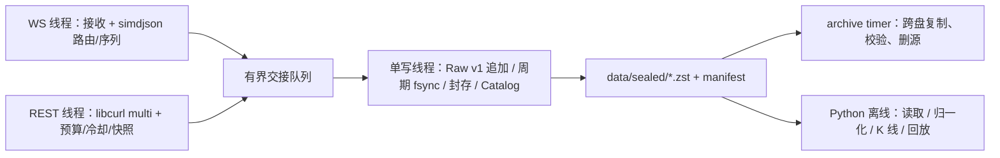
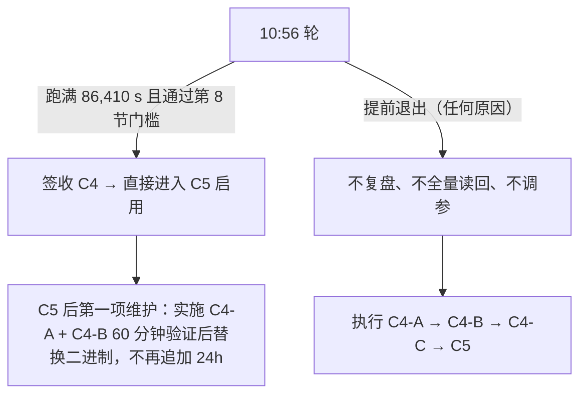
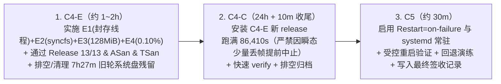

# Binance Market Data Recorder — C++ 重写里程碑计划（定稿）

> **定稿：2026-11-09。** 本文件是团队的**唯一执行依据**，替代此前文件中并存的原计划、11.23 指令、V2、V3 各版本。旧全文（含 11.1–11.22 运行日志、各轮失败证据）逐字保存在 [cpp_rewrite_plan_history.md](cpp_rewrite_plan_history.md)，只供查证，不再作为任务来源。
>
> **当前状态（2026-11-10 19:10 所有者第 9 节正式裁决与 `C4-E` 指令更新）：**
> 1. **已完成项：** C0、C1（单源）、C2（精简）、C3（四币对）、**C4-A（写路径 5 项修复）**、**C4-B（60 分钟公网验证，`dropped_total=0`）**、**C4-D（Python 归档与读回脚本去过度防御：归档吞吐提速至 `14.6 / 19.2 GB/h`，快速 `verify` 缩短至 `16.73 / 19.80 s`）**、**C4-P（10 主流 USDT 对 Python vs. C++ 16 分钟控制变量对比：Python 每万条记录 CPU 为 C++ 的 `2.65 倍`、峰值 RSS 为 `3.44 倍`）** 均已完成并 PASS！
> 2. **C4-C 7h27m 中止根因诊断：** `C4-C` 于 `2026-11-10 09:50:28` 启动，运行 `26,828 s`（约 7 小时 27 分）后，Spot 全程 `dropped_total=0`、系统盘最小可用 `18.63 GiB`（`C4-D` 彻底解决了归档积压）；但 USD-M 在约 `13,350 条/秒` 的行情洪峰窗口内因**单写线程上三项同步磁盘 I/O 叠加阻塞**（周期 55 文件逐个 `fsync` 峰值 `5.54 s` + 同步 Zstd 压缩封存 `writer_seal_ms` 峰值 `3.91 s` + 新分片首帧同步 header `fsync` + 目录 `fsync`，使最大 `receive→fsync` 达 `17.85 s`），打满 `64 MiB` 队列并在 `1.4 秒` 内集中丢弃 `23,385` 条（占 `40,901,735` 条的 `0.0572%`）。
> 3. **所有者按第 9 节做出的正式裁决（见第 5.4–5.6 节 `C4-E`）：** 鉴于实测证明 `writer_sync_ms`（5.54 s）与 `writer_seal_ms`（4.27 s）在共享 KVM 云盘上**同时存在秒级尖峰并叠加阻塞单写线程**，单选第 9 节选项 2 或单选选项 3 仍会留下另一半 4~5 秒的同步阻塞。所有者按 **第 9 节选项 5（合并选项 2 + 选项 3 + 选项 1 门槛豁免）** 授权执行 **`C4-E`（写线程 I/O 解耦一次改到位）**：
>    - **E1（选项 2：独立后台封存线程）**：配置模式下 `rotate()` 只移交已关闭的 `RawFile` 指针，Zstd 压缩、6 次封存 `fsync` 与 Catalog `SEALING/SEALED` 事务移交单后台 `sealer_` 线程完成，使写线程 `rotate()` 耗时从 ~4 秒降至 `< 1 ms`；
>    - **E2（选项 3：周期同步改用 Linux `syncfs(2)` + 取消配置模式新分片首帧同步 header `fsync`）**：配置模式下 `tick()` 用一次 `::syncfs(fd)` 替代 55 个文件逐个 `::fsync(fd)`，并移除 `RawFile::append()` 打开新分片时的同步 `fsync` + `sync_directory`；
>    - **E3（配置模式队列上限扩至 `128 MiB` / `131,072` 条）**：利用充裕内存余量（C4-C 双进程峰值 RSS 合计仅 `172.9 MiB / 6.16 GiB`）将配置模式队列缓冲翻倍至 `128 MiB`（`--rss-limit-mib` 相应调至 `384`）；
>    - **E4（选项 1：24h `C4-C` 丢弃容忍门槛放宽至 `0.10%`）**：设计目标仍为 `dropped_total = 0`，将 24h 资格硬门槛 `--max-drop-percent` 由 `0.01%` 放宽至 **`0.10%`**（诚实记录缺口即可），避免共享云盘极端瞬态抖动导致 24h 功亏一篑。
>    - **执行流水线：** 完成 `C4-E` 并通过原生测试矩阵后，排空/清理旧轮残留数据，**不再重跑 60 分钟 `C4-B`，直接启动新一轮 `C4-C`（24h）并自动衔接 `C5` 常驻启用**。
>
> **2026-11-10 20:11 执行状态：** `C4-E` 已完成（提交 `b610a656`；Release 二进制 `618dae98…`；Release 13/13、ASan/UBSan 9/9、TSan 9/9 全部通过）。上一轮 7h27m 残留已排空，系统盘约 20 GiB 可用。新一轮 `C4-C` 已于 **2026-11-10 20:11:03 上海时间** 启动（release `20261110-b610a656`、新根 `live-20261110T121047Z`、`--rss-limit-mib 384 --max-drop-percent 0.10`，Spot PID `298079` / USD-M PID `298091`），预计 **2026-11-11 20:11:13** 结束；当前 RUNNING，C4/C5 尚未签收。

---

## 1. 目标与范围

### 1.1 目标

用 C++20 实现 Binance Spot 与 USD-M 永续的公开行情采集核心，在 4 vCPU / ~5.8 GiB 的 GreenCloud VPS 上长期无人值守运行，为回测、策略和交易模块留出至少一半整机资源。

只录制**事后无法从官方归档免费下载**的实时数据；可离线构造或下载的数据一律不在实时进程中录制。

### 1.2 固定范围（本轮不改）

| 项目 | 固定值 |
| --- | --- |
| 标的 | 显式白名单 10 个 USDT 对：BTC、ETH、SOL、BNB、ZEC、XRP、NEAR、UNI、DOGE、LINK（[config/c4-mainstream.json](config/c4-mainstream.json)）。Spot + USD-M 共 20 个产品。 |
| Spot WS | `depth@100ms`、`bookTicker`、`aggTrade`（每 symbol 3 流，一条组合连接） |
| USD-M WS | `/public`：`depth@100ms`、`bookTicker`；`/market`：`aggTrade`、`markPrice@1s`、`forceOrder`（每 symbol 5 流，两条组合连接） |
| REST | 启动 `exchangeInfo`；启动/断层时 `depth` 快照；USD-M 五路 300 秒错峰轮询（`openInterest`、三种多空比、`takerBuySellVol`） |
| 存储 | Raw v1 + 封存 Zstd + manifest + SQLite Catalog（WAL/NORMAL）；分片 900 秒 / 16 MiB 轮换 |
| 进程结构 | 每市场一个进程；每进程 WS 线程（Spot 1、USD-M 2）+ REST 线程 + **单写线程** |
| 部署 | systemd `sbmdr-recorder@{spot,usdm}` + `sbmdr-archive.timer`（`OnActiveSec=15s`、`OnUnitInactiveSec=10s`）；slice 配额 175%、归档 `CPUQuota=50%`、CPUWeight 100/200 |
| 离线 | 继续复用冻结 Python 基线 `38acb1d0` 的 reader、归一化、回放、K 线合成与历史下载 |

### 1.3 永久不做（本重写阶段）

多周期 K 线 / `S12` K 线 / 实时 K 线补齐；`ticker@24hr` 与滚动窗口统计；冷门法币与边缘稳定币对；自动 Top-N；COIN-M；GUI / Web API / 交易执行 / 其他交易所；微服务、消息总线、插件框架、依赖注入。

---

## 2. 执行规则（防止过度设计与死循环）

### 2.1 改动规则

1. **只做本文件列出的任务。** 任务清单之外的改进写进第 10 节候选清单，不实施。
2. **一个问题一次改到位。** 第 6 节已经给出具体数值和做法，照做即可，不再开“先测量再讨论”的新一轮。只有第 9 节列出的情况才回到所有者决策。
3. **禁止的调参方式：** 继续缩小分片（< 16 MiB）、减少币对、微调 systemd 配额或权重、扩大线程数，用来“碰运气”通过 24h。
4. **不为理论风险加机制。** 不加 watchdog、重试层、优先级队列、状态机、额外线程、新配置系统。
5. 正常实现细节（变量名、函数拆分、测试写法）由实现者决定，不需要请示。

### 2.2 测试规则（按变更范围，不一刀切）

| 变更类型 | 必跑 | 不跑 |
| --- | --- | --- |
| C++ 队列 / 写线程 / 存储（C4-A） | Release 全部 13 项 CTest（含新增 `c4-ingress-drop`）+ ASan/UBSan + TSan 各一次 | — |
| 仅配置 / systemd / 部署脚本 | `c3-configured` + `systemd-analyze verify` + 启停一次 | sanitizer、C++ 重编译矩阵 |
| 仅 Python 离线工具 | 对应 `c4-candles` / `c4-normalize-adapter` 等 | C++ 测试 |
| 仅文档 | `git diff --check`、链接检查 | 任何运行测试 |

所有可执行测试在 GreenCloud 原生 Linux x86_64 上运行；开发机只做编辑与静态检查。性能数字只取 Release、无 sanitizer、无 strace 的运行。

### 2.3 失败轮与记录规则

- **中途失败的运行不做全量读回。** 只保留日志、status 摘要和失败原因；只有怀疑数据损坏时才校验受影响的文件。全量独立读回只对最终通过的那一轮做一次。
- **运行文档只写三件事：** 最终采纳的代码改动（提交号 + 二进制 SHA-256）、最终 24h 起止时间、最终验收结果。不再为中间试验写“不拼接时长、不冒称重跑”类声明；失败轮在 `c3-c5-deployment.md` 用一行记录（时间、原因、处理）。
- 验收脚本本身出错（不是记录器出错）时，修脚本后在**同一份已闭合数据**上重跑验收，不重新采集。

---

## 3. 架构与数据合同（现有实现，保持不变）

数据合同（沿用，不重新设计）：

1. WS 保留应用层 payload 原字节；REST 保留 HTTP body 与请求参数、状态、必要响应头（provenance）。
2. 保留接收 UTC / monotonic 时间、交易所时间、序列字段；金额不经 double。
3. 正常封存：写入时计算 CRC32C / SHA-256 → fsync → 同盘原子 rename → 目录同步 → manifest → Catalog。无封存后回读、无后台重验、无启动空分片。
4. 崩溃后由 `ExecStartPre` 的 `recover_raw.py` 截尾/隔离；不完整区间不得标为 complete。
5. **周期耐久同步：公网配置模式为 5 秒**（C4-A 由原 900 ms 调整，理由见 6.3）。崩溃最多丢失每个文件约 5 秒未同步数据，由恢复流程截到最后完整帧并标记缺口。正常停止和封存仍完整 fsync。
6. 磁盘：启动要求可用 ≥ 15 GiB（C4-A 由 18 GiB 调整），运行中 ≤ 13 GiB 触发 `DISK_EMERGENCY_STOP` 排空封存后停止。未完成归档验证的数据不删除。
7. 缺口如实记录：断线重连、序列断层、本地丢弃都要在数据（`capture_flags`/`sequence_gap`）、manifest（`complete=false`）和 Catalog 事件中可查。**文件 CRC/SHA 正确只说明存储完整，不说明行情覆盖完整。**

---

## 4. 已完成里程碑（不重开）

| 阶段 | 结论 | 证据 |
| --- | --- | --- |
| C0 基线与原型 | Python 基线固定；保留 Raw v1、Zstd 封存、libcurl multi；预算冻结。 | [c0.1-baseline.md](c0.1-baseline.md)、[c0-prototype-and-budget.md](c0-prototype-and-budget.md) |
| C1 单源端到端 | 单源 2,760 s、30,360 条完整读回；延迟原门槛未达，所有者接受 VPS 实测表现。合成容量压测失败结论保留，不再为其改造。 | [c1-recorder.md](c1-recorder.md)、[c1-closeout-20261107.json](c1-closeout-20261107.json) |
| C2 精简可靠性 | 退避期 SIGTERM、depth 快照与 U/u/pu 桥接、五路错峰 REST 与 429/418 冷却、十例文件恢复边界。 | [c2-reliability.md](c2-reliability.md)、[c2-core-qualification-20261108.json](c2-core-qualification-20261108.json) |
| C3 四币对 | 二进制 `234264…` 公网 3,605 s，155 分片 / 2,502,622 条全部读回；CPU 合计 27.41% 单核，RSS 合计 64.31 MiB。 | [c3-c5-deployment.md](c3-c5-deployment.md)、[c3-c5-qualification-20261109.json](c3-c5-qualification-20261109.json) |
| C4 离线部分 | 跨盘归档（含复制中断/目标损坏保源）、combined WS 归一化 `invalid=0`、Decimal OHLCV、官方历史 CHECKSUM 下载均已通过。 | 同上 |
| C4-A 写路径修复 | 5 项写路径修复（`f68a2f47`）合入；原生 Release 13/13、ASan/UBSan 9/9、TSan 9/9 及 `c4-ingress-drop` 全部通过。 | [c3-c5-deployment.md](c3-c5-deployment.md) |
| C4-B 60 分钟公网验证 | 二进制 `4181d599…` 公网实盘 3,604 s，Spot 3,300,637 条 / 227 分片、USD-M 15,104,852 条 / 920 分片全部读回，`dropped_total=0`，队列峰值 3.11 / 25.56 MiB，记录器峰值 RSS 合计 91.0 MiB，进程平均 CPU 78.97% 单核。 | [c3-c5-deployment.md](c3-c5-deployment.md) |

---

## 5. 当前运行轮（10:56 轮）的处理规则

当前轮：release `20261109-fb2d2501`，二进制 `40df2dc2…`，T0 `2026-11-09 10:56:12.8`（上海时间），16 MiB、队列 8,192 条。本计划定稿时**没有核实**它的实时状态。

- **跑满且通过：** 不中断、不改代码，按第 8 节验收后进入 C5。由于旧二进制在 2 秒以上写入停顿时仍会退出，而 `StartLimitBurst=3/300s` 可能让服务在连续退出后停摆，C4-A 仍要做，但作为 C5 后的维护：通过 C4-A 测试与 C4-B 60 分钟验证后替换，**不再追加 24h**。
- **提前退出：** 只在 `c3-c5-deployment.md` 记一行，立即开始 C4-A。
- **实际结果（2026-11-09 11:15:11 上海时间）：** 该轮提前退出；USD-M 运行 18m56s 后以 exit 1 结束，Spot 同时停止。按本节未做全量读回、未调参，C4-A 已随后实施并完成回环/原生回归；C4-B 已通过，C4-C/C5 尚未开始。

### 5.1 C4-A/C4-B 结果、Code Review 结论与所有者正式决策（2026-11-10）

**结论：C4-A 完成；C4-B 60 分钟公网验证 PASS；C++ 二进制（`4181d599…`）正式冻结；所有者已授权执行 `C4-D`（Python 归档与读回脚本去过度防御）与 `C4-P`（10 交易对 Python vs. C++ 控制变量对比测试），随后直接启动 `C4-C`（24h）与 `C5`。**

| 项目 | 当前结果 |
| --- | --- |
| 发布物 | `/opt/sbmdr/current -> /opt/sbmdr/releases/20261109-f68a2f47`；二进制 SHA-256 `4181d599e5466bca444463a7ec5edb7bf3d92edbb3055406d40714ac78180e4b`；配置 SHA-256 `75d1e9ad6fc54d4ab5118362f4c503384f018dcc90a17074108a321964e9bae8`；C++ 提交 `f68a2f47`；资格驱动提交 `27b1f0ac` |
| C4-A 回归 | 原生 Release 13/13（127.56 s）、ASan/UBSan 9/9、TSan 9/9（117.26 s）；`c4-ingress-drop` 连续 3 次通过 |
| C4-B 采集 | 2026-11-09 22:02:29–23:02:29 上海时间，3,600 s；Spot PID 257375 / USD-M PID 257386，全程未变、`NRestarts=0`；Spot 3,300,637 条/227 分片，USD-M 15,104,852 条/920 分片（合计 **18,405,489 条**） |
| C4-B 门槛 | 两市场 `dropped_total=0`；队列峰值 Spot 3,266,187 B（3.11 MiB）/ USD-M 26,799,387 B（25.56 MiB ≤ 32 MiB）；记录器峰值 RSS 合计 95,395,840 B（**91.0 MiB**），含归档上界 193,126,400 B（184.2 MiB ≤ 256 MiB）；系统盘最小可用 19,703,959,552 B（≥ 13 GiB） |
| C4-B 读回/归档 | Spot/USD-M 独立读回记录数与记录器一致，冻结 Python Catalog 可读，无 `.partial`；归档 25 次通过、0 失败，搬运 612 个文件/410,466,952 B；`LOCAL_DELETED` 188/424 |
| C4-B 资源 | 进程 CPU 均值合计 **78.97% 单核**（Spot 20.85%、USD-M 58.12%），含归档 88.11%；整机忙碌 29.97%，最小可用内存 5.13 GiB / 6.16 GiB（83.2%）；slice 60 s 峰值 142.59%，按 200% 口径记录 |
| C4-B 写路径 | `writer_sync_ms` 均值/最大 Spot 16.57/331.55、USD-M 24.24/423.16；`writer_seal_ms` 均值/最大 Spot 8.91/952.73、USD-M 36.11/1,052.04；最大耐久 5.77/6.58 s；append p99 180/712 ms |
| C4-C 前置阻塞 | 每小时产生压缩数据约 799.7 MB，归档实际搬运约 410.5 MB/h（约 51%）；1 小时后仍有 39/496 个 `SEALED` 分片、约 382 MB 未归档。此外，C4-B 停机后 1 小时数据的单线程 Python 全量 CBOR 读回耗时 **38m28s**（23:02:29→23:40:57），若 24h（约 4.42 亿条）照此全量解码将导致停机读回耗时 **~15.4 小时** |
| 证据 | `/srv/recorder-data/sbmdr-c4a-deploy/results/c4-c5-24h/progress.json`；详细记录见 [c3-c5-deployment.md](c3-c5-deployment.md) 的 C4-B 小节 |

#### 所有者 Code Review 结论与正式决定

经过对 C++ 核心（`prototype/*`）、Python 归档与验证链路（`prototype/operations.py`、`vendor/python-baseline/...`）及部署脚本（`deployment/*`）的全面 Code Review，结论与决定如下：

1. **C++ 采集核心（`prototype/*`）—— 验收通过，保持二进制 `4181d599…` 冻结，严禁重编：**
   - `C4-A` 的 5 项改动非常干净，64 MiB 内存计费队列与 5s 批量 `fsync` 彻底消除了写停顿自杀退出问题，`C4-B` 实盘 1 小时 1,840.5 万条消息实现 **0 丢包**，两个 C++ 进程合计仅占 **78.97% 单核 CPU** 与 **91.0 MiB 内存**。
   - **决定：** **不修改 C++ 代码、不调整 `rotation_bytes`（保持 16 MiB）、不重新编译 `sbmdr-c0`**，使 `C4-A` 原生回归与 `C4-B` 60 分钟实盘证据对 `C4-C` 保持 100% 有效。
   - *（非阻塞 Code Review 备注，留作 C5 后维护，当前不改：[`read_ws`](prototype/main.cpp#L683) 在 [`queue.try_push`](prototype/main.cpp#L756) 之前更新了 `previous_by_symbol`，且 [`DepthBridge::observe`](prototype/recorder_core.hpp#L204) 仅检查 `"malformed"` 未显式检查 `"ingress_drop"`；因丢帧恢复首帧已由 `read_ws` 强制打上 `"sequence_gap"` 且实盘 `dropped_total=0`，不影响当前运行。）*

2. **阻塞点 #1 根因与决定：Python 归档吞吐不足（410.5 MB/h vs 799.7 MB/h）是由 4 层“过度防御”人为限速造成的：**
   - Code Review 查明，`C4-B` 整整 1 小时内 `sbmdr-archive.service` 运行 25 轮（墙钟时间约 2,050 秒），但**实际消耗 CPU 仅 329.15 秒（折合 9.14% 单核）**！其余 **~1,720 秒墙钟时间全部浪费在人为 `time.sleep` 和重复解压上**：
     1. **人为 `time.sleep` 限速器（主因）**：[`drain.py:220`](vendor/python-baseline/src/binance_market_data_recorder/archive/drain.py#L220) 硬编码了 `io_bytes_per_second=16 * 1024 * 1024`，每次读取/解压都通过 [`ReadBudget.consume`](vendor/python-baseline/src/binance_market_data_recorder/spool/readback.py#L50-L56) 强制调用 `time.sleep(delay)`。
     2. **单分片 3 次重复 Zstd 全量解压 + 6 次 SHA-256（过度防御）**：C++ 写线程在密封分片时已流式计算并持久化了 `uncompressed_sha256` 与 `stored_sha256`。但 [`ArchiveManager.run_once()`](vendor/python-baseline/src/binance_market_data_recorder/archive/manager.py#L247-L560) 在把同一个封存文件从系统盘移到归档盘的单次事务中，竟在 `_reserve`（257 行）、`_copy`（376 行）、`_verify_and_commit_external`（412 行）**连续 3 次调用 `validate_sealed_artifact` 将 `.zst` 全量 Zstd 解压并重算双 SHA-256**，又在 `_verify_and_commit_external`（425 行）与 `LOCAL_DELETE_PENDING`（339 行）**2 次全量读取哈希目标盘文件**、在删除前（343 行）**第 4 次全量哈希源文件**！由于解压后体积约为压缩包的 5 倍，单分片在 `ReadBudget(16 MiB/s)` 下被重复计费 `3*(S+U) + 5*S ≈ 23*S` 字节，导致每搬运 1 MB 压缩文件就被迫 `sleep` 约 1.5~2 秒（即使 timer 无间隔连续跑，天花板也被锁死在 ~720 MB/h，仍低于 799.7 MB/h）！
     3. **Timer 空转与单轮限时**：[`sbmdr-archive.timer`](deployment/sbmdr-archive.timer) 设 `OnUnitInactiveSec=60`（每轮结束后空等 60 秒才启动下一轮），且 [`prototype/operations.py:49`](prototype/operations.py#L49) 设 `max_runtime_seconds=50`。
     4. **过低的归档 CPU 配额**：[`sbmdr-archive.service`](deployment/sbmdr-archive.service) 设 `CPUQuota=25%`。
   - **决定：** 授权执行 **第 5.2 节（`C4-D`）**，在不改 C++ 二进制的前提下拆除上述 4 层过度防御，并在启动 `C4-C` 前将 `C4-B` 遗留的 535 个分片排空归零。

3. **潜在阻塞点 #2 根因与决定：消除 `C4-C` 24h 停机后长达 15.4 小时的 Python 全量 CBOR 解码停机：**
   - Code Review 发现，`C4-B` 1 小时数据（1,840.5 万条）在停机后执行 [`prototype/operations.py verify`](prototype/operations.py#L79-L140) 耗时 **38 分 28 秒**（先在 [`load_source_chunks`](vendor/python-baseline/src/binance_market_data_recorder/normalize/raw.py#L135) 全量解压校验一遍，再在 `iter_source_records` 全量解压第二遍并用单线程 Python 逐条解码 1,840 万个 CBOR 帧）。
   - 若不优化，`C4-C` 24 小时（约 **4.42 亿条记录**、~27,500 个分片）停机后运行 `operations.py verify` 将耗时 **24 × 38.5 分钟 ≈ 15.4 小时**，导致 `C4-C` 结束到 `C5` 正式启用之间出现 15 小时以上的采集中断！
   - **决定：** 授权在 **第 5.2 节（`C4-D`）** 中一并优化 `operations.py verify`（利用已归档校验证据与经哈希绑定的 manifest 元数据，仅对 `rest_observations`、多连接重连边界分片及未归档尾部分片做逐帧 CBOR 解码），将 24h 停机读回时间从 ~15.4 小时缩短至 **< 3 分钟**。

4. **新增环节决定（`C4-P`）：在启动 24h `C4-C` 前执行 10 主流 USDT 交易对 Python vs. C++ 控制变量性能对比测试（16 分钟）：**
   - 趁当前服务处于 `C4-B` 结束后的 `inactive` 空窗期，按 **第 5.3 节（`C4-P`）** 在同台 VPS、完全相同的 10 个主流 USDT 交易对与相同稀缺流集合下，运行 16 分钟（960 秒）Python 基线实盘采集，输出同口径量化对比报告 `results/cpp-vs-python-10usdt-benchmark.json`。

---

### 5.2 C4-D：Python 归档与读回脚本去过度防御修复（立即执行，约 30 分钟）

**硬性前提：严禁修改任何 `.cpp` / `.hpp` 文件，严禁重编 `release/sbmdr-c0`（保持 SHA-256 `4181d599e5466bca444463a7ec5edb7bf3d92edbb3055406d40714ac78180e4b` 不变）。**

| # | 修改对象 | 具体改动要求 |
| --- | --- | --- |
| D1 | **移除归档人为 `time.sleep` 限速**（[`drain.py:219-225`](vendor/python-baseline/src/binance_market_data_recorder/archive/drain.py#L219-L225)） | 将 `ArchiveManager(io_bytes_per_second=16 * 1024 * 1024, ...)` 改为 `io_bytes_per_second=None`（或允许由调用方传入 `None` 并默认 `None`），彻底取消归档过程中的 `ReadBudget` 睡眠节流。 |
| D2 | **消除单笔归档事务内的重复解压与重复哈希**（[`manager.py`](vendor/python-baseline/src/binance_market_data_recorder/archive/manager.py)） | 在单次 `run_once()` 正常推进中：（1）`_reserve` 已校验过源 manifest 与源文件后，同一进程内紧接着执行的 `_copy` 与 `_verify_and_commit_external` 不再重复调用 `_validate_source_bundle` 进行第 2、第 3 次全量 Zstd 解压（仅当跨进程恢复、即进入 `_advance` 时状态已处于 `VERIFYING` 且非本轮刚完成 `_copy` 时才补做源校验）；（2）`_verify_and_commit_external` 完成目标盘 `.copying` 的 SHA-256 校验并原子 `os.replace` 为最终文件后，紧接着在同一轮 `_advance` 进入 `LOCAL_DELETE_PENDING` 时，不再调用 `_validate_external_commit` 对刚重命名的目标文件做第 2 次全盘重读哈希（跨进程恢复直接从 `VERIFIED` / `LOCAL_DELETE_PENDING` 起步时仍保留校验）。修改后必须重跑归档故障注入测试确认 `archive-faults-final` 100% 通过。 |
| D3 | **提高归档调度占空比与配额**（[`sbmdr-archive.timer`](deployment/sbmdr-archive.timer)、[`sbmdr-archive.service`](deployment/sbmdr-archive.service)、[`operations.py:49`](prototype/operations.py#L49)） | 1. `deployment/sbmdr-archive.timer`：`OnActiveSec=15`、`OnUnitInactiveSec=10`（原为 120 / 60）。 2. `deployment/sbmdr-archive.service`：`CPUQuota=50%`、`TimeoutStartSec=600`（原为 25% / 240；`sbmdr.slice` 总配额保持 175% 不变）。 3. `prototype/operations.py`：`archive_drain(..., max_runtime_seconds=120, max_files=1000)`（原为 50 秒）。 |
| D4 | **消除 24h 停机读回的二次解压与全量单线程 CBOR 解码瓶颈**（[`prototype/operations.py:79-167`](prototype/operations.py#L79-L167)） | 优化 `operations.py verify`： 1. 对 Catalog 中已处于 `LOCAL_DELETED` / `VERIFIED`（已经过 C++ 密封校验 + 归档全量校验）的分片，定位外部归档文件并校验文件存在、字节大小等于 `manifest["stored_bytes"]` 及外部归档 manifest 绑定关系，免除在 `load_source_chunks` 中再做一遍全量 Zstd 解压；对尚未归档的本地 `SEALED` 分片仍执行完整 `validate_sealed_artifact`。 2. 对单连接 WS 分片（`manifest["stream"] != "rest_observations"` 且 `len(manifest["connection_ids"]) == 1`），直接用经哈希绑定的 `manifest` 累加 `records`（`record_count`）、`source_counts`、`capture_flags`、`connections`、`bridge_connections`（当 `"depth_bridge"` 在 `capture_flags` 中时记录该连接）及 `connection_monotonic_ranges_ns`（取 `receive_monotonic_range_ns`）。 3. 对 **全部 `rest_observations` 分片**、**全部多连接分片（`len(manifest["connection_ids"]) > 1`，含 23h 主动换连分片）**、以及 **每个 `market/symbol/stream` 的首尾分片与所有未归档本地 `SEALED` 分片**，继续调用 `iter_source_records(chunk)` 逐帧解码并断言 `seen == chunk.manifest["record_count"]`。 4. 确保输出 JSON 的全部字段与 [`deployment/qualify.py:121-304`](deployment/qualify.py#L121-L304) 的所有断言 100% 兼容。 |
| D5 | **修复重装目录幂等性**（[`deployment/install.py:99,175`](deployment/install.py#L99)） | 将 `old_logs.mkdir()` 与 `evidence.mkdir()` 改为带 `exist_ok=True`（若 `results/c4-c5-24h` 已存在旧轮证据，先移动备份为 `results/c4-b-60m-evidence` 再创建干净的 `results/c4-c5-24h`），防止 `install.py` 因目录已存在而抛 `FileExistsError`。 |

**`C4-D` 验证门槛（在现有 C4-B 存量数据上当场验证，不重跑 C4-B 采集）：**
1. 运行归档故障注入测试（`archive-faults-final`）通过。
2. 对 `C4-B` 遗留的 535 个本地 `SEALED` 分片（~382 MB）执行 `operations.py archive`，确认全部排空（`SEALED` 积压归零），且实测折算归档吞吐 **≥ 1,600 MB/h**（生产写入速率 ~800 MB/h 的 **2 倍以上**）。
3. 在已闭合的 `C4-B` 数据根上重跑一次优化后的 `operations.py verify` 与 `qualify.py` 停机校验逻辑，确认输出 `status="PASS"`、记录数精确等于 `3,300,637`（Spot）与 `15,104,852`（USD-M），且单次 `verify` 耗时从原来的 **38 分 28 秒** 降至 **< 30 秒**。

> **2026-11-10 C4-D 执行结果（提交 `7ecb87da`）：** 归档故障注入两个故障点通过；C4-B 的 535 个 `SEALED` 分片 / 389,246,717 B 全部排空（Spot 22,544,119 B / 5.56 s ≈ 14.6 GB/h；USD-M 366,702,598 B / 68.73 s ≈ 19.2 GB/h）。优化后 `operations.py verify`：Spot 16.73 s、USD-M 19.80 s，记录数精确匹配，`status=PASS`；`qualify.verify_stopped` 在已闭合 C4-B 数据上重跑 PASS。未修改或重编 C++，冻结二进制仍为 `4181d599…`；vendored Python baseline 树哈希更新为 `cd615fc1…` 并记录 C4-D patch。C4-P 随后执行。

### 5.3 C4-P：10 主流 USDT 交易对 Python vs. C++ 控制变量性能对比测试（约 25 分钟）

**目的：** 此前 Python 版的历史实测数据（如 `M4.2`：CPU 109.16%、RSS 366–718 MiB、最大封存延迟 13.60 s、2 小时断连 72 次并失败）是在“50 个交易对、4,038 个源（含 K 线、24h Ticker 等冗余流）”下测得的。为了科学、严谨地量化**“单纯将采集核心从 Python 重写为 C++20 带来的系统资源与性能改进”**，同时考虑到旧 Python 版在高负载下无法长时间稳定运行，本环节采用**严格控制变量法**，在完全相同的 10 个主流 USDT 交易对和相同稀缺流范围下进行 **16 分钟（960 秒）** 有界实盘测试。

#### 1. 控制变量设计（Apples-to-Apples）

| 维度 | Python 基线组（`C4-P` 实测） | C++20 重写组（`C4-B` 实测 + 同口径 960s 切片） |
| --- | --- | --- |
| 代码版本 | `vendor/python-baseline`（固定提交 `38acb1d0`） | `release/sbmdr-c0`（固定提交 `f68a2f47`，二进制 `4181d599…`） |
| 运行机器 | `greencloud-tokyo-01`（4 vCPU / 6.16 GiB RAM，空载无并发） | 同台 `greencloud-tokyo-01`（空载无并发） |
| 交易对（10 对 / 20 产品） | `spot_symbols` 与 `usdm_symbols` 均设为：`BTCUSDT, ETHUSDT, SOLUSDT, BNBUSDT, ZECUSDT, XRPUSDT, NEARUSDT, UNIUSDT, DOGEUSDT, LINKUSDT` | 完全相同的 [config/c4-mainstream.json](config/c4-mainstream.json) 10 个 USDT 交易对 |
| 采集流范围 | 通过 [`RecorderConfig`](vendor/python-baseline/src/binance_market_data_recorder/config.py#L52-L106) 显式启用同款稀缺流： • Spot WS：`diff_depth`、`book_ticker`、`agg_trade` + REST `depth_snapshot`、`exchange_info` • USD-M WS：`diff_depth`、`book_ticker`、`agg_trade`、`mark_price`、`liquidation` + REST `depth_snapshot`、`exchange_info` 及 300s 轮询 `open_interest`、`taker_buy_sell_volume`、`global_long_short_ratio`、`top_long_short_account_ratio`、`top_long_short_position_ratio` • **显式关闭非对称流**：`side_premium_index_enabled=false`、`side_funding_history_enabled=false`、`side_funding_info_enabled=false`、`side_open_interest_statistics_enabled=false`、`side_basis_enabled=false` | 完全相同的 Spot（3 WS + 2 REST）与 USD-M（5 WS + 7 REST）稀缺流集合 |
| 分片轮转策略 | `rotation_seconds = 900.0`（15 分钟）、`rotation_bytes = 16777216`（16 MiB） | 900 秒 / 16 MiB（完全一致） |
| 测试时长 | **960 秒（16 分钟）**：完整覆盖启动快照、3 轮 5m REST 轮询、以及第 15 分钟的全市场定时分片压缩密封峰值；避免 Python 因长时间运行崩溃或打满磁盘 | 对比 `C4-B` 完整 3,600 秒均值/峰值，并提取 `C4-B` 前 960 秒窗口同口径数据 |

#### 2. 执行步骤与采集指标

1. **隔离数据根：** 在 `/var/lib/binance-market-data-recorder/S-BMDR/benchmark-py-10usdt` 创建临时隔离目录（测试完成并提取指标后清理释放系统盘空间，不影响 `C4-C` 系统盘可用空间）。
2. **启动与采样：** 用上述受控 TOML 配置启动 Python `binance-market-recorder`（运行 960 秒后发送 `SIGTERM` 优雅停止；若 Python 在 960 秒内提前崩溃、断连或触发异常，如实记录存活秒数与失败原因，**不修 Python 代码、不重跑**）。
3. **采样指标（写入 `results/cpp-vs-python-10usdt-benchmark.json` 并在 `c3-c5-deployment.md` 汇总成对比表）：**
   - **吞吐量与工作负载归一化：** 总写入记录数、每秒平均消息数（`records_per_sec`）、压缩后存储字节数；因为不同时刻市场活跃度有波动，除绝对值外，必须计算**归一化指标：`每 10,000 条消息消耗的 CPU 秒数（cpu_sec_per_10k_records）`**。
   - **CPU 占用：** 进程平均 CPU（`% of 1 core`）、1 秒/30 秒采样峰值 CPU（`% of 1 core`）、整机 `cpu_busy` 与 `cpu_steal`。
   - **内存占用：** 峰值 RSS（`MiB`）、运行期间 RSS 内存增长曲线（启动后 1m vs 15m RSS）、与 C++ 版（91.0 MiB）的倍数关系。
   - **写路径与密封延迟：** 分片密封（Zstd 压缩 + 落盘）耗时均值与最大值（`ms`）、周期 `fsync` 耐久延迟最大值。
   - **稳定性与并发开销：** 线程/进程总数、960 秒内 WebSocket 断连/重连次数、丢弃帧数或队列阻塞报警次数。
4. **收尾清理：** 导出 `results/cpp-vs-python-10usdt-benchmark.json` 后，删除临时目录 `/var/lib/binance-market-data-recorder/S-BMDR/benchmark-py-10usdt`，确认系统盘可用空间 ≥ 18 GiB。

> **2026-11-10 C4-P 执行结果：** Python 960 秒运行正常结束（exit 0，未提前崩溃）：1,794,771 条、CPU 均值 111.25% 单核、峰值 RSS 261.5 MB、CPU 5.953 s/10k 条、10 次断线/恢复、封存最大 2.731 s。C++ C4-B 前 960 秒：2,387,688 条、CPU 均值 55.86%、峰值 RSS 合计 76.0 MB、CPU 2.246 s/10k 条、0 断线。归一化后 Python CPU/记录为 C++ 的 **2.65 倍**，峰值 RSS 为 **3.44 倍**。临时数据根已删除，系统盘恢复约 20 GiB 可用。原始结果：[c4p-cpp-vs-python-20261110.json](c4p-cpp-vs-python-20261110.json)。

> **2026-11-10 17:17 C4-C 失败与第 9 节升级：** 运行 26,828 s 后 USD-M `dropped_total=23,385`（40,901,735 条中的 0.0572%，超过 0.01% 门槛 5.7 倍），队列达到 64 MiB 计费上限 53,333 条；Spot 丢弃为 0。最大 receive→fsync 14.11 / 17.85 s。按第 8.4/9 节停止两记录器与 archive timer，未做全量读回、未自行调参。证据：`/srv/recorder-data/sbmdr-c4a-deploy/results/c4-c-drop-failure-20261110T091707Z`（及 [c4c-drop-failure-20261110.json](c4c-drop-failure-20261110.json)）。

---

### 5.4 C4-E：针对 C4-C 7h27m 丢帧根因的所有者第 9 节正式裁决与一次性写线程 I/O 解耦（约 1~2 小时）

#### 1. C4-C（7h27m）失败根因诊断：为什么单选选项 2 或单选选项 3 都不够？

根据 [c4c-drop-failure-20261110.json](c4c-drop-failure-20261110.json) 的实测证据，本次 7 小时 27 分运行证明 `C4-D` 已彻底解决归档瓶颈（系统盘可用全程 ≥ `18.63 GiB`），Spot 全程 `dropped_total = 0`（`11,848,402` 条），且两个记录器峰值 RSS 合计仅 **`172.9 MiB`**（Spot `66.8 MiB` + USD-M `106.1 MiB`，占整机 `6.16 GiB` 内存不到 3%）。

USD-M 在第 7 小时 27 分出现 `23,385` 条集中丢弃（`0.0572%`），是因为在共享 KVM 虚拟盘（`/dev/vda1`）发生宿主机 I/O 抖动 + 行情瞬间爆发（`1.4 秒` 内涌入 `~18,700` 条消息，约 **`13,350 条/秒`**）时，**单写线程上以下三项同步阻塞操作发生了串联叠加，导致写线程累计停顿超过 10 秒（最大耐久延迟 `17.85 s`）**：

1. **周期逐文件 `fsync` 阻塞（`writer_sync_ms` 最大 `5.54 s`，首丢窗口前刚出现 `2.38 s`）**：[`RecorderStorage::tick()`](prototype/recorder_storage.hpp#L387-L395) 每 5 秒对 USD-M 约 55 个活跃文件逐个调用 `::fsync(fd)`，55 次串行 ext4 日志刷新在虚拟盘抖动期耗时高达 `2.38 ~ 5.54 s`。
2. **同步分片压缩与封存阻塞（`writer_seal_ms` 最大 Spot `4.27 s` / USD-M `3.91 s`）**：[`RecorderStorage::rotate()`](prototype/recorder_storage.hpp#L264-L352) 在单写线程内同步执行 `raw.finish()`（`fsync`）、`catalog_.sealing()`（SQLite 事务）、`compress_active()`（读取 16 MiB 原文件 + Zstd 压缩 + 写出 `.zst.partial` + `fsync`）、3 次 `sync_directory()`、manifest 写出 + `fsync` 及 `catalog_.sealed()`（SQLite 事务）。
3. **未计入 `sync_ms/seal_ms` 的新分片首帧同步 `fsync`**：每当分片轮转后，新分片的第一条消息在 [`RawFile::append()`](prototype/main.cpp#L341-L343) 打开 `.bmdr.partial` 写入 60 字节 header 时，又在写线程热路径上同步执行了一次 `::fsync(fd_)` 和一次 `sync_directory("data/active")`（15 分钟全市场轮转窗口内会触发 ~110 次额外同步 `fsync`）。

**所有者裁决结论：** 既然实测证明 `writer_sync_ms`（5.54 s）与 `writer_seal_ms`（4.27 s）**双双高达 4~5 秒**，若只选第 9 节选项 2（仅加封存线程）或只选选项 3（仅改 `syncfs`），写线程上仍会残留另一半 4~5 秒的同步阻塞。遵循第 2.1 节**“一个问题一次改到位”**原则，所有者按 **第 9 节选项 5（指定组合方案：合并选项 2 后台封存线程 + 选项 3 `syncfs` 周期同步 + `128 MiB` 队列扩容 + 选项 1 放宽 24h 峰值丢弃门槛至 `0.10%`）**，下达以下 **4 项确定性修改（`C4-E`）**。

---

#### 2. `C4-E` 改动清单（只改这 4 项，保持全部 13 项 CTest 100% 兼容）

| # | 改动项 | 位置 | 具体做法与测试兼容约束 |
| --- | --- | --- | --- |
| **E1** | **增加单后台封存线程 `sealer_`（第 9 节选项 2）** | [`Catalog`](prototype/recorder_storage.hpp#L4-L158)、[`RecorderStorage`](prototype/recorder_storage.hpp#L237-L470)、[`recorder_run.hpp:253`](prototype/recorder_run.hpp#L253) | 1. **Catalog 线程安全**：在 `class Catalog` 内增加 `std::mutex mutex_;`，在 `startup`、`overload`、`ingress_drop`、`active`、`sealing`、`sealed` 六个公开方法入口加 `std::lock_guard lock(mutex_);`，使写线程（调用 `active`、`ingress_drop`）与后台封存线程（调用 `sealing`、`sealed`）并发访问 SQLite 完全无数据竞争（零 TSan 报警）。 2. **后台封存队列与线程**：为 `RecorderStorage` 增加构造参数 `bool async_seal = false`。在 [`recorder_run.hpp:253`](prototype/recorder_run.hpp#L253) 传入 `config && test_queue_records == 0`。 3. 当 `async_seal == true` 时，`RecorderStorage` 启动 1 个后台 `std::thread sealer_`（配 `std::mutex`、`std::condition_variable`、`std::deque<SealJob>`，上限 64 个待封存分片，满时反压等待，以及 `std::exception_ptr seal_error_`）。 4. 在 `rotate(Slot& slot, bool rest, const char* reason)` 中：写线程只把 `std::move(slot.raw)`、`slot.active`、`slot.first`、`slot.overload_gap`、`rest` 打包推入 `sealer_` 队列，立即将 `slot.first = false; slot.overload_gap = false; rotations[reason] = rotations.value(reason, 0) + 1;` 并返回（写线程耗时 **< 0.1 ms**）。 5. 后台 `sealer_` 线程执行原封存全流程（`raw->finish()` → `catalog_.sealing()` → `compress_active()` → 生成 manifest → `fs::rename` → `sync_directory` → `catalog_.sealed()` → `fs::remove(active)` → `sync_directory`），并将 `sealed_count`、`seal_ns_`、`max_durability_ns` 改为原子更新（`std::atomic`）。 6. 在 `RecorderStorage::finish()` 中，将所有剩余活跃 `slot` 推入封存队列后关闭队列、`sealer_.join()`，若 `seal_error_` 非空则 `std::rethrow_exception(seal_error_)`（析构函数中确保安全 `join()`）。 7. **关键测试兼容约束**：当 `!config`（单源模式，`c2-recovery-boundaries` 依赖 `LD_PRELOAD` 在同步 `rotate` 各阶段注入 `SIGKILL`）或 `test_queue_records != 0`（`c4-ingress-drop` 传入 `test_queue_records=1024` 并依赖 `LD_PRELOAD` 在 `rename` 中 `usleep(3.5s)` 阻塞写线程以触发满队列丢弃）时，`async_seal` 为 `false`，保持原同步 `rotate()` 行为不变，确保 13 项 CTest 语义与断言 100% 兼容。 |
| **E2** | **周期同步改用 Linux `syncfs(2)` + 取消配置模式新分片首帧同步 header `fsync`（第 9 节选项 3）** | [`RecorderStorage::tick()`](prototype/recorder_storage.hpp#L385-L395)、[`RawFile`](prototype/main.cpp#L316-L445) | 1. **Linux `syncfs(2)` 一次同步**：在 `RecorderStorage::tick()` 中，当处于配置模式（`sync_period_ >= milliseconds(5000)`）且在 Linux 下（`#ifdef __linux__`）时，不再对 55 个 `slot` 逐个调用 `::fsync(fd)`；改为查找第一个有未同步数据的活跃分片（`slot.raw && slot.raw->has_pending_sync()`），对其 `fd` 调用**一次 `::syncfs(fd)`**（失败抛 `std::runtime_error("Raw syncfs failed")`），随后统一更新所有脏 `slot.raw` 的 `fsync_utc`、`pending_since` 与 `max_durability_ns`。单源模式（`sync_period_ < milliseconds(5000)`）保留逐个 `slot.raw->sync()`（`::fsync(fd_)`），确保 `c2-recovery-boundaries` 的 `fsync_eio` 与 `after_raw_fsync` 故障注入 100% 原样通过。 2. **取消配置模式新分片首帧 header 同步 `fsync`**：在 [`RawFile::append()`](prototype/main.cpp#L341-L343) 中增加参数 `bool sync_header = true`（或在 `RecorderStorage::append()` 调用时传入 `!async_seal_`）：单源模式保持首次写 header 后立即 `::fsync(fd_)` + `sync_directory(path.parent_path())`（兼容 `c2-recovery-boundaries` 的 `header_only` / `truncated_header` 测试）；配置模式下跳过这两次热路径同步 `fsync`（由 5s 周期 `syncfs`、封存前 `raw->finish()` 以及崩溃后 `recover_raw.py` 兜底）。 |
| **E3** | **配置模式队列上限扩至 `128 MiB`（`131,072` 条）+ `C4-C` RSS 门槛调至 `384 MiB`** | [`main.cpp:56-58, 509-554`](prototype/main.cpp#L56-L58)、[`recorder_run.hpp:237-239`](prototype/recorder_run.hpp#L237-L239)、[`deployment/advance.py:197-198`](deployment/advance.py#L197-L198) | 1. 在 `main.cpp` 新增 `constexpr std::size_t configured_queue_limit = 128 * 1024 * 1024;`（`128 MiB`），将 `configured_queue_records` 从 `65536` 提高到 `131072`；单源默认 `queue_limit = 64 * 1024 * 1024` 与 `queue_records = 8192` 保持不变（确保 `c2-handoff-limit` 原断言不变）。 2. `Handoff` 构造函数改为 `explicit Handoff(std::size_t records = queue_records, std::size_t byte_limit = queue_limit)`，内部用成员变量 `byte_limit_` 替代硬编码 `queue_limit`；在 `recorder_run.hpp:239` 构造 `queue` 时传入 `config && !test_queue_records ? configured_queue_limit : queue_limit`。 3. 将 `deployment/advance.py:198`（及第 8.2 节）的 `--rss-limit-mib` 从 `256` 调整为 **`384`**（即使双进程队列打满也远低于 384 MiB，仅占 6.16 GiB 整机内存的 6.2%）。 |
| **E4** | **放宽 24h `C4-C` 峰值丢弃容忍门槛至 `0.10%`（第 9 节选项 1 + 选项 5）** | [`deployment/advance.py:201-202`](deployment/advance.py#L201-L202)、第 8.2 / 8.4 节 | 1. 我们的工程目标仍是 `dropped_total = 0`（在 E1+E2+E3 消除写线程同步 I/O 阻塞并翻倍队列后，常态与常规尖峰下应为 0 丢弃）。 2. 为防止 24 小时内共享宿主机发生极端瞬态卡顿导致功亏一篑，将第 8.2/8.4 节及 `deployment/advance.py:202` 的 `--max-drop-percent` 从 `0.01` 调整为 **`0.10`**（即允许 `dropped_total` ≤ 已接受 WS 记录数的 **`0.10%`**，所有丢弃必须诚实标记 `ingress_drop`、`sequence_gap` 与 Catalog `INGRESS_DROP` 事件）。 3. **运行期严禁提前人工中止**：在 `C4-C` 86,410 秒运行期间，除非某个进程异常退出，或单市场累计 `dropped_total` 已经超过 24h 预计总记录数的 `0.10%`（例如 USD-M `dropped_total > 150,000` 条），否则**严禁中途人工停止**，必须跑满 86,410 秒由 `qualify.py` 自动完成停机验证并直接进入 `C5`。 |

---

#### 3. `C4-E` 验证与清理步骤

1. **原生测试矩阵（必跑）：** 按第 2.2 节 C++ 存储变更规则，在 GreenCloud 原生 Linux x86_64 上跑通 **Release 全部 13 项 CTest**（含 `c2-recovery-boundaries`、`c2-handoff-limit`、`c4-rotation-burst`、`c4-overload-catalog`、`c4-ingress-drop`）+ **ASan/UBSan 9/9** + **TSan 9/9** 各一次，记录新提交号与新二进制 SHA-256。
2. **清理上一轮中止的 `C4-C` 残留数据：** 将上一轮（7h27m 中止轮）系统盘 `/var/lib/binance-market-data-recorder/S-BMDR` 下未归档的本地分片排空或清理，确保启动新一轮 `C4-C` 前系统盘可用空间 **≥ 18.5 GiB**。
3. **不重跑 60 分钟 `C4-B`：** 通过上述第 1 步全部 13 项 Release + ASan + TSan 测试后，直接通过 `deployment/advance.py` 安装新 release 并启动 24 小时 `C4-C`（86,410 s）→ 自动衔接 `C5` 常驻启用。

> **2026-11-10 C4-E 执行结果：** 提交 `b610a656`；Release 二进制 SHA-256 `618dae987fce00d7e19fb4a32d87f43c613e433b3e104e516d8aca61158d6b99`；Release **13/13**、ASan/UBSan **9/9**、TSan **9/9** 全部通过。上一轮 7h27m 残留已排空（系统盘约 20 GiB 可用）。新 release `20261110-b610a656` 已安装，C4-C 第二轮于 **2026-11-10 20:11:03 上海时间** 启动，预计 **2026-11-11 20:11:13** 结束；当前 RUNNING。

---

### 5.5 唯一推进顺序（团队直接按此流水线执行到底）

**团队行动指令：** 以上 `C4-E → C4-C → C5` 全链路已获所有者按第 9 节正式裁决授权，**无需在中间步骤再次停下请示**，直接推进至 `C5` 正式常驻上线并完成文档签收。

---

## 6. C4-A：写路径修复（一次改到位，约 1 天）

### 6.1 要解决的问题（已有证据）

此前 7 轮扩容失败都是同一模式：USD-M 写线程停顿约 2 秒以上 → 8,192 条队列打满 → WS 等 250 ms 后抛 `IngressOverload` → 整个进程退出 → 24h 重新计时。

- USD-M 实测约 **3,600 条/秒**（11.21：1,464 s 内 5,223,377 条），8,192 条只能缓冲约 **2.3 秒**。
- 写线程每 900 ms 对所有有未同步数据的文件逐个 `fsync`（[recorder_storage.hpp:354-362](prototype/recorder_storage.hpp#L354-L362)）。所配流几乎每秒都有消息，因此 USD-M 每轮约 40–50 个文件、Spot 约 30 个文件都要同步，两个进程合计**每秒约 80 次 fsync**，落在同一块共享 VPS 系统盘上。
- 180 秒隔离诊断中单次 fsync 最慢只有 74 ms，但 USD-M 队列峰值仍达 6,607 条（约 1.8 秒积压）。单次 fsync 解释不了这个积压；更合理的解释是一轮内几十次 fsync 的累计耗时，再叠加同步封存。缩小分片不会减少这部分开销，反而增加文件打开、header fsync 和目录同步次数。这和 128→32→16 MiB 都没有解决问题的结果一致。

### 6.2 改动清单（只改这 5 项）

“配置模式”指带白名单配置文件运行的模式，包括公网生产以及 `c3-configured`、`c4-rotation-burst`、`c4-overload-catalog` 等回环测试。旧的单源回环模式（C1/C2 测试）保持原有常数与行为，原有测试含义不变。

| # | 改动 | 位置 | 具体做法 |
| --- | --- | --- | --- |
| A1 | **队列按内存计费并放大** | [main.cpp:56-57](prototype/main.cpp#L56-L57)、[`Handoff`](prototype/main.cpp#L504-L582) | 每条消息计费 `body.size() + 1024`（1 KiB 是 Message 结构、JSON 字段、deque 节点的固定开销估计）；`push/pop/take/rest_admissible` 统一使用该计费。字节上限保持 **64 MiB**，在配置模式下就是该队列的内存上界。条数上限在配置模式下设为 **65,536**（只作保险），单源模式保持 8,192。按 USD-M 实测平均帧大小，可缓冲约 **9 秒以上**输入。 |
| A2 | **DepthBridge 上限与队列解耦** | [recorder_core.hpp:223](prototype/recorder_core.hpp#L223)、[:327](prototype/recorder_core.hpp#L327) | 新增独立常量 `depth_pending_limit = 8192`，替换这里对 `queue_records` 的引用。放大队列后，每个 symbol 的桥接缓存不能跟着变大。 |
| A3 | **满队列：丢弃当前帧、标记缺口、进程继续** | [`Handoff::push`](prototype/main.cpp#L506-L528)、[`read_ws`](prototype/main.cpp#L694)、[`run_core_rest`](prototype/recorder_run.hpp#L113-L131)、[`launch_ws`](prototype/recorder_run.hpp#L367-L370) | 配置模式下 `push` 改为**不等待**的 `try_push`，返回成功/失败，不抛 `IngressOverload`。**WS 失败时：** 丢弃当前帧，按 `(symbol, stream)` 累计丢弃数与首末丢弃时间；同一流下一条被接受的消息带上 `sequence_gap`、`ingress_drop` 标志和 `sequence["ingressDropped"]=n`；每连接最多每秒一条 `INGRESS_DROP` status_line（含累计数）。**写线程**追加到带 `ingress_drop` 的消息时，写一行 Catalog `operational_events`：`event_type='INGRESS_DROP'`，范围写入 `evidence_json`，身份列留 NULL（沿用 11.13 修正）。**`diff_depth`** 的丢弃会让下一条消息序列不连续，现有 [`DepthBridge::reset()`](prototype/recorder_core.hpp#L139-L144) 会自动请求快照并重新桥接，无需新代码，只需测试确认。**REST 失败时：** 丢弃该响应并写 status_line；depth 快照不标记完成（沿用 1 秒后重试）；周期轮询进入下一周期。**保持不变：** 队列关闭、写入/fsync 失败、磁盘紧急停止仍按原逻辑退出。 |
| A4 | **周期耐久同步改为 5 秒** | [recorder_storage.hpp:361](prototype/recorder_storage.hpp#L361) | `milliseconds(900)` 改为构造参数：配置模式 **5,000 ms**，单源模式保持 900 ms。fsync 次数约降为原来的 1/5（两个进程合计约 80 次/秒降到约 15 次/秒）。封存、退出时的同步不变。 |
| A5 | **启动磁盘门槛 18 → 15 GiB** | [recorder_run.hpp:206-207](prototype/recorder_run.hpp#L206-L207) | 运行中 13 GiB 紧急停止不变。理由：系统盘总可用约 19.4 GiB；18 GiB 的启动门槛意味着只要有超过约 1.4 GiB 尚未归档的数据，`Restart=on-failure` 就拉不起进程。 |

另在现有每秒 status_line 中加 **3 个常驻字段**（不放在 `#ifdef` 里）：`writer_sync_ms`（本秒累计周期 fsync 耗时）、`writer_seal_ms`（本秒累计 `rotate()` 耗时）、`dropped_total`（WS+REST 累计丢弃数，原子计数）。这就是全部诊断，不加 perf、strace 或事件追踪。

### 6.3 明确不改（之前提过，但已判定无效或不必要）

| 不改项 | 理由 |
| --- | --- |
| `take()` 批大小 32→256、把 `tick()` 移出逐条循环 | `tick()` 在同步未到期时只做一次时钟比较，几乎无开销；32 条一批时每秒约 110 次加锁，不是瓶颈。 |
| WS 满队列等待 3–5 秒 | WS 线程等待期间不读 socket、不处理 ping/pong，等待只是把积压挪到内核缓冲区和交易所端。 |
| 按流优先级丢帧 | 没有研究需求说明应该牺牲哪种流；淘汰已入队消息需要扫描队列，还会破坏顺序。 |
| 分片大小 | 保持 16 MiB，不再缩小，也不改回 32 MiB（避免再改一个变量）。 |
| 异步封存线程、合并物理分片、`syncfs`、Raw v2、无锁队列 | 第 10 节候选清单；只有 C4-B 失败且所有者决定时才考虑。 |
| SQLite `busy_timeout=30s`、`BEGIN IMMEDIATE` | 没有持锁阻塞证据；归档事务短。 |
| `Retry-After > 1 天` 时退出 | Binance 封禁可达 3 天，提前重试不是容错；退出后交给操作者处理是正确行为。 |
| CPU 配额 / 权重、币对名单 | 固定，见 1.2。 |

### 6.4 测试

**修改已有测试：**

- `c4-overload-catalog`（`--stall-one`，单次 3.5 秒封存阻塞）：断言由“进程过载退出”改为“**进程不退出、无丢弃、30,000 条全部按原字节读回**”。
- `c2-handoff-limit`：单源模式原断言保留；新增配置模式断言：满时 `try_push` 立即返回失败，不阻塞、不抛异常。

**新增一项丢弃路径测试**（可作为 `verify_rotation_burst.py` 的新参数）：回环配置模式下，用仅测试可用的参数把队列条数设为 1,024（公网模式不读取该参数），注入 3.5 秒阻塞。断言：

1. 进程持续运行，并在收到 SIGTERM 后正常排空。
2. 发送数 = 读回数 + `dropped_total`。
3. 丢弃后每个受影响流的下一条消息带 `ingress_drop` 与 `sequence_gap`。
4. Catalog 中有 `INGRESS_DROP` 事件，冻结 Python Catalog 能正常打开。
5. `diff_depth` 丢弃后发出了新的快照请求，桥接恢复。

**执行：** 第 2.2 节 C4-A 行，Release **13 项**（原 12 项 + 新增 `c4-ingress-drop`）+ ASan/UBSan + TSan **各跑一次**，结果绑定提交号与二进制 SHA-256。

### 6.5 完成标准

- 6.2 的 5 项改动和 3 个 status 字段已合入；6.4 全部通过。
- 出一份简短变更说明（写在 `c3-c5-deployment.md` 新小节）：改了什么、提交号、二进制 SHA-256、测试结果。

---

## 7. C4-B：60 分钟公网验证 + 发布准备（约半天）

### 7.1 60 分钟公网短测

用 C4-A 的二进制，按正式部署方式（systemd 两个实例 + archive timer，`Restart=no`）、十币对配置在独立根上运行 **3,600 秒**，然后 SIGTERM。

| 检查 | 通过条件 |
| --- | --- |
| 进程 | 两个实例全程同 PID，不退出 |
| 丢弃 | `dropped_total = 0`（两个市场） |
| 队列 | `queued_payload_bytes` 峰值 ≤ 32 MiB（计费上限的 50%） |
| 内存 | 两个记录器 + 归档峰值 RSS 合计 ≤ 256 MiB |
| 数据 | 冻结 Python 能打开 Catalog；每个市场抽 3 个封存分片用 `operations.py verify` 读回通过；排空后无 `.partial` |
| 归档 | timer 至少成功执行一次跨盘事务 |

另外记录（不作门槛）：`writer_sync_ms`、`writer_seal_ms` 的均值和最大值，CPU 均值与峰值。

**通过：** 不重编译，同一二进制直接进入 C4-C。**不通过：** 按第 9 节处理，不自行调参重跑。

> **2026-11-09 结果：C4-B PASS。** 3,600 秒采集与全量读回完成；两市场 `dropped_total=0`，队列峰值 ≤32 MiB，含归档 RSS ≤256 MiB，归档 timer 25 次成功/0 失败。详细数据与 C4-C 归档前置阻塞见 5.1。

### 7.2 发布准备（可与 7.1 并行）

现有 `install.py` + staging 目录的部署方式保留，不改成 submodule、wheel 或 CI。只补以下事项：

1. **运行手册** `deployment/RUNBOOK.md`（1–2 页），列出实际命令：原生构建（含 `PYTHON_BASELINE`）、运行 CTest、准备 staging、`install.py` 安装、启动/停止/状态、日志位置、`operations.py verify`、手动归档、回退到上一个 release、磁盘紧急停止后的处理。
2. **CMake 明确报错**：需要 Python 基线的测试在 `PYTHON_BASELINE` 为空时，在 configure 阶段给出清晰错误，不要等到运行时才失败。
3. **Python 基线已内联**：`vendor/python-baseline` 固定 main 提交 `38acb1d0`，包含 `BASELINE.json` 树哈希；`prototype/CMakeLists.txt` 默认使用该目录，`deployment/install.py` 只从该目录复制到 release，不再读取 `source/python/src`。

---

## 8. C4-C：一次 24h 资格与数据闭环（24h + 半天收尾）

### 8.1 运行

固定 `C4-E` 通过回归测试的二进制、配置、unit，在新的独立根上运行 **86,410 秒**（24h + 10 s），archive timer 同时运行，资格期 `Restart=no`。满时长后 SIGTERM 两个实例并排空。

### 8.2 验收门槛（已按所有者 2026-11-10 `C4-E` 裁决更新）

| 项目 | 门槛 |
| --- | --- |
| 进程 | 两个实例各自同一 PID 跑满 86,410 s，`NRestarts=0`，正常排空退出 |
| 数据完整性 | 对本轮全部封存分片（已归档 + 本地）做**一次**全量 `operations.py verify`：CRC32C / SHA-256 / 记录数 100% 通过；冻结 Python 可打开 Catalog；无 `.partial` |
| 本地丢弃 | 每个市场 `dropped_total` ≤ 已接受 WS 记录数的 **0.10%**（目标为 0，`C4-E` 由 0.01% 调整）；每次丢弃都有 `ingress_drop` 标志和 Catalog 事件 |
| 网络缺口 | 断线自动重连，重连后有 `sequence_gap` 标记；depth 重新桥接。**不设逐流断线秒数门槛**；`forceOrder` 没有消息不算断流 |
| 连接换新 | 每条 WS 连接至少一次 23h 主动换连，换连后各 symbol depth 已重新桥接 |
| CPU / 内存 | 沿用所有者 11.20 口径：整机平均忙碌 ≤ 50%，整机最小可用内存 ≥ 50%；两个记录器 + 归档峰值 RSS 合计 ≤ **384 MiB**（`C4-E` 配合 128 MiB 队列上限由 256 MiB 调整） |
| 磁盘 / 归档 | 系统盘可用全程 ≥ 13 GiB；结束后归档积压归零，源文件按目标校验后回收 |
| 离线冒烟 | 每个市场取 1 个 symbol 的 1 小时数据：归一化 `invalid=0`；用 `aggTrade` 合成 1m K 线成功。复用现有工具，不写新代码 |

> **2026-11-10 归档/读回（`C4-D`）与写线程 I/O 解耦（`C4-E`）已全部授权：**
> 1. `C4-D` 已完成（提交 `7ecb87da`），归档吞吐达 `14.6 / 19.2 GB/h`，停机 `verify` 缩短至 `< 20 s`。
> 2. 针对首轮 `C4-C` 在 7h27m 因单写线程同步 `fsync` + 同步封存叠加阻塞触发的集中丢弃，所有者已在 **第 5.4 节（`C4-E`）** 正式裁决：实施 **E1（独立后台封存线程）+ E2（Linux `syncfs(2)` 周期同步 + 取消配置模式新分片首帧同步 header `fsync`）+ E3（128 MiB 队列上限 / 384 MiB RSS 门槛）+ E4（0.10% 丢弃容忍门槛）**，通过 Release 13/13 + ASan + TSan 后直接启动新一轮 `C4-C`（24h）并自动衔接 `C5`。

### 8.3 报告（只记录，不作门槛）

每个进程的 CPU 均值/峰值、append p99、最大 receive→fsync、`writer_sync_ms` / `writer_seal_ms` 分布、压缩后 GB/天、分片数/天、按归档盘容量算出的可保留天数。原 1.25 s 耐久和单核 30–50% CPU 目标照常列出“达到/未达到”，不影响签收。

### 8.4 失败处理

| 失败类型 | 处理 |
| --- | --- |
| 记录器崩溃、异常退出、数据错误 | 定位 bug，补一个能复现它的测试，修复后重跑 C4-C。失败轮不做全量读回 |
| 丢弃超过 24h 预计记录数的 0.10%（如 USD-M > 150,000 条），或队列持续打满不回落 | **停止**，按第 9 节交所有者决定（瞬态少量丢弃严禁提前人工中止） |
| 验收脚本出错 | 修脚本，在同一份已闭合数据上重跑验收，不重新采集 |
| 操作者主动中断（部署修正等） | 记一行，重新计时，不算记录器失败 |

---

## 9. 升级规则（防止死循环）

出现以下任一情况，团队**停止自行改动**，把 status_line 中的 `queued_*`、`writer_sync_ms`、`writer_seal_ms`、`dropped_total`、CPU 和 steal 数据整理成一页交给所有者：

- C4-B 未通过；
- C4-C 因丢弃或队列持续打满失败（**2026-11-10 17:17 已触发，所有者已在第 5.4 节 `C4-E` 做出正式裁决**）；
- 同一类 bug 修复后在 C4-C 中再次出现；
- C4-C 开始前发现归档吞吐不足以满足第 8.2 节的磁盘/积压门槛（**2026-11-09 已触发，所有者已在第 5.2 节 `C4-D` 解决并验证通过**）。

所有者从以下选项中选一个（或指定组合方案），团队只实施选中的方案：

1. 接受实测结果签收（丢弃视为已诚实记录的缺口）。
2. 若 `writer_seal_ms` 占主导：增加一个封存线程（写线程只移交已关闭分片，压缩与发布在封存线程完成）。
3. 若 `writer_sync_ms` 仍占主导：周期同步改用 Linux `syncfs` 一次调用完成。
4. 缩小币对范围（违背 10–20 对目标，需所有者明确同意）。
5. 若归档吞吐是瓶颈：在不改 C++ 写入路径的前提下，由所有者选择提高 archive timer 频率、延长单次归档时间或增加独立归档执行容量；团队不自行调参。
6. **2026-11-10 19:10 所有者针对首轮 C4-C（7h27m）的正式裁决（见第 5.4 节 `C4-E`）：** 合并实施 **选项 2（单后台封存线程 `E1`）+ 选项 3（Linux `syncfs(2)` 周期同步与取消新分片首帧 header 同步 `fsync` `E2`）+ 配置模式 128 MiB 队列缓冲（`E3`）+ 选项 1 放宽 24h 峰值丢弃容忍门槛至 `0.10%`（`E4`）**，一次改到位后直接重跑 `C4-C`（24h）并衔接 `C5`。

---

## 10. C5：正式启用与交接（约半天）

### 10.1 任务

1. 用 C4-C 同一发布物，把 unit 改为 `Restart=on-failure`（保留现有 `RestartSec=10`、`StartLimitBurst=3/300s`），`systemctl enable` 两个记录器和 archive timer。
2. 受控重启验证一次：`systemctl restart sbmdr-recorder@spot sbmdr-recorder@usdm`，确认 `ExecStartPre` 恢复、启动、继续写入和归档都正常。崩溃恢复已由 `c2-recovery-boundaries` 覆盖，**不在生产根上做 SIGKILL 演练**。
3. 保留上一个 release 目录；按 RUNBOOK 演练一次回退命令（只切换 `current` 链接后启动，验证能启动即可）。
4. 在 `c3-c5-deployment.md` 写签收记录：二进制 SHA-256、配置 SHA-256、24h 起止时间、第 8.2 节逐项结果、第 8.3 节报告数据。

### 10.2 完成标准

两个实例与 archive timer 已 enable 并正常运行，回退命令已演练，RUNBOOK 已入库，签收记录已写。**满足即签收 C4 与 C5，重写阶段结束。** 不设 72 小时观察门禁、每日全量校验或新的监控平台；之后的异常按日常运维处理。

---

## 11. 候选清单（不是任务，C5 之后按实际需要再评估）

| 候选 | 什么时候才考虑 |
| --- | --- |
| 独立封存线程 / `syncfs` | 第 9 节所有者选中时 |
| 扩到 11–20 对 | 策略确有需要；先跑 C4-B 同款 60 分钟验证 |
| 代码整理为 `src/` `include/` `tests/`、加 namespace | 需要多人协作或新增模块时 |
| Python 基线改为 submodule 或固定 wheel、`build-release.sh`、CI | 需要在第二台机器部署，或有新成员加入时 |
| Catalog schema 版本检查、事务 RAII 回滚 | 再次出现跨语言 Catalog 契约问题时 |
| 物理分片合并、Raw v2、流式压缩、无锁队列、内存池、绑核 | 同口径测量证明它是主要瓶颈时 |
| 自动 Top-N、COIN-M | 策略明确需要时 |

无论是否出现性能问题，都不恢复：封存后全量回读、后台重验、启动空分片、内部防篡改深拷贝、多周期实时 K 线。

---

## 12. 对此前各版意见的最终取舍

以下结论已定，团队不再重新讨论。

| 来源 | 建议 | 定稿处理 | 理由 |
| --- | --- | --- | --- |
| 11.23 | 队列条数提到 131K/262K | **改**：按 `body+1KiB` 计费、上限 64 MiB，条数 65,536 只作保险（A1） | 只计 body 时，26 万条的 Message 开销不受控 |
| 11.23 | `take` 32→256、把 `tick` 移出逐条循环 | **不做** | 未到期的 `tick` 只是一次时钟比较，不是瓶颈 |
| 11.23 | WS 满队列等待 3–5 s | **不做**，改为立即丢弃并标记（A3） | 等待期间不读 socket、不回 ping |
| 11.23 | 失败轮不做全量读回、按变更范围测试、文档精简 | **采纳**（2.2、2.3） | — |
| 11.23 | 当前轮跑满即签收 | **采纳**，C4-A 改为上线后维护（第 5 节） | 旧二进制遇停顿仍会退出，可能触发 `StartLimitBurst` |
| V2 | 按流优先级丢帧 | **不做** | 无业务依据，复杂度高 |
| V2 | 先测 fsync 扇出，再限每轮最多刷 32 个文件 | **改**：同步周期直接改为 5 s（A4）+ 常驻计时字段 | 证据已足够；限刷数量会推迟低频文件的耐久 |
| V2 | SQLite 1 s 超时 + 三次重试 | **不做** | 无持锁证据，反而会增加新的退出路径 |
| V2 | `Retry-After` 截断到 24h | **不做** | 封禁可达 3 天，提前重试不是容错 |
| V2 | 2h soak + 2–4h 故障 soak | **合并**为 C4-B 60 分钟 | 已知故障由回环夹具覆盖 |
| V2 | 逐流 30/120 s、0.1%/0.5% 缺口门槛 | **不做**，只设本地丢弃 ≤ 0.01% 一项 | 公网断线由交易所侧决定，只要求如实记录 |
| V2 | 72h 观察门禁 + 自动回滚触发器 | **不做** | 启用后转日常运维 |
| V2 | submodule/wheel、`build-release.sh`、CI、schema hash | **推迟**到候选清单；C5 只交 RUNBOOK 与 CMake 报错 | 单 VPS 部署已可用 |
| V2 | 启动磁盘门槛改为配置项 | **改**为固定 15 GiB（A5） | 18 GiB 会让自动重启在常态下失败；不需要新配置项 |
| V3 | “sync 会跳过干净文件，所以 fsync 扇出不成立” | **不同意** | 所配流几乎每秒都有消息，每轮约 70 个文件都需要同步 |
| V3 | “依据实测确定一次队列容量”、“核实丢弃影响后再定” | **改为本文给出的固定数值与门槛** | 避免再开一轮测量和讨论 |
| V3 | 独立的小型缺口摘要通道 | **简化**：缺口挂在同流下一条被接受的消息上 + Catalog 事件（A3） | 不需要新通道 |
| V3 | 不追加 72h、不强制 submodule、保持 SQLite 与 Retry-After 现状 | **采纳** | — |

---

## 13. 依据

- 历史全文与各轮失败证据：[cpp_rewrite_plan_history.md](cpp_rewrite_plan_history.md)、[c3-c5-deployment.md](c3-c5-deployment.md)
- Python 生产计划与当前状态：[production_milestone_plan.md](https://github.com/tomohikoAmada/BinanceMarketDataRecorder/blob/main/docs/production_milestone_plan.md)、[CURRENT_PRODUCTION_STATE.md](https://github.com/tomohikoAmada/BinanceMarketDataRecorder/blob/main/docs/CURRENT_PRODUCTION_STATE.md)
- 存储与消费者契约：[storage_contract.md](https://github.com/tomohikoAmada/BinanceMarketDataRecorder/blob/main/docs/storage_contract.md)、[consumer_contract.md](https://github.com/tomohikoAmada/BinanceMarketDataRecorder/blob/main/docs/consumer_contract.md)
- Binance 限流与流定义：[IP 限制](https://developers.binance.com/en/docs/products/spot/rest-api#ip-limits)、[USD-M 强平流](https://developers.binance.com/en/docs/catalog/core-trading-derivatives-trading-usd-s-m-futures/api/ws-streams/market#liquidation-order-streams)
- 库语义：[libcurl multi](https://curl.se/libcurl/c/libcurl-multi.html)、[SQLite busy_timeout](https://www.sqlite.org/c3ref/busy_timeout.html)、[syncfs(2)](https://man7.org/linux/man-pages/man2/syncfs.2.html)
