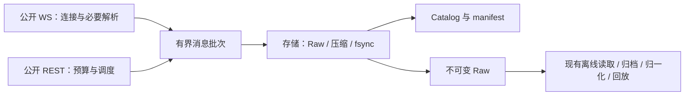

# Binance Market Data Recorder — C++ 重写里程碑计划

> **版本：中文定稿，2026-11-03；第二轮实现与性能意见复核，2026-11-04；范围收敛与架构减负修订，2026-11-08。**
>
> **状态：C0 已完成；C1 已按稳定单源范围签收，完整容量压力失败及耐久原门槛失败保留；2026-11-08 精简 C2 核心可靠性已完成，GreenCloud 原生 Release、适用 ASan/UBSan/TSan 与公开 5 分钟轮询读回通过；2026-11-09 精简 C3 已以最终二进制完成 60 分钟公网与 2,502,622 条全量读回；C4 工具与部署准备已实现，十二币对容量失败保留；十币对此前约 24 分钟过载，当前 9b0b30f1 固定权重的新 24h 正在运行；C4/C5 尚未签收或正式常驻。范围决议见[11.9](#c1-closeout-and-scope-pivot-20261108)，当前验收见 11.10–11.19。**
>
> 本文件整合并替代此前的 C++ 草案与评审，作为同一仓库新分支上的独立重写计划。Python 的现行计划、运行记录和历史数据继续保留；服务切换属于 C5，不因计划定稿自动发生。

## 一、目标与执行原则

### 1.1 目标

使用现代 C++20 实现 Binance Spot 与 USD-M 永续（COIN-M 按需可选，默认不纳入常驻）公开行情采集核心，在保证数据语义、耐久性和缺口如实记录的前提下：

1. 大幅降低采集进程的 CPU、内存、磁盘 I/O 和调度开销，在受限 VPS（4 vCPU / ~5.8 GiB RAM）上为后续回测、特征/策略与交易执行模块留出充足资源余量。
2. **聚焦真正稀缺的实时数据**：仅实时录制**事后无法从官方公开历史归档免费下载**的高频微观结构与衍生品实时状态数据（`depth@100ms` + REST `depth` 快照、`bookTicker`、`aggTrade`、USD-M `markPrice@1s` 与 `forceOrder`、5 分钟级 `openInterest`/多空比/主动买卖量，以及最多单一 `1m` 闭合 K 线）。凡事后可从 `data.binance.vision` 免费下载或可由 `aggTrade`/`1m` K 线离线确定性构造的多周期 K 线（`3m..1M`、`S12` UTC+8 K 线等）一律移出实时采集进程。
3. **聚焦主流高流动性标的**：废弃“自动发现 BTC/ETH 全部 50 个含冷门法币/边缘稳定币报价对”的做法，改为**显式白名单配置的 Top 10~20 主流 USDT/USDC 交易对**。
4. 保持模块职责清楚、依赖单向、实现简单，复用现有存储契约、测试与离线读取工具，在目标 VPS 上完成 24h 进程级稳态运行验证。

业务实现统一使用 **C++20**；成熟库通过其 C/C++ API 使用，不为了“C&C++”额外拆出一套 C 业务框架。Python 保留用于现有离线读取、归一化、K 线合成/历史下载、回放、研究辅助和测试工具。

决策顺序固定为：**守住核心主流标的的稀缺实时数据与诚实缺口标记 → 严控 VPS 常驻资源成本 → 按显式配置平稳扩展至 Top 10~20 主流币对**。不录制可免费下载/可离线构造的冗余派生流，也不让偶发网络闪断或冷门源空窗一票否决整机运行。

### 1.2 KISS / YAGNI 执行合同

- **优先复用**：能复用现有模块、契约、算法、夹具或成熟库，就不新建等价机制。跨语言时迁移必要实现，不逐类翻译 Python，也不让 C++ 实时路径依赖 Python 解释器。
- **只做当前阶段**：每个里程碑完成其任务与退出标准即可。后续能力、候选优化、顺手整理不进入当前变更。
- **新增机制须有四项说明**：可复现问题、最小实现方案、资源成本、验收标准。写在对应任务或变更说明中即可，不建立新的审批服务、设计登记系统或文档流水线。
- **没有证据就保持简单**：只有实测瓶颈、可复现故障或当前阶段明确要求的能力，才构成新增机制的理由。理论上的极低概率风险不构成增加复杂防御的理由。
- **不做预留式架构**：不新增微服务、通用事件总线、插件框架、依赖注入容器、通用状态机引擎或为其他交易所预留的抽象层。职责模块不是必须新增的类层次。
- **延续已有状态语义**：复用现有连接、源健康、缺口和分片生命周期；不为相同事实维护第二套状态机或重复持久化日志。
- **不重复验证可信内部数据**：受控进程内不做防篡改深拷贝，不层层重验相同字段。外部输入长度、缓冲区寿命、实际 I/O 结果和已有耐久规则仍须正确处理。
- **不追求形式上的零开销**：不把全面零分配、零拷贝、无锁或绑核设成目标。一次有界复制、一个短临界区或标准容器，只要满足预算就可以使用。
- **验收失败先定位**：先复现、分段测量、修复最小原因。不能通过扩大线程池、增加队列或重试层来掩盖持续过载。

正常实现选择不需要反复请求确认。超出当前里程碑的改进记入第八节候选清单；候选条目不是实施任务。

### 1.3 项目边界

保留项目名称、仓库、数据路径及正式 CLI `binance-market-recorder`。当前实际重写分支为同一仓库的 **`S-BMDR`**，计划位于仓库根目录；可使用独立 worktree。当前实验程序名为 `sbmdr-c0`，正式 CLI 对齐仍属于后续交付工作，不为本次评审单独改名。

仅访问公开、免密钥、免签名市场数据接口；不读密钥、凭据库，不调用账户或订单接口，不输出原始代理 URL。市场数据目录中的接口不一定免密钥，权限须逐接口确认。

继续遵守现有生产数据根目录规则。实验与 Python 实例使用独立数据子目录和 Catalog；不并发写同一数据集。正式采集数据不放在仓库、Desktop、Documents、iCloud 或 `/tmp`。

本计划不增加 GUI、Web API、交易执行、其他交易所、Kafka、Kubernetes 或新的部署平台。

## 二、复用基线与已确认事实

规划依据为 `main@38acb1d0ee1e` 的源码与保留记录。C0 启动时固定实际使用的最新基线，不把本文件中的历史数值当作实时状态。

Python 已完成多项去冗余优化，正常封存后的全文件解压回读、后台实时重验及启动空分片已移除。第二轮 M4 的 CPU 109.16%、RSS 366.10–617.90 MiB 和 seal 最大 13.602s 是历史观测，不能单独证明所有延迟来自 GIL，也不能推导 C++ 必然降到某个百分比。详见 [生产计划](https://github.com/tomohikoAmada/BinanceMarketDataRecorder/blob/main/docs/production_milestone_plan.md) 和 [状态记录](https://github.com/tomohikoAmada/BinanceMarketDataRecorder/blob/main/docs/CURRENT_PRODUCTION_STATE.md)。

| 现有成果 | 重写中的处理 | 参考 |
| --- | --- | --- |
| 产品配置、公开源清单、共享请求与适用性 | **改为显式白名单配置（Top 10~20 主流 USDT/USDC 交易对）**，淘汰自动扫出 50 个含冷门法币/边缘稳定币产品的旧逻辑；仅复用 `exchangeInfo` 精度与状态核对。 | [产品与源定义](https://github.com/tomohikoAmada/BinanceMarketDataRecorder/blob/main/src/binance_market_data_recorder/binance/public_sources.py)、[覆盖矩阵](https://github.com/tomohikoAmada/BinanceMarketDataRecorder/blob/main/docs/milestones/P0/coverage.md) |
| WS 分组、热流隔离、REST 预算与到期调度 | 复用规则和故障案例，以 C++ 异步实现替换必要路径；因砍掉冗余 K 线与冷门对，连接数与 REST 调度复杂度大幅下降。 | [WS 实现](https://github.com/tomohikoAmada/BinanceMarketDataRecorder/blob/main/src/binance_market_data_recorder/binance/public_websocket.py)、[请求预算](https://github.com/tomohikoAmada/BinanceMarketDataRecorder/blob/main/src/binance_market_data_recorder/binance/request_budget.py) |
| K 线流与衍生周期策略 | **实时最多保留单一 `1m` 闭合 K 线（或完全不录 K 线），全面砍掉 `3m..1M` 其余 15 个周期、`S12`（UTC+8）全部周期及断线实时 REST K 线补齐状态机**；多周期 K 线改由离线从 `aggTrade`/`1m` 构造或从官方历史归档下载。 | [ADR-0058](https://github.com/tomohikoAmada/BinanceMarketDataRecorder/blob/main/docs/adr/0058-kline-closed-bar-persistence-and-backfill.md) |
| 快照桥接与深度序列检查 | 迁移实时所需的小范围逻辑（启动/断线拉取 REST `depth` 快照并与 `diff_depth` 的 `U/u` 桥接）；全量盘口重建保持离线。 | [ADR-0052](https://github.com/tomohikoAmada/BinanceMarketDataRecorder/blob/main/docs/adr/0052-bounded-raw-batches-and-sequence-only-capture-health.md) |
| Raw v1、manifest、CRC/hash、恢复与归档 | 默认兼容现有格式和生命周期；格式变更仅按 C0 的证据选择执行。 | [ADR-0010](https://github.com/tomohikoAmada/BinanceMarketDataRecorder/blob/main/docs/adr/0010-raw-chunk-v1-byte-format.md)、[存储契约](https://github.com/tomohikoAmada/BinanceMarketDataRecorder/blob/main/docs/storage_contract.md) |
| Catalog、状态转换与共同水位 | 复用现有必要表与语义；WAL + NORMAL、预编译 SQL 和批量更新。 | [Catalog](https://github.com/tomohikoAmada/BinanceMarketDataRecorder/tree/main/src/binance_market_data_recorder/storage/catalog)、[ADR-0059](https://github.com/tomohikoAmada/BinanceMarketDataRecorder/blob/main/docs/adr/0059-catalog-wal-normal-sync-and-watermark-checkpoint.md) |
| Raw 读取、归一化、确定性回放、历史导入 | 优先继续使用现有 Python 模块，配合离线脚本完成高周期 K 线合成或官方归档导入。 | [消费者契约](https://github.com/tomohikoAmada/BinanceMarketDataRecorder/blob/main/docs/consumer_contract.md)、[数据契约](https://github.com/tomohikoAmada/BinanceMarketDataRecorder/blob/main/docs/data_contract.md) |
| 回放基准、golden vectors、故障与兼容测试 | 直接复用可适用部分；只补 C++ 特有的内存、线程和字节兼容测试。 | [三方基准工具](https://github.com/tomohikoAmada/BinanceMarketDataRecorder/blob/main/tools/benchmark_m3_three_way.py)、[测试目录](https://github.com/tomohikoAmada/BinanceMarketDataRecorder/tree/main/tests) |

历史快照中的 4,038 个活跃逻辑源、50 个产品、85/89 个 WS 组仅作为 C0.1 Python 旧基线的对照档案保留，**不再作为 C++ 生产目标范围**。后续按精简后的主流交易对与稀缺实时流分别报告逻辑源、连接、帧率、打开文件和压缩上下文数量。

## 三、默认架构与技术选择

### 3.1 最小运行结构

一个采集进程，默认三个有明确职责的工作线程：

- **WS 线程**：Asio/Beast 连接、必要解析与 WS 源状态。
- **REST 线程**：libcurl multi、多窗口预算和到期请求；空闲时等待，不定时全速扫描。
- **存储线程**：消费有界消息批次，处理 Raw、压缩、fsync、manifest 和 Catalog。

这是网络与存储分工，不是三个新服务。入口线程按需处理进程生命周期，不参与逐帧处理。每个可变对象有明确的写入线程；跨线程传递拥有型消息或小型完成通知，避免共享可变对象图。存储水位和请求结果只通过必要交接返回，不引入消息总线。

模块继续沿用 `binance / collector / spool / storage / tools` 的职责边界；可以用少量源文件实现，不要求每项职责都有抽象基类。

`spool/storage` 不依赖 Binance 解析器；`binance/collector` 不直接写 SQLite。离线消费者只依赖发布契约。热流先复用已证明必要的独立连接分组，是否再分线程留到瓶颈实测后。

### 3.2 技术栈

| 部分 | 默认选择 | 选择理由与约束 |
| --- | --- | --- |
| 语言与构建 | C++20、CMake、CTest、vcpkg manifest | 使用已验证工具链，固定 baseline 和必要版本约束；依赖随当前任务引入。 |
| WS/TLS | Boost.Asio、Boost.Beast、OpenSSL | 复用成熟连接与 TLS 实现；明确连接所属 executor。 |
| REST | libcurl multi | 复用并发请求、连接复用和代理能力；不自研 HTTP 连接池。 |
| JSON | simdjson | 复用 parser，提取路由、过滤、序列和水位所需字段，保留原始主体。 |
| 队列与内存 | 标准拥有型缓冲区、批量队列、mutex/condition_variable | 同时限制记录数和字节数；默认不用无锁队列或自研内存池。 |
| 压缩与摘要 | libzstd、Abseil CRC32C、OpenSSL EVP | C0 已采用 Abseil 并通过既有 golden，继续复用，不为匹配早期候选名称改换 CRC 库；保留既有 CRC 和必要文件摘要。 |
| Catalog | SQLite C API，加少量 RAII 资源管理 | 复用既有 SQL/表；不再同时引入 SQLiteCpp 或 ORM。 |
| CLI、配置与日志 | CLI11、toml++、spdlog | 保留原命令与配置含义；日志记录状态和错误，不逐帧输出。 |
| 单测与诊断 | 现有 CTest + Python 夹具、ASan/UBSan、独立 TSan 构建 | 先复用已实现入口，不为形式统一额外引入 GoogleTest；性能只测不带 sanitizer 的 Release。 |

Raw v1 的 C++ 编码使用成熟 CBOR 库及必要的固定 schema 适配；C0 验证 canonical 字节与现有 golden 一致，不手写通用 CBOR 解析器。

上述默认方案不要求提前开发替代实现。只有默认方案出现可复现问题，才在对应里程碑内做一个针对性对照；不长期维护 Beast/libcurl 两套 REST 栈。

### 3.3 现代 C++ 实施规则

- 优先普通结构体、值语义、标准容器、RAII、move 与 `unique_ptr`；实际需要共享生命周期时才用 `shared_ptr`。
- `span/string_view` 只借用内存。消息跨线程后，原始 buffer 必须继续有效；先用拥有型 buffer，允许一次必要复制。
- simdjson 输入保留所需 padding，parser 与返回 view 的寿命明确；按需提取不等于验证了整份 JSON。
- 使用现成协程/回调 API，不开发自己的协程运行时。正常解析和网络错误用清楚的结果返回，初始化失败在应用边界处理。
- 资源析构负责释放；关键 `finish/seal` 显式返回 I/O 结果，不在析构里隐藏写入失败。
- 密集状态可用 `vector` 和进程内 `uint32_t` 下标；磁盘仍保留可还原的身份。没有必要为了去掉一次字符串查找增加独立连接。
- 发行构建采用目标架构基线，默认不使用 `-march=native`。CPU 专用调优、LTO 和额外线程均以测量为依据。
- 模块入口执行必要检查，内部信任明确的类型与所有权约定；不复制 Python 的动态字典层、模型导出链或防篡改副本。

## 四、数据、存储与覆盖合同

### 4.1 原始数据与持久化

1. WS 保留所选消息的应用层 payload 字节。REST 每个响应保留一个主体表示；新 C++ 路径默认保留 HTTP 库交付的 body，说明是否解压，并保存必要请求参数、状态和响应头。HTTP body 不称为完整网络 wire bytes。
2. 保留价格/数量精度、产品与源身份、连接/进程身份、真实接收 UTC/monotonic 时间、交易所时间及其单位、必要序列和缺口标记；不将金额经 double 改写，不伪造缺失时间。
3. 合法 `k.x == false` 只更新存活/过滤计数；闭合 bar 持久化。畸形消息保留并标记，不能被误判为形成中 K 线丢弃。
4. 默认保持 `15 分钟 / 128 MiB` 轮换和独立的 `1 秒` 耐久周期。统计 receive → 成功 fsync 的实际延迟；仅触发 timer 不等于耐久完成。
5. 正常封存使用写入/压缩过程中的 CRC32C、必要 SHA-256、成功写入、fsync、同文件系统原子 rename 和目录同步。无 live 封存回读、无后台重验、无启动空 chunk 或额外边界文件。
6. 文件、manifest 与 Catalog 按既有顺序发布并在启动对账；Catalog 不是市场 payload 的第二份存储。WAL + NORMAL 下的近期元数据可按现有规则恢复；跨盘删除前保留既有耐久提交屏障。
7. 全文件读取仅用于崩溃恢复、跨盘复制目标校验和手动 `verify-raw`。截尾/损坏按现有规则恢复或隔离，不能标成完整，不能跳过损坏后假装连续。
8. 不删除未完成归档的数据。接近磁盘硬保留时停止新采集、尽可能排空并封存，记录 `DISK_EMERGENCY_STOP`。保留量沿用配置并纳入队列、当前分片和元数据的提交空间。

这些是既有正确性要求，不通过新状态机或重复日志重新实现一遍。旧 ADR 中已被现行工程合同废除的实时回读等步骤不恢复。

### 4.2 Raw 格式与压缩的决策边界

**默认基线是 Raw v1 + 现有未压缩 active / 封存压缩流程。** 先验证 C++ 实现的实际成本；不把格式升级和流式压缩设为重写的强制前提。

C0 允许在测到相关瓶颈后，做一个最小格式或压缩对照实验。采用变化必须满足：相同数据语义、可重复的收益、可接受的内存与恢复成本，以及最小读取适配。证据不足就保留默认方案并结束选型。

若选 Raw v2：

- 给出明确的版本、端序、偏移、长度、CRC 和身份/时间/请求语义，不直接把 C 结构体内存当文件协议。
- 头部大小由信息需求决定，不强求 64 字节。原草案的帧头实际为 72 字节，已通过编译检查确认。
- 只实现当前数据所需的记录类型；不开发通用 schema、任意扩展字段系统或新的序列化框架。
- 新字节契约形成简短 ADR；C1 同步完成最小 Python reader。现有 Raw v1 文件保持不变，旧读取能力保留。
- 混合多个逻辑源的 chunk 只在物理分片数量/压缩上下文成本已被测为瓶颈时纳入；否则保持现有分片边界。

若选流式压缩：

- 证明它相对 active/seal 的 I/O 或轮换收益，计算所有活跃上下文的总内存。
- `ZSTD_e_flush` 不等于 fsync，也不结束压缩 frame；压缩文件不能按解压后的 Raw 偏移直接截断。
- 只实现选定方案必需的恢复路径。优先用成熟 Zstd API 恢复可验证前缀；不顺手增加 seek/index 协议、独立压缩段框架或历史迁移器。

### 4.3 覆盖范围与扩展顺序（2026-11-08 范围收敛修订）

不再沿用旧 Python 基线“自动扫描 50 个含冷门法币/边缘稳定币的 BTC/ETH 产品 × 53 行全矩阵（4,038 个逻辑源）”的臃肿范围。**C++ 采集器只录制显式配置的主流高流动性 USDT/USDC 交易对，且只录制真正稀缺、事后无法从官方公开历史归档免费下载的实时微观结构与衍生品状态数据。**

#### 1. 标的池范围（显式白名单，禁止自动膨胀）

- **市场范围**：聚焦 **Spot（现货）** 与 **USD-M Perpetual（U 本位永续合约）**。彻底剔除 `BTCARS`、`BTCTHB`、`ETHMXN`、`BTCUAH` 等低流动性法币对，以及 `BTCU`、`BTCUSD1`、`ETHU` 等边缘稳定币对；COIN-M 与交割合约默认不纳入常驻采集（仅在策略明确需要时按白名单开启）。
- **分阶段扩展梯度**：
  1. **C3 首批核心（4~6 个主力对）**：例如 `BTCUSDT`、`ETHUSDT`、`SOLUSDT`、`BNBUSDT`（及可选 `BTCUSDC`、`ETHUSDC`）的 Spot + USD-M 永续。
  2. **C4 常规容量（Top 10~20 主流 USDT/USDC 交易对）**：按配置文件显式列出的 Top 10~20 高流动性主流币对（如增加 `XRPUSDT`、`DOGEUSDT`、`ADAUSDT`、`AVAXUSDT`、`LINKUSDT`、`SUIUSDT` 等），总产品数控制在 **20~40 个（10~20 个币种 × Spot/USD-M）**。

#### 2. 实时采集数据流清单（只录稀缺实时数据）

| 类别 | 保留的实时采集源 | 采集频率 / 触发方式 | 保留理由（稀缺性） |
| --- | --- | --- | --- |
| **WS 核心微观结构（Spot + USD-M）** | `depth@100ms`、`bookTicker`、`aggTrade` | 实时推送（100ms 增量深度 / 实时 BBO / 实时归集逐笔成交） | 盘口排队位置、毫秒级 BBO 跳动与微观订单流事后无法从免费公开归档完整还原；`aggTrade` 可离线确定性合成任意周期 K 线与成交量分布。 |
| **WS 衍生品实时状态（仅 USD-M）** | `markPrice@1s`、`forceOrder` | 实时推送（1s 标记价/指数价/实时费率 / 强平订单流） | 实时资金费率跳动、基差与强平事件流属于衍生品微观结构核心信号。 |
| **WS 基础 K 线（可选，最多 1 个周期）** | `kline_1m`（仅 `k.x == true` 闭合落盘） | 每分钟闭合写 1 条（可配置关闭） | 仅作为轻量分钟级在线对齐基准；若策略纯离线回测，亦可直接由 `aggTrade` 合成或从官方归档下载。 |
| **REST 目录与盘口恢复（Spot + USD-M）** | `exchangeInfo`、`depth` 快照 | `exchangeInfo` 仅启动及每日低频刷新；`depth` 仅启动初始化及 WS `sequence_gap` 断层时按预算拉取 | 记录交易精度/规则变更，以及为 `depth@100ms` 增量流提供合法盘口重建基准。 |
| **REST 衍生品持仓与多空状态（仅 USD-M）** | `openInterest`、`topLongShortAccountRatio`、`topLongShortPositionRatio`、`globalLongShortAccountRatio`、`takerBuySellVol` | 5 分钟级低频错峰轮询 | Binance 官方历史归档对持仓量与多空比保留窗口有限，低频实时采样成本极低且不可替代。 |

#### 3. 明确砍掉的冗余源（移交离线合成或按需历史下载）

- **砍掉全部多周期 K 线与等价时区 K 线**：移除 `1s`、`3m`、`5m`、`15m`、`30m`、`1h`、`2h`、`4h`、`6h`、`8h`、`12h`、`1d`、`3d`、`1w`、`1M` 共 15 个常规周期、全部 `S12`（UTC+8 时区 K 线）、以及 `continuousKline` / `indexPriceKline` / `markPriceKline` / `premiumIndexKline` 的实时订阅与断线 REST 补齐状态机。需要任何周期 K 线时，统一从已录制的 `aggTrade` / `1m` K 线离线聚合构造，或用离线脚本从 `data.binance.vision` 下载。
- **砍掉冗余滚动窗口统计**：移除 `ticker@24hr` 与 `rollingWindowTicker`（`1h`/`4h`/`1d`），其统计量完全可由逐笔成交离线算出。
- **规模对比**：逻辑源总数从旧计划的 **4,038 个**骤降至 **约 80~240 个**（10~20 个主流币对），组合 WS 连接仅需 **2~4 条**，REST 请求从整分密集突发降至每 5 分钟数十次轻量轮询，从根源上消除 VPS CPU 尖峰、内存膨胀与限流封禁风险。

## 五、里程碑与逐项验收

### 5.1 总览

| 阶段 | 交付目标 | 本阶段不开展的工作 |
| --- | --- | --- |
| C0 | 固定真实基线、最小原型与资源预算（**已完成**） | 全矩阵迁移、复杂优化、生产切换 |
| C1 | 单产品采集到读取的最小完整链路（**已完成并关闭**） | 全市场扩展、多写线程/无锁队列改造 |
| C2 | 核心故障恢复、WS 重连、深度快照桥接与轻量 REST 调度 | 多周期 K 线断线补齐状态机、旧桶复杂重试 |
| C3 | 首批主流核心币对（4~6 个 USDT 主力对，Spot + USD-M）稀缺流打通 | 50 产品自动发现、多周期 K 线、冷门法币对 |
| C4 | 扩容至 Top 10~20 主流 USDT/USDC 交易对、运维归档与离线合成衔接 | 重写全部离线 Python 功能 |
| C5 | 生产部署、24h 进程级稳态验证与正式切换 | 单源 36s 一票否决连坐、无休止极限压测 |

每项任务的四列就是实施说明。涉及更细的新机制时，在该任务内补同样的四项信息；不能只写“更稳”“更先进”或“可能更快”。复用现有逻辑的直接迁移不需要额外设计文档。

### C0：真实基线与最小决策

**目标：** 得到可重复输入、可信比较方法和可执行默认方案。此阶段只允许小原型，不建设完整产品。

| 任务 | 可复现问题/当前需求 | 最小实现与复用 | 资源成本 | 验收标准 |
| --- | --- | --- | --- | --- |
| C0.1 基线固定 | 旧基准曾混用不同范围/运行时长，无法归因性能收益。 | 固定 Python 提交、配置、产品/源快照与已有回放输入；保留生成种子和必要样本，不新建基准框架。 | 离线 CPU、现有夹具和结果文件；无常驻成本。 | 同一输入两次运行的计数/内容一致；过滤、必需源和排除项明确。 |
| C0.2 最小 C++ 原型 | 尚无本项目 C++ 成本数据；已有热流延迟、整分迟发及 17.8 MiB 目录失败样本。 | 用默认库打通本地 WS/HTTP 样本接收、必要解析、拥有型交接和 v1 framing；只补缺失场景。 | 少量原型代码、依赖构建与测量时间；内存按实际缓冲计量。 | 普通/畸形/大响应可解释；输出与现有语义一致，测得分配、CPU 和峰值内存。 |
| C0.3 格式/压缩取舍 | 只有 C0.2 或现有同口径证据定位了编码/active-seal 成本，才需改变它。 | 按 4.2 对已定位问题做一个最小对照；否则记录继续 v1。REST 默认 libcurl，只有复现不满足需求时才试另一实现。 | 实验工时、兼容代码和潜在上下文内存均列出；不保留两套生产方案。 | 有重复测量收益且语义/恢复可行才采用；没有结论性收益就采用默认方案。 |
| C0.4 预算固定 | 无统一硬件、负载与上限时，CPU/RSS 数字不可验收。 | 在现有配置和基准报告中记录目标硬件、峰值输入、队列、CPU/RSS、磁盘及 IP 份额，按第六节定义口径。 | 少量配置/报告字段；不新增监控服务。 | 预算为明确数值并注明依据，覆盖大消息和突发；后续不能为通过验收临时放宽。 |

**C0.1 已完成。** [固定基线与复跑命令](c0.1-baseline.md)记录 Python 提交、离线配置、源清单和两轮一致性结果。

**C0.2–C0.4 已完成。** [原型与固定预算](c0-prototype-and-budget.md)记录 loopback、独立 Python Raw 读回、分配与资源测量。保留 Raw v1、现有 Zstd 封存和 libcurl multi。预算冻结供目标机后续验收。

**退出标准：** 原型、基线、预算及格式选择可重现；其余候选留在第八节。默认复用现有测试工具，不把小原型扩大为全源采集器。

### C1：最小端到端记录器与读取器

**目标：** 实现 Spot BTCUSDT 的一个高频 WS 源和一种公开 REST 来源，从接收到可独立读取完整连通。

| 任务 | 可复现问题/当前需求 | 最小实现与复用 | 资源成本 | 验收标准 |
| --- | --- | --- | --- | --- |
| C1.1 工程与依赖 | C++ 需要可重复构建；跨架构不能依赖结构体布局。 | CMake presets、CTest、vcpkg 固定基线；只加入本阶段用到的依赖。 | 构建与测试时间、二进制依赖；不增加业务线程。 | GreenCloud 原生 Linux x86_64 构建及同一字节向量通过；已完成的 ARM64 字节兼容结果保留，不把跨平台重复运行设为每次变更的门槛。 |
| C1.2 网络与交接 | 存储工作会延迟收包；借用接收 buffer 跨线程可复现内容被覆盖。 | 按 3.1 分工，复用产品/源身份；移动拥有型 buffer，消息数和字节双上限，按批取出。 | 默认三个工作线程、连接缓冲、有限队列；空闲等待。 | 延迟存储消费者时内容不变、接收线程不做磁盘操作；超过预算明确报告，不能无限分配。 |
| C1.3 写入与目录 | 必须保留既有 Raw/manifest/Catalog、耐久和轮换行为。 | 实现 C0 选定格式；复用 SQL、统计字段和 seal 顺序；首次真实消息才开文件。 | 有界写入批次、所选压缩上下文、SQLite cache、必要 fsync。 | 15 分钟/128 MiB 两种轮换正确；同步水位真实；无启动空文件、无封存后回读。 |
| C1.4 读取、状态与退出 | 晚做 reader 会延迟发现格式不兼容；退出时仍有在途数据。 | v1 直接用现有 Python reader；若选 v2，只加最小读取适配。状态复用简明快照，退出依次停止接收、排空、封存。 | 离线 reader 成本；低频摘要，无共享内存协议。 | 独立读回比对 payload/时间/身份/数量；正常退出排空完成，I/O 失败可见。 |

**C1 已按稳定的单源范围完成并正式关闭（2026-11-08）。** [当前版本收尾报告](c1-closeout-20261107.json)绑定 `b473af6a` 及原生 Release 二进制：系统盘单源稳态运行 **2,760.23 秒**，独立读回 **30,360 条**（27,601 WS + 2,759 REST）、20 个分片，含 3 次时间、15 次大小轮换及退出封存 2 个分片。追加 p99 **38 ms**，耐久峰值 **1.562 秒**，峰值 RSS **69.37 MiB**；耐久原门槛未通过，按所有者接受当前 VPS 实测表现的决定签收。CPU、队列、完整性、正常排空和每分钟队列回落检查通过。合成组合容量长测在约 **1,262 秒**触发 `INGRESS_OVERLOAD WS`，此前完整分钟 0–20 均采样到空队列，约 1 秒 CPU 峰值 **243.29%**。该次没有完成完整读回；日志不足以独立证明具体封存/fsync/REST 重叠耗时或零毫秒到达。正式采纳方案 1：**按稳定的单源范围签收 C1，保留完整容量压力未通过的结论，不为该压力场景继续改造 C1。** 旧 [GreenCloud 稳态报告](c1-greencloud-qualification.json)保留为历史证据。

**退出标准（已满足）：** 默认链路真实墙钟运行 45–60 分钟，跨多次轮换且无持续积压；正常与畸形消息独立读回一致；当前 C++ 单测及 ASan/UBSan 检查通过。

### C2：故障、恢复和调度可靠性（精简收尾）

**目标：** 覆盖已知失败与既有耐久合同所需的核心边界。聚焦真实生产必需的崩溃恢复、WS 断线重连、深度快照桥接与轻量 REST 调度，砍掉针对多周期 K 线与冷门币对的复杂修补逻辑。

| 任务 | 可复现问题/当前需求 | 最小实现与复用 | 资源成本 | 验收标准 |
| --- | --- | --- | --- | --- |
| C2.1 文件恢复 | 进程在写入/封存期间终止可留下半帧或 Catalog 未登记文件。 | 复用现有恢复/隔离/对账规则；在写入、fsync、rename、manifest、Catalog 边界用现有夹具注入退出、短写、EINTR、ENOSPC。 | 启动时扫描相关 partial/未登记产物；无 live 全文件扫描。 | 已承诺耐久的数据可恢复；截尾与损坏如实标记；不会把不完整区间设为 complete。 |
| C2.2 连接生命周期 | 已有 Pong timeout、重连样本；需要支持 24h 主动换连与断线自动恢复。 | 复用超时、指数退避抖动重连、控制消息限额与 23h 主动换连；TLS/HTTP 协议由库处理。 | 有界连接与少量 timer；重试消耗计入实际预算。 | 代表源断网、失效连接、心跳与主动换连后正确恢复并标记 `sequence_gap`；不影响其他健康源。 |
| C2.3 轻量 REST 调度 | 多源轮询需遵守权重预算与 429/418 `Retry-After` 冷却，避免齐发抖动。 | 复用持久 `libcurl multi`、滚动权重窗口、确定性错峰（jitter/offset）和限流冷却；砍掉针对冷门对 `D16` 旧桶的复杂重判状态机（收到合法响应即原样落盘记录）。 | 每源少量到期状态，受限连接数与请求量；不建新调度服务。 | 错峰轮询与 429/418 冷却夹具通过；队列半满（`rest_admissible()`）时自动延后低频 REST 轮询，优先保住实时 WS。 |
| C2.4 深度快照桥接 | `depth@100ms` 在启动或断线重连后需要 REST `depth` 快照重建连续序列基准。 | 仅实现实时所需的 **Spot/USD-M 深度快照请求与 `U/u/pu` 序列桥接标记**；**明确砍掉多周期闭合 K 线的断线实时 REST 补齐状态机**（K 线缺口统一留给离线合成或历史归档脚本处理）。 | 每 symbol 极小序列状态与按需快照请求；无全量盘口内存树，不扫历史。 | 启动及断线重连后能触发或关联 REST `depth` 快照，序列连续性与断层（`sequence_gap`）标记准确。 |
| C2.5 过载、磁盘保底与 TSan 收尾 | 写入停顿、磁盘不足可耗尽有界队列；TSan 退避期 SIGTERM 子用例偶发超时。 | 复用磁盘硬保留（`DISK_EMERGENCY_STOP`）和有界队列保护；定位并修复 TSan 下退避等待对 `stop_token` / SIGTERM 的响应延迟。 | 配置规定的缓冲及排空空间；低频容量采样。 | 注入存储停顿/低空间后无静默覆盖、无未归档删除；GreenCloud 原生 ASan/UBSan 与独立 TSan（含退避期 SIGTERM）全部通过。 |

**精简 C2 已完成（2026-11-08）。** 三项核心工作已落地，见[可靠性说明](c2-reliability.md)与[原生报告](c2-core-qualification-20261108.json)：显式 stop_callback 唤醒与 12 次退避期 SIGTERM 边界回归；Spot/USD-M 快照代次及 U/u/pu 桥接；五路 5 分钟错峰 REST、共享冷却和十例实际文件恢复边界。Release 七项与适用 ASan/UBSan、TSan 六项检查通过。TSan 首轮测试时间夹具失败、诊断与仅调整测试周期的复验保留，不改业务 5 分钟周期或退出超时。23 小时换连/24 小时实际连续运行由 C5 自然覆盖，不据此提前声称生产资格。

**退出标准：** 上述精简后的核心故障与恢复夹具通过；GreenCloud 原生 ASan/UBSan 与独立 TSan 无未解决缺陷。

### C3：首批主流核心币对（Spot + USD-M）与稀缺源打通

**目标：** 用显式白名单配置打通首批 4~6 个主流 USDT 交易对（如 `BTCUSDT`、`ETHUSDT`、`SOLUSDT`、`BNBUSDT` 的 Spot + USD-M 永续）的全部稀缺实时流，验证多源组合运行。

| 任务 | 可复现问题/当前需求 | 最小实现与复用 | 资源成本 | 验收标准 |
| --- | --- | --- | --- | --- |
| C3.1 显式白名单配置与目录核对 | 自动发现 50 个产品会混入大量无价值冷门法币对与边缘稳定币对。 | 通过 TOML/JSON 配置文件显式指定目标市场（`spot`、`usdm`）与主流 symbol 白名单；启动及低频刷新 `exchangeInfo` 核对交易状态与精度，原样保存单份目录响应。 | 极小配置状态与低频目录快照（如启动 1 次 + 每 6~24 小时 1 次）。 | 仅订阅白名单内且处于交易状态的标的；无冷门对混入、无每分钟拉取 17.8 MiB 大目录的无谓开销。 |
| C3.2 核心稀缺 WS 组合流 | 单源原型需扩展为支持多 symbol 稀缺流并发接收与解析路由。 | 按市场建立组合 WS 连接，订阅白名单标的的 `depth@100ms`、`bookTicker`、`aggTrade`，以及 USD-M 的 `markPrice@1s`、`forceOrder`（及可选单一 `kline_1m` 闭合过滤）。提取路由、时间戳与序列字段（`U/u/pu`、`a`、`u`）。 | 2~4 条组合 WS 连接，复用单 WS 线程与 `simdjson` 解析器。 | 各流正确路由至对应市场/标的/流分片；合法形成中 `1m` K 线（若启用）在内存过滤，畸形帧保留并标记 `malformed`。 |
| C3.3 衍生品状态与深度快照 REST | 需要采集事后难以完整免费下载的 USD-M 持仓/多空状态及按需深度快照。 | 在 REST 线程按 5 分钟周期错峰轮询 USD-M 白名单标的的 `openInterest`、`topLongShortAccountRatio`、`topLongShortPositionRatio`、`globalLongShortAccountRatio`、`takerBuySellVol`；按 C2.4 触发启动/断线 `depth` 快照。 | 每 5 分钟仅数十次小体积 JSON 请求，连接池常驻复用。 | 请求错峰发出、无整分突发拥塞；响应 provenance 与原始 body 完整落盘，独立 Python 读取校验通过。 |
| C3.4 轻量运行状态与诚实缺口 | 逐 poll 写 SQLite 健康行会造成严重写放大。 | 仅在内存维护各源最近接收/落盘时间戳、计数与缺口标记，定期（如每分钟）输出轻量状态快照；分片切换/封存时更新 Catalog。 | 常数级内存表；SQLite 仅随分片生命周期写入。 | 无高频健康表写放大；断线、限流与恢复在日志、状态摘要和分片 manifest `capture_flags` 中诚实可查。 |

**退出标准：** 首批 4~6 个主流币对（Spot + USD-M）在 GreenCloud 真实公开环境连续运行至少 60 分钟，跨多次分片轮换，覆盖启动 `exchangeInfo`/`depth` 快照、实时 WS 流与 5 分钟衍生品 REST 轮询；所有封存分片独立读回校验 100% 通过，稳态 CPU 与 RSS 远低于 VPS 预算上限。

### C4：扩容至 Top 10~20 主流交易对、运维与离线数据补全衔接

**目标：** 将显式配置扩展至 Top 10~20 主流 USDT/USDC 交易对，衔接跨盘归档、Parquet 归一化回放，以及离线 K 线合成/官方历史归档下载工具。

| 任务 | 可复现问题/当前需求 | 最小实现与复用 | 资源成本 | 验收标准 |
| --- | --- | --- | --- | --- |
| C4.1 扩容至 Top 10~20 主流币对 | 策略研究需要覆盖主流高流动性币种截面（10~20 个 USDT/USDC 交易对）。 | 在配置文件中将白名单扩展至 Top 10~20 主流币对（Spot + USD-M），按连接流数上限自动分 2~4 个 WS 连接组，测量真实入口带宽、CPU、RSS 与每日压缩后磁盘增量（GB/day）。 | 实测 10~20 币对常驻 CPU、内存与磁盘日增量，确保留有 ≥50% 机器资源余量给回测与策略。 | 连续运行无队列积压、无 `IngressOverload`；输出清晰的“Top 10~20 覆盖—资源实测表”与磁盘保留天数测算。 |
| C4.2 运维与跨盘安全归档 | 系统盘（`/dev/vda1`）用于低延迟活跃写入，需定期安全归档至大容量数据盘（`/dev/vdb1`）。 | 复用现有 `status / verify-raw / archive` 工具与 CLI 入口；保持“系统盘写 active 并封存 `.zst` → 跨盘复制至 `/dev/vdb1` → 校验目标哈希与 manifest → 登记 Catalog 并清理源盘已归档分片”的安全顺序。 | 归档仅顺序读写已封存 `.zst` 文件，不干扰实时写线程。 | 命令和退出码可用；复制中断或目标损坏时源盘分片完好保留，验证通过后源盘空间正常回收。 |
| C4.3 消费兼容与离线 K 线构造/下载 | 实时采集砍掉了多周期 K 线，回测与特征研究需要任意周期 K 线及统一数据视图。 | 复用现有 Python Raw reader、归一化（Parquet）与确定性回放模块；配套提供/复用轻量离线脚本：① 从已录制的 `aggTrade` / `1m` K 线确定性聚合生成任意周期 K 线（`5m`、`15m`、`1h`、`4h`、`1d` 等）；② 按需从 `data.binance.vision` 免费下载历史 K 线归档补齐。 | 离线按需运行，零实时采集开销。 | Raw v1 封存文件可被现有 Python 工具链无损读取并导出供回测/特征计算消费；离线合成 K 线与成交明细时间戳、精度完全对齐。 |

**退出标准：** Top 10~20 主流交易对配置冻结；跨盘归档与离线读取/K 线合成链路跑通；系统盘与归档盘空间循环健康。

### C5：生产部署、24h 稳态验证与正式切换

**目标：** 在 GreenCloud VPS 上完成 Top 10~20 主流币对精简配置的 24h 连续稳态运行验证，完成 systemd 生产服务切换。

| 任务 | 可复现问题/当前需求 | 最小实现与复用 | 资源成本 | 验收标准 |
| --- | --- | --- | --- | --- |
| C5.1 资源与收益核对 | 验证 C++ 精简版相对历史 Python 方案的资源节省与长期共驻余量。 | 汇总 C4/C5 实测的 CPU 均值/峰值、峰值 RSS、fsync 延迟与每日磁盘增量，确认在 4 vCPU / 5.8 GiB VPS 上只占用小部分资源。 | 阶段报告汇总，无需为凑旧 4,038 源同口径而重跑臃肿配置。 | 稳态 CPU 均值显著低于单核（如 `<30%~50%`），峰值 RSS `<256 MiB`，为后续策略与执行引擎留出充裕空间。 |
| C5.2 发布与 systemd 部署准备 | 确保生产环境配置、数据路径、自动重启与优雅退出（SIGTERM 排空封存）可靠。 | 冻结 Release 二进制、配置文件与 systemd unit（配置合理的 `TimeoutStopSec` 与 `Restart=on-failure`）；使用独立生产数据子目录与 Catalog。 | 一份可随时回滚的二进制与配置。 | 启动、路径、CLI 与信号优雅退出排空正常；跨盘归档定时任务协同正常。 |
| C5.3 24h 进程级稳态验证 | 验证真实公网环境下 24h 跨日运行、23h 主动换连、分片轮换与跨盘归档的稳定性。 | 固定 Top 10~20 主流币对配置连续运行 24h；运行结束后执行 `verify-raw` 校验全部封存分片完整性。 | 24h 正常采集与一次离线分片校验。 | 满足下方修订后的**实用工程门禁**。 |
| C5.4 正式启用与日常运行 | 完成数据底座交付，转入策略回测与执行模块开发。 | 启用 C++ `binance-market-recorder` 生产服务与归档任务，保留旧 Python 数据与读取工具兼容。 | 常规生产常驻成本。 | 服务长期无人值守稳定运行，数据底座阶段正式收官。 |

**统一门禁（2026-11-08 实用化修订，废除单源 36s 一票否决连坐）：**

- **进程级连续稳定**：同一采集进程连续运行 24h 无崩溃、无 OOM、无死锁；队列深度、内存 RSS 与 SQLite WAL 无持续单调增长积压。
- **落盘数据 100% 完整可信**：所有已封存 `.zst` 分片与 `.manifest.json` 100% 通过 CRC32C 与 SHA-256 独立校验；无静默丢帧、无半帧伪装完整。
- **网络抖动容错与诚实缺口记录（替代原单源 ≥99.5% / ≤36s 硬性一票否决）**：公网采集面对 Binance 偶发断连、429/418 限流或某交易对短暂无成交时，只要采集器**自动退避重连恢复，并在分片/消息上如实记录 `sequence_gap`、`source_failed` 及断线时间窗**，即视为合格；**不再因为单个流累计断线超过 36 秒/432 秒而推翻整轮 24h 验收**。
- **连接生命周期覆盖**：24h 运行自然覆盖至少一次 23h 主动换连与断线重连 + `depth` 快照桥接恢复，恢复后数据流正常接续。
- **资源预算达标**：CPU、RSS、磁盘增长与跨盘归档符合预设预算，系统盘空间保持在安全水位以上。

## 六、预算、测量与测试口径

C0 将以下数值写入同一份简短基线/预算报告，不为它们新建配置服务。C4 扩展只能在冻结的总体上限内选择范围；上限变化须作为明确范围变更，重新对比，不作为验收修补。

| 指标/预算 | 定义 |
| --- | --- |
| CPU 上限 | `100 × Δ(user+system CPU秒) / Δ墙钟秒`；100% 为一核。汇总全部采集相关线程/进程，分空闲、稳态、突发与轮换窗口。 |
| RSS 上限 | 稳态与峰值；覆盖 TLS、parser、队列 payload、压缩上下文、SQLite 和线程成本。整机/cgroup 与 socket/page cache 另报。 |
| 峰值输入与队列 | 记录真实消息大小/速率、最大单帧、允许存储停顿、记录数/字节上限。队列只吸收短暂突发，不用于掩盖长期写入不足。 |
| 耐久与本地延迟 | receive → enqueue → append → 成功 fsync；receive 是实际应用接收边界，不假称 NIC 到包时间。 |
| REST 截止 | due → admission → request start → response → persist；区分预算、本地、网络与交易所发布等待。 |
| 网络与磁盘 | 入口字节、压缩后 GB/day、应用/块设备写入、fsync、WAL、归档吞吐、保留天数和排空预留。 |
| 正确性 | 同输入 payload/字段/计数、已过滤记录、缺口与补齐、逐源可用率、历史兼容。收益对比不能减少语义或必需范围。 |

测量使用抽样或固定容量直方图，不每帧写日志/SQL，不保存无限增长的观测列表。不承诺尚未测得的 `CPU <8%`、`RSS <64 MiB`、`50 万帧/秒` 或 `3 秒校验`。

### 6.1 测试环境：从本次评审起以 GreenCloud 为准

按用户要求，后续可执行测试统一在 **`greencloud-tokyo-01` 的原生 Linux x86_64 环境**运行，包括相关 CTest、Python 兼容/恢复测试、sanitizer、性能及持续运行验收。开发机用于编辑、静态审查、文档检查和结果查看；历史 macOS/模拟 Linux 结果保留，但不能代替当前目标机结论。

- 复用现有 CMake/vcpkg、CTest 和 Python 夹具，不新增测试服务、调度平台或环境抽象层。固定的 Python 基线及依赖可放在隔离测试目录中复用。
- 测试使用独立进程、端口、数据根和 Catalog。合成夹具可使用 VPS 临时目录；真实公开采集使用既有内部根下的独立 `S-BMDR` 子目录。故障注入只作用于测试进程和测试文件，不通过填满生产盘或终止现有采集进程制造故障。
- Release 用于性能测量，ASan/UBSan 与 TSan 分开运行。测试前检查可用资源；共享 IP 上的公开烟测请求计入既有预算。并行负载影响结果时如实记录，不将其当作采集器自身性能。
- 结果继续写入已有阶段报告/JSON，至少绑定实际源文件或提交、二进制、工具链/依赖、输入配置、主机和运行时长；无需新建证据管理系统。

### 6.2 按变更范围选择测试

测试按变化范围执行，执行地点遵循 6.1：

- C++ 实现：相关 CTest、ASan/UBSan；涉及线程交接时运行独立 TSan。只补能发现真实边界错误的用例，不写镜像实现的测试。
- Python 工具/读取兼容发生变化：相关 pytest、ruff、mypy 及适用的 `python3.12 tests/verify_m0_contracts.py`。
- Raw v1 路径：复用现有 golden 与独立校验；若选 v2，为新格式增加同等必要字节兼容验证。
- 进入 C5 前运行完整适用套件；生产性能不用 sanitizer 数值替代。
- 文档变更只检查链接、结构和 `git diff --check`，不无关地重复运行全套性能/压力测试。

通过当前退出标准后进入交付，不为寻找理论隐患无限扩展测试、风险模型或保护层。

## 七、阶段交付与范围控制

每个里程碑只需保留：

1. 可定位的实现提交和实际使用的配置/输入标识。
2. 一份简短验收结果，引用已有日志或测试产物。
3. 本阶段新增机制的四项说明，以及尚未解决的真实缺陷。
4. 明确的状态：未开始、进行中、通过或未通过。

复用现有文档/结果目录，避免相同数据在多份报告重复保存。只有磁盘格式、发布契约或删除授权等边界变化需要 ADR；普通局部实现写在变更说明里即可。

当前开发工作已于 **2026-11-08 完成 C1 稳定单源签收及精简 C2 核心可靠性**。下一阶段为 **C3 显式白名单首批 4~6 个主流 USDT 交易对（Spot + USD-M）稀缺实时流 → C4 扩容至 Top 10~20 主流 USDT/USDC 交易对、归档与离线衔接 → C5 24h 进程级资格与生产切换**。本轮已获授权推进 C3–C5；阶段证据与未完成项见 11.12，24h 资格通过前不宣称生产签收。

## 八、候选优化：不纳入当前默认实施范围

下表只说明何时值得重新考虑，不是待办清单。候选被当前里程碑的实际问题触发后，仍须按四项说明限定最小改动。

| 候选 | 必须先复现的问题 | 最小试验 | 必须计入的成本 | 采用条件 |
| --- | --- | --- | --- | --- |
| Raw v2 / 流式压缩 | v1 framing 或 active/seal 在同口径测量中形成主要瓶颈。 | 按 C0/4.2 做一种针对性对照。 | 格式/reader、压缩上下文、恢复和维护成本。 | 收益可重复、语义不减、恢复通过；否则保持 v1。 |
| 更少的物理分片 | 打开文件、fsync 或压缩上下文数量确实限制预算。 | 仅合并一个实际类别并验证身份。 | 新格式映射、读取筛选、故障影响范围。 | 资源改善且身份/连续性可验证。 |
| SPSC/其他无锁队列 | 简单批量队列的锁等待已进入关键延迟。 | 替换一个明确 producer/consumer 通道。 | 队列内存、唤醒逻辑与线程顺序约束。 | 同输入延迟/CPU 改善且不忙等、不扩大内存。 |
| 内存池/局部零分配 | 分配器在稳态热路径占有显著可测成本。 | 优先 buffer reserve/复用，再考虑现成池。 | 常驻预留、归还规则、大消息处理。 | 分配成本降低且峰值 RSS/寿命测试不回归。 |
| 第二个 WS/存储线程或独立 Catalog 线程 | 已定位的单线程计算、压缩或 checkpoint 导致排队。 | 仅拆出被测到的阻塞职责。 | 栈、缓冲、交接、顺序和停止复杂度。 | 峰值延迟下降，总资源仍在预算内。 |
| 绑核、特殊 I/O、CPU 专用构建 | 默认系统调度/库路径明确无法满足冻结预算。 | 针对目标机做单变量实验。 | 可移植性、空闲 CPU、运维与构建成本。 | 比简单方案有实际收益；不默认增加。 |
| 自动 Top-N / 动态调配 | 固定配置已实际无法满足当前覆盖目标。 | 低频更新名单，复用现有配置与目录事件。 | 排名输入、变更记录、订阅抖动和恢复请求。 | 可追溯且不缩减失败分母，不侵占核心余量。 |
| nanobind / C++ Parquet | 现有离线 Python 读取/转换成为实际瓶颈。 | 优化一个读取或转换入口。 | ABI、打包、依赖体积、对象/解压内存。 | 离线吞吐改善且发布契约不变；不进入 live。 |

无论是否出现性能瓶颈，都不恢复封存后实时全量回读、后台重复重验、启动空文件、内部防篡改深拷贝、重复全量 REST 表示或重复数据订阅。确有新的故障证据时，先修复出错的边界，不自动叠加这些机制。

## 九、依据

- 项目范围、失败样本与已有验收：[Python 生产计划](https://github.com/tomohikoAmada/BinanceMarketDataRecorder/blob/main/docs/production_milestone_plan.md)、[当前状态记录](https://github.com/tomohikoAmada/BinanceMarketDataRecorder/blob/main/docs/CURRENT_PRODUCTION_STATE.md)、[覆盖矩阵](https://github.com/tomohikoAmada/BinanceMarketDataRecorder/blob/main/docs/milestones/P0/coverage.md)。
- Binance 语义与权限：[官方来源记录](https://github.com/tomohikoAmada/BinanceMarketDataRecorder/blob/fa73698304fb8666a2379c000c6e912fa19af085/docs/binance_sources.md#cpp-rewrite-research-20261103)。本计划延续 2026-11-03 已完成的检索，不把文档研究当作线上端点资格。
- C++ 所有权和按证据优化：[C++ Core Guidelines](https://isocpp.github.io/CppCoreGuidelines/CppCoreGuidelines)；内存对象不等于磁盘协议：[C++ 对象表示](https://eel.is/c++draft/basic.types.general)。
- 库的实际约束：[Beast 线程与缓冲](https://www.boost.org/doc/libs/latest/libs/beast/doc/html/beast/using_websocket/notes.html)、[libcurl multi](https://curl.se/libcurl/c/libcurl-multi.html)、[simdjson 生命周期与 padding](https://simdjson.org/api/4.6.4/md_doc_2basics.html)、[libzstd API](https://github.com/facebook/zstd/blob/v1.5.7/lib/zstd.h)、[SQLite 同步语义](https://sqlite.org/pragma.html#pragma_synchronous)、[vcpkg 版本规则](https://learn.microsoft.com/en-us/vcpkg/users/versioning)。

## 十、首轮代码审查与修复记录（GPT-6 Astra，2026-11-04）

**阅读说明：10.1–10.3 为首次审查时的历史快照，R1–R4 已按 10.4 修复。依赖缺失、16.2 GiB 空间不足、未提交等描述均不是当前状态；最新判断与执行顺序以第十一节为准。**

### 10.1 审查范围与结论

本次审查对象为 **`S-BMDR@7c06dcbc` 加当前未提交工作区**。HEAD 提交内容停在 C0；C1/C2 的头文件、读取/恢复脚本、构建配置和验收记录中有多项尚未纳入 Git。下述结论针对已经读到的工作区内容，不将它们误称为已提交发布版本。

| 阶段 | 实际完成情况 | 本次判断 |
| --- | --- | --- |
| C0 | 固定 Python 基线与输入、Raw v1 原型、格式决策、目标预算已有提交与记录。 | 已完成；目标机预算仍是待验证上限，不是已取得的生产成绩。 |
| C1 | Spot BTCUSDT S02 + S01、TLS、三个工作线程、有界交接、Raw/压缩/manifest/Catalog、读取与正常停止链路已实现。历史长测 2,760.11 秒、30,344 条、20 个分片，记录 CPU 均值 1.42%、峰值 RSS 23.13 MiB。 | 最小链路已打通，历史数据只说明该 macOS 单 WS/REST 负载。当前代码与报告摘要不同，且未覆盖 C0 规定的突发、大目录、存储停顿组合，不能推算全源性能或签收 GreenCloud。 |
| C2 | 有离线恢复适配、代表源重连、单源滚动配额/冷却、序列缺口与队列饱和处理。 | 部分实现。下列缺陷、C++ 崩溃/I/O 故障边界、心跳/主动换连、多源准入、快照桥接、闭合 K 线补齐和低空间验收仍未闭合。 |
| C3–C5 | 尚无完整源矩阵迁移、广度扩展或连续生产资格证据。 | 未开始；当前还不是可替换 Python 生产版的全源记录器。 |

**架构评价：方向合理，宜继续小步修正。** 拥有型 payload、标准有界队列、单一存储所有者、成熟网络/压缩库，以及复用 Python 离线工具均值得保留。当前单产品原型使用两个存储槽、少量源文件和固定身份是合理的阶段约束；不要求现在扩成通用框架。Raw v2、无锁队列、内存池、绑核和额外线程均没有新的必要性证据。

本次定位使用的源码 SHA-256 前 12 位：`main.cpp=e6d47b926879`、`recorder_run.hpp=5d5d5b2bc714`、`recorder_storage.hpp=809b42bebb7d`、`recover_raw.py=b76e1b5ad3b4`。行号均指本次工作区版本。

### 10.2 需要修改的具体问题

以下 R1–R3 是正确性问题，R4 是已经选定的 libcurl 复用方案尚未落实；都属于当前 C1/C2 范围。除 R3 已在 VPS 复现外，其他项为源码路径确认，所列回归尚未在目标机执行，不标为测试通过。

#### R1 · P1 · 短暂 WS 故障会变成整个记录器永久退出（C2.2）

定位：[recorder_run.hpp:194](/Users/amada/Documents/Development/Crypto/BinanceMarketDataRecorder/prototype/recorder_run.hpp:194)，以及同文件 208–215、289–305 行。

| 要求 | 处理意见 |
| --- | --- |
| 可复现问题 | WS 连续六次未收到记录就失败，`consecutive > 5` 抛出异常，外层停止 WS、REST 和记录器。连接立即被拒绝/关闭时，重试等待合计仅约 8 秒；即使端点随后恢复，进程也不再采集。当前没有可依赖的生产自动重启链路，不能据此宣称具备持续重连能力。 |
| 最小实现 | 复用现有停止令牌、抖动和 `AttemptWindow`，对可恢复连接错误限制退避上限及尝试频率，不以累计六次失败终止采集。明确的配置/证书错误仍可退出；不增加第二套重试管理器或 watchdog。 |
| 资源成本 | 保留一个有上限的退避计数/时间点，沿用现有连接预算和等待；不增加线程，不忙等。 |
| GreenCloud 验收 | 回环服务连续拒绝至少六次后恢复，原进程继续记录且标记重连缺口；冷却期间 SIGTERM 能退出，重试次数不突破预算。正常连接和现有重连用例继续通过。 |

#### R2 · P1 · 响应体失败会丢弃已经收到的限流冷却（C2.3）

定位：[main.cpp:761](/Users/amada/Documents/Development/Crypto/BinanceMarketDataRecorder/prototype/main.cpp:761)（先抛传输错误，后取 HTTP 状态），以及 [recorder_run.hpp:274](/Users/amada/Documents/Development/Crypto/BinanceMarketDataRecorder/prototype/recorder_run.hpp:274)（普通失败快速重试）。

| 要求 | 处理意见 |
| --- | --- |
| 可复现问题 | HTTP 服务先返回 `429` 或 `418`、`Retry-After: 60`，再发送短于 `Content-Length` 的 body 并断开。libcurl 报传输失败；`receive_rest()` 在读取状态/返回结果前抛异常，已收到的 `retry_after` 随局部对象销毁，调度器进入 1 秒快速重试，绕过服务端冷却。 |
| 最小实现 | 在转交传输错误前取得已收到的 HTTP 状态和冷却头，让同一调度分支先应用已确认的 429/418 冷却，再报告 body 不完整。不要把残缺 body 标成完整响应或刷新成功水位；不新增限流服务。 |
| 资源成本 | 复用现有响应结果，增加必要的传输失败标识或等价返回信息；常数级元数据，无额外请求或线程。 |
| GreenCloud 验收 | 扩展现有 HTTP 限流夹具，分别覆盖完整与截断的 429/418；冷却到期前请求计数不增长，失败响应不被判为有效。普通未收到 HTTP 响应的连接失败仍按原规则有限快速重试。 |

此结论依据实际调用顺序；libcurl 可分别提供[已收到的响应码](https://curl.se/libcurl/c/CURLINFO_RESPONSE_CODE.html)和[传输错误](https://curl.se/libcurl/c/libcurl-errors.html)，不能把两者合并成“只有 body 全部成功才知道被限流”。

#### R3 · P1 · 恢复失败仍返回成功退出码（C2.1，已在 GreenCloud 复现）

定位：[recover_raw.py:25](/Users/amada/Documents/Development/Crypto/BinanceMarketDataRecorder/prototype/recover_raw.py:25)、65、71 行。

| 要求 | 处理意见 |
| --- | --- |
| 可复现问题 | 复用的 `recover_storage()` 会将部分封存对账错误返回为 `action="reconcile_failed"`；适配器只收集并打印，最终正常退出。封存 artifact 缺失而 active 为空时，工具因此报告退出码 0，后续脚本不能用退出码判断恢复是否成功。 |
| 最小实现 | 检查已有恢复结果中的失败项，保留错误明细并返回非零退出码；已成功隔离/截尾等结果仍按现有规则处理。不增加新的磁盘扫描、恢复状态机或重复校验。 |
| 资源成本 | 遍历已经在内存中的少量结果，无新增磁盘读写或常驻成本。 |
| GreenCloud 验收 | 使用现有 Raw golden 生成隔离封存夹具，将其 artifact 临时移开后执行恢复：应输出失败并非零退出；移回后恢复成功且可重复执行。既有截尾/隔离用例继续通过。 |

**本次实测：** 在 GreenCloud 使用固定 Python 提交 `38acb1d0` 的源码、原生 Python 3.12.3 和当前适配器，合成目录为 `/tmp/sbmdr-review-20261104-wVI0im`。artifact 临时移开时得到 `exit_code=0`、`action=reconcile_failed`、`stderr=""`；移回后得到 `exit_code=0`、`action=catalog_unchanged`。仅移动合成夹具并已恢复，未改动生产数据。这个实测验证的是适配器缺陷，不是 C++ 整体恢复资格。

#### R4 · P2 · 每个 REST 请求销毁连接缓存，未实现连接复用（C2.3）

定位：[main.cpp:714](/Users/amada/Documents/Development/Crypto/BinanceMarketDataRecorder/prototype/main.cpp:714)（每次调用重新创建 `Easy`、`Multi`），调用点 [recorder_run.hpp:237](/Users/amada/Documents/Development/Crypto/BinanceMarketDataRecorder/prototype/recorder_run.hpp:237)。

| 要求 | 处理意见 |
| --- | --- |
| 可复现问题 | 连续对支持 keep-alive 的同一 HTTP 服务请求时，每次 `receive_rest()` 返回都销毁 multi 及其连接池，下一次重新连接。即使用了 multi API，也没有跨请求连接复用；当前函数还会阻塞 REST 工作线程直到单次请求完成，不能作为多源并发调度已完成的证据。 |
| 最小实现 | 将 multi 的生命周期提到现有 REST 工作线程，复用现有 easy handle 或按当前并发需要增减 handle；完成后正确移除，再在同一 multi 上发后续请求。多源准入仍按 C2.3 原任务实现，不手写连接池或网络框架。 |
| 资源成本 | 有界的连接/TLS 缓存替代反复建立与销毁；并发和连接数仍受 C0 预算限制。实测握手次数及 RSS，不预先承诺 CPU 收益。 |
| GreenCloud 验收 | 使用 HTTP/1.1 keep-alive 夹具连续请求，服务端接受连接次数小于请求次数；请求失败后仍可继续，正常/异常退出均正确释放 handle。后续多源夹具分别验证并发与派发延迟，不能用单请求吞吐替代。 |

[libcurl 文档](https://curl.se/libcurl/c/curl_multi_cleanup.html)明确 multi 清理会关闭其连接池；最小修正是调整库对象的生命周期。

### 10.3 验收与交付收尾

| 当前问题 | 最小处理 | 成本 | 验收 |
| --- | --- | --- | --- |
| C1 长测摘要与当前代码不同，C1/C2 文件尚有未跟踪项；旧报告不能证明当前版本。 | 在本轮修正结束后纳入必要源码、构建/测试脚本和结果，记录实际版本；保留历史报告，补一份 GreenCloud 当前版本结果。 | 一次当前阶段适用回归和既定长测，无常驻组件。 | 从干净检出可构建/测试；源文件及二进制与报告对应。不要提交 `.venv`、构建目录、缓存或采集数据。 |
| CMake 声明最低 3.24，而 preset schema 使用 6；3.24 只支持到 5。 | 当前 preset 未用到 6 的特性，降至兼容 schema 即可，或如实提升最低版本；不添加构建包装层。 | 常数级配置修改。 | 声明版本与 preset 一致，GreenCloud 的 configure/build/test 入口可用。参考 [CMake 3.24 文档](https://cmake.org/cmake/help/v3.24/manual/cmake-presets.7.html)。 |
| `c1-recorder.md` 仍写 429/418 后停止采集，当前代码已改为冷却；其中本地构建/测试示例也未体现新的环境要求。 | 实施对应修正时同步这几处说明、复跑命令和测试环境，不另建一套操作手册。 | 文档修改，无运行成本。 | 文档行为与当前二进制一致，后续复跑入口指向 GreenCloud。 |

**本次目标机现场仅作执行准备信息：** GreenCloud 为 Linux x86_64、4 vCPU、5,878 MiB RAM，CMake 3.28.3、GCC 13.3.0；原 Python systemd 服务为 `inactive/dead`。`pkg-config`、Ninja 及主要 C++ 开发依赖尚不齐全；采集根所在系统盘可用约 **16.2 GiB**，低于公开模式要求的 18 GiB。因此本次没有安装开发依赖、运行 C++ 原生测试、启动公开采集或变更生产服务。依赖与磁盘条件具备后再执行目标机验收，不为让测试启动而下调冻结门槛或删除生产 Raw。

首轮提出的顺序为：**修 R1–R3 → 在 C2.3 中落实 R4 → 补齐当前版本 GreenCloud 的 C1 验收与对应故障回归 → 完成 C2 已列出的剩余验收项**。R1–R4 现已完成，当前顺序见第十一节。

**执行准则：当前问题、最小方案、明确成本、可验证结果。当前里程碑不需要的机制，保持候选状态。**

### 10.4 审查修复与 GreenCloud 执行记录（2026-11-04）

- R1–R4 已纳入本地 Git。WS 在退避上限继续尝试；已确认的 418/429 先冷却，截断响应不会写成完整 Raw；恢复对账失败保留明细并返回非零；REST 工作线程跨请求保留 libcurl multi 连接池。CMake preset schema 已降至 5。
- GreenCloud 选择原地清理。四个旧回滚/失败部署目录经 `rsync` 内容和元数据核对后迁至 `/srv/recorder-data/sbmdr-retired-deployments.Bs5e2h`，旧路径保留符号链接。安装 15 个构建相关包后系统盘可用 **20,862,427,136 B（19.43 GiB）**。原 Python 服务为 `inactive`、`disabled`，原采集数据保留。
- 当前修复二进制 SHA-256 为 `f5abaeb9d92c8d386ed8a83c025c9bd22bff569d616b7a75b06ffca4a3084d44`。GreenCloud Ubuntu x86_64、GCC 13.3.0、CMake 3.28.3 的 Release 四项 CTest 通过，覆盖六次以上连续断连、完整与截断的 418/429、恢复失败非零退出及 HTTP keep-alive。
- 同一二进制于 **08:56:29（上海时间）** 启动 46 分钟回环长测，工作根位于 GreenCloud 的独立数据盘目录。独立读回先通过，随后接收到成功 fsync 的 **1.25 秒**门禁失败。原驱动在断言前未写出指标，无法追溯本轮的准确峰值。驱动已改为先写报告再判门禁。C1 当前版本仍未通过完整目标机验收。
- 两次 190 秒短诊断使用同一二进制、同一输入和默认轮换配置，各读回 2,091 条、完成一次 128 MiB 轮换。数据盘 `/dev/vdb1` 的接收至追加 p99 为 774 ms，接收至 fsync 峰值 3.021 秒，`strace` 观察到单次 fsync 最长 1.887 秒。系统盘 `/dev/vda1` 对照分别为 24 ms、1.153 秒和 24.3 ms。系统盘短测过门槛后于 **09:50:34（上海时间）** 启动同一二进制的 46 分钟复验。
- Release 的最新 GreenCloud R1–R4 回归复测通过。本机 ASan/UBSan 套件通过；本机 TSan 的退避期 SIGTERM 子用例在完整夹具中仍有超时，独立运行曾正常退出。保留该差异，C2 sanitizer 退出门槛仍开放。
- 系统盘 46 分钟复验通过 C1 单 WS/REST 稳态门禁。同一进程运行 **2,760.27 秒**，独立读回 **30,361 条**、**20 个封存分片**，包括 3 次时间和 15 次大小轮换。接收至追加 p99 **26 ms**、接收至成功 fsync 最大 **1.108 秒**、峰值 RSS **69.18 MiB**。同一版本通过 GreenCloud 公开 TLS 烟测，独立读回 2 条 WS 与 1 条 REST。
- 系统盘单次突发夹具使用 8,192 条 WS、17,817,762 B REST 响应和第一次 fsync 注入 250 ms 等待。全部 **8,195 条**读回，但追加 p99 **922 ms** 和耐久峰值 **1.938 秒**分别超过 500 ms 与 1.25 秒。该组最长 fsync 调用（含注入）为 **251.4 ms**。因此 C1 稳态通过、C0 突发延迟门禁仍未关闭。C2 的多源调度、深度桥接、闭合 K 线补齐和故障矩阵继续开放。
- [原生验收数据](c1-greencloud-qualification.json)固定二进制、脚本摘要、负载及结果。原始诊断日志保留在 GreenCloud 的 `/srv/recorder-data/sbmdr-native.v0xV1b`。

## 十一、突发延迟与团队优化意见复核（GPT-6 Astra，2026-11-04）

### 11.1 当前确认到哪里

本轮核对 `S-BMDR@c0a299880f67`、三个修复提交及当前验收 JSON，并通过 SSH **只读核对** GreenCloud 的 CTest 日志、实际二进制摘要、构建参数和 fsync 跟踪。C++ 实现相对验收记录中的 `7ef37251` 没有后续改动；三个测试/恢复脚本摘要与报告相符；目标机二进制仍为报告中的 `f5abaeb9d92c…`。没有在本轮重跑性能测试或验证任何新优化收益。

- **R1–R4 可以关闭相应 Release 缺陷项。** 原生四项 CTest 和一次可靠性专项复测均有日志，修法与首轮意见相符。持久 multi 已实现连接复用，但多源并发调度仍是 C2 剩余任务。
- **C1 单产品稳态已有可信目标机证据。** 46 分钟系统盘运行的读回、轮换和延迟结果有效；它使用 10 Hz WS 与每秒一次普通目录，不是 C0.4 的完整容量负载。
- **突发资格仍开放。** 8,195 条全部读回证明该次运行没有少写这些已接收记录；922 ms / 1.938 秒不能标为达标。由于输入和测量方式存在差异，也不能据此断言标准负载一定失败，或承诺若干代码改动后一定通过。
- **环境阻碍已解除，存储路径要固定。** 保留 10.4 的迁移、依赖和 19.43 GiB 空间记录；本轮确认原 Python 服务仍 `inactive/disabled`。系统盘与数据盘的 fsync 表现不同，后续 active/封存临时文件测试沿用系统盘独立测试根，原有归档用途不变；每次记录实际挂载点。空间仍按既定门槛检查。

### 11.2 对团队四项归因的判断

| 团队意见 | 复核结论 | 对推进方式的影响 |
| --- | --- | --- |
| `922 + 900 + 116 = 1,938 ms` 能精确定位；排队超过 350 ms 就必超线。 | **不成立。** 922 ms 是所有记录追加延迟的 p99，1,938 ms 是耐久最大值，未绑定同一记录；116 ms 没有独立测量。`receive → append` 还包含编码、摘要、写入等时间，不只是排队。900 ms 是检查周期，不是每条记录必等的时间，存储工作也可能推迟检查。 | 年龄驱动的同步值得验证，但撤回“数学上必超”和“改后一定小于 1 秒”的结论。 |
| 大 REST 的 base64/JSON/CBOR 复制阻塞唯一写线程 300–400 ms。 | **路径存在，耗时未证实。** 组装确在写线程内，存在大对象、复制和扫描；精确复制次数受 initializer-list、move 和库实现影响，不能只按四步认定。目标机未暴露 `sha_ni`，但这不能推导 EVP 的实际耗时，CRC32C 仍交给库选择实现。 | 短诊断区分准备、framing、摘要/写入和 fsync 的成本；只有准备阶段确实阻塞 WS，才移动已有组装逻辑。 |
| 固定 18 个 envelope key 可以免去逐帧排序，能减少 95% 分配、节省 200–300 ms。 | **固定顶层顺序可复用，收益数字无依据。** C0 的 2,237,609 次 `new` 是旧 macOS 原型全进程计数，包含网络、消息、REST 等，并非只计 `canonical()`；当前程序还多了封存和目录工作。动态 `source_sequence` 等嵌套内容仍需符合 v1 字节规则。 | 优先用现有 JSON/CBOR 库减少重建与复制；不以旧计数承诺新 CPU 收益，不立即手写 CBOR 编码器。 |
| 突发实际发送了三条大目录，应改为一分钟一次。 | **确认。** 结果有 3 条 REST；现有 `scenario()` 将 REST 间隔硬编码为 1,000 ms。相对规定的一条，多了两条 17,817,762 B body 及对应 base64/Raw 工作。总工作量并非简单翻倍，延迟也不能按条数线性折算。 | 先修夹具，显式核对请求、完整响应与读回计数；保留旧的三目录失败记录，不重标为标准负载结果。 |

对同一条记录，耐久延迟才能拆为：`receive→append 完成 + append 完成→覆盖该记录的 fsync 开始 + fsync 调用耗时`。分析最大值时需保留对应记录/源的这些时间，不能拼接不同样本的分位数或极值。

**团队遗漏的两项测量成本：**

1. VPS 的 `trace-burst-recorder` 实际命令是 `strace -f -ttT -e trace=fsync -e inject=fsync:delay_enter=250ms:when=1 …`。因此这是一组**带跟踪及注入的诊断结果**。250 ms 发生在首个匹配的 fsync 调用，不自动等同于已定义的消息消费暂停点。`strace` 是基于 ptrace 的[诊断工具](https://strace.io/)，本次没有测出其额外扰动；不能假定为零，也不能反过来把全部超标归因给它。
2. VPS 构建参数为 `-O3 -DNDEBUG`，没有定义 `SBMDR_NO_NEW_COUNTER`。[main.cpp:59](/Users/amada/Documents/Development/Crypto/BinanceMarketDataRecorder/prototype/main.cpp:59)因而仍对每次非对齐 C++ `new` 更新两个共享原子计数器。它属于 C0 分配诊断，不应默认为生产性能成本；用已有开关关闭后单独对照，不能预估能省多少毫秒。

数据盘诊断还记录过 **1.887 秒的单次 fsync**。该调用在跟踪中的观测时间已超过 1.25 秒端到端目标，单靠调整 timer 无法保证修复这类长调用。系统盘突发中的 251.4 ms 最大调用包含注入，日志不足以说明所有剩余时间都是 CPU；`writev`、调度等待等仍需按证据区分。

### 11.3 当前实施项 B0：先取得可比较的基线

定位：[verify_recorder.py:104](/Users/amada/Documents/Development/Crypto/BinanceMarketDataRecorder/prototype/verify_recorder.py:104)、同文件 149、249–277 行；[main.cpp:59](/Users/amada/Documents/Development/Crypto/BinanceMarketDataRecorder/prototype/main.cpp:59)及现有 CMake 构建入口。

| 要求 | 最小处理 |
| --- | --- |
| 可复现问题 | 一秒 REST 周期改变了规定负载；突发启动方式未纳入现有驱动的固定入口；跟踪及全局分配计数混入性能数值；当前聚合统计不足以支持团队的毫秒级归因。 |
| 实现方案 | 参数化现有 `scenario()` 的 REST 间隔与目录大小，增加同一驱动内的标准突发入口。性能 Release 使用已有 `SBMDR_NO_NEW_COUNTER`；分配测量另用计数构建。为脱离 strace 保留 250 ms 停顿，可沿用 C0 的写线程暂停方式，在 **record 回环测试模式首次取得消息批次后、追加前**执行一次有明确起止时间的暂停，默认关闭、公开模式不启用。不建设通用注入框架。 |
| 资源成本 | 少量测试参数、一次测试暂停及常数级统计；生产性能构建去掉两个逐分配原子操作。诊断字段只在短诊断使用，不新增逐帧日志、无限列表或观测服务。 |
| 验收标准 | GreenCloud 同一系统盘、依赖与输入下可重复执行；无 strace/sanitizer 的性能结果与诊断结果分开。完整读回和既定预算均按实际记录判定，失败也先保存指标。旧失败数据保持不变。 |

具体执行顺序：

1. **固定标准输入。** 单次诊断为 8,192 条 WS、一次 17,817,762 B REST 和一次 250 ms 存储停顿；REST 周期设为 60,000 ms，另断言实际请求、完整响应、Raw 读回均恰好一条 REST，合计 8,193 条。记录实际输入字节和暂停起止，不能靠遗漏 REST 或停止接收较慢记录过关。原有普通长测的每秒目录场景保留，不全局改成一分钟。
2. **冻结一种不带跟踪的暂停方式。** 上述回环暂停与旧首个 fsync 注入属于不同注入点，必须如实登记；校正后的基线与所有优化版本使用同一种方式。以默认未优化实现建立新基线，不将夹具改动带来的改善写成算法收益。
3. **只做必要的对照。** 先用校正夹具取得计数开启/关闭的短对照，再以关闭计数的 Release 作为后续基线；计数关闭应标为 disabled，不能把零值解释成“零分配”。基线和实际候选各顺序运行三次，报告各次结果及波动；不并行压测、不挑最好一次。正确性用现有 reader、golden 和适用 CTest 验证。
4. **仍超标才补短诊断。** 复用现有结果 JSON，分别观察 WS/REST 的接收至入队、入队至追加，以及大 REST 准备/framing/写入和 fsync 的主要耗时。保留最坏耐久样本的阶段时间、fsync 次数和队列排空时间即可；用少量累计值、固定直方图或采样，不建设全量事件追踪。测量开销与生产成绩分开。
5. **不要遗漏完整容量口径。** 一次通过只说明该次突发；C0.4 还有 **1 MiB/s 稳态背景、每 60 秒一次突发及大目录、停顿解除后 ≤1 秒排空**。短测通过后补这个组合的重复突发验证。最终修改版做一次既定 45–60 分钟多轮换验收；可将组合负载并入该长测，避免两套重复长跑。

阈值不变：稳态追加 p99 ≤100 ms、突发追加 p99 ≤500 ms、任一已接受记录接收到成功 fsync ≤1.25 秒，队列、CPU/RSS 沿用 C0。接收时间必须保持在原应用接收边界；增加 REST 准备工作时不能把时间戳后移来缩短指标。

### 11.4 条件实施 B1：按未同步记录年龄调度，避免逐帧刷盘

定位：[recorder_storage.hpp:328](/Users/amada/Documents/Development/Crypto/BinanceMarketDataRecorder/prototype/recorder_storage.hpp:328)、[main.cpp:352](/Users/amada/Documents/Development/Crypto/BinanceMarketDataRecorder/prototype/main.cpp:352)和[recorder_run.hpp:121](/Users/amada/Documents/Development/Crypto/BinanceMarketDataRecorder/prototype/recorder_run.hpp:121)。

| 要求 | 处理意见 |
| --- | --- |
| 启动条件 / 可复现问题 | B0 的同一最坏样本显示：已经排队的记录追加后，又因固定同步相位等待而超出耐久预算。用既有暂停夹具覆盖刚错过一次同步的相位；源码已表明当前 `tick()` 不读取 `pending_since`，但不能由此声称它解释全部 1.938 秒。 |
| 最小实现 | 给 RawFile 一个只读的“有待同步数据及其最早接收时间/截止时间”访问器，不暴露可写状态。先复用现有 **900 ms** 调度提前量，按最早接收时间计算到期点，不另加任意 750/800 ms 配置。按现有有界批次在批前、批后及空闲等待后检查，到期只同步 dirty 槽；成功后清除该槽待同步年龄。封存/退出的必要同步保留。 |
| 资源成本 | 每个活跃槽复用已有时间点，常数级比较；fsync 次数可能增加，须实测。当前 `tick()` 在每条 append 后调用，**不能只加年龄判断而保持逾期后每帧 fsync**；优先在现有批次边界合并。 |
| GreenCloud 验收 | 相位夹具和突发下完整读回、耐久 ≤1.25 秒、追加 p99 达标；低频单条记录也及时同步。报告 fsync 次数和耗时，确认低流量没有变成“每次队列空就同步”、积压没有变成“一帧一次同步”。CPU/RSS 不越预算。 |

不采用“队列排空就无条件 fsync”。队列空不代表存储批次没有在途消息，正常稀疏输入也会频繁清空队列。若记录在追加前已经超过预算，或单次写入/fsync 自身过慢，提前同步不能补救；应继续定位处理时间，不靠提高同步频率掩盖持续积压。

### 11.5 条件实施 B2/B3：只处理实测占主导的编码工作

下面两项**不是必须一起完成的优化包**。B0/B1 后仍失败时，由分段证据决定先做哪一项；一次只改一个原因，复测达标后停止。不得把“预计 50–80 行”或“减少 95% 分配”作为验收依据。

| 项目 | 启动条件 / 可复现问题 | 最小实现与代码位置 | 资源成本 | 验收 |
| --- | --- | --- | --- | --- |
| B2：固定 envelope 顺序及缓冲复用 | 实测 framing、顶层对象重建/排序或 payload 复制占据主要处理时间。 | 在 [RawFile::append](/Users/amada/Documents/Development/Crypto/BinanceMarketDataRecorder/prototype/main.cpp:281) 按 v1 固定顺序构造 18 个顶层字段，用现有 `ordered_json` / `to_cbor` 输出，绕过该固定层的递归重建；动态 `source_sequence` 仍按现有规则处理，chunk header 不盲目取消规范化。消费拥有型消息时用 move 转移 payload，先消除已存在的无用复制。需要复用 CBOR 缓冲时，由存储线程持有一份 scratch，写完再 clear，不让按值 `write_all` 接口将其容量一并销毁。 | 减少临时对象，保留有界 scratch 容量；实际容量计入 RSS，不给每个源预分配 32 MiB。不引入内存池或自研通用编码器。 | 实际优化写入路径通过 golden、独立 Python canonical/CRC/读回检查；正常、畸形、REST、空/可选字段及当前序列类型保持一致。同输入性能改善超出波动，CPU/RSS/耐久均达标。 |
| B3：REST payload 准备移至已有 REST 线程 | 分段证据显示大 REST 的 provenance/base64 准备阻塞后续 WS；B2 等更小改动尚未解决。 | 将 [main.cpp:300](/Users/amada/Documents/Development/Crypto/BinanceMarketDataRecorder/prototype/main.cpp:300) 的现有组装代码提取为具体 helper，在 [receive_rest 入队前](/Users/amada/Documents/Development/Crypto/BinanceMarketDataRecorder/prototype/main.cpp:806)调用。传入现有 run/source/请求元数据，保持同一表示。REST Message 持有准备后的 payload 并 move 入队；原 HTTP body 在准备结束后释放，写线程不重复组装。先沿用库序列化，不同时手拼 JSON。 | 工作从存储线程转到 REST 线程，**不会自动减少总 CPU**。约 17.8 MB body 变为约 23.76 MB base64 加元数据，队列必须按准备后实际字节计费，原 body、parser、准备暂存及在途数据仍计入 RSS。 | payload/请求时间/原 body 逐字节读回一致，截断限流回归保持通过；接收时间在准备前记录，端到端指标包含准备成本。WS 延迟改善，同时 REST 准入/派发不越预算，单帧 ≤32 MiB、队列 ≤64 MiB、总 RSS 达标。 |

B2 不等于“直接删掉 `canonical()`”。Raw v1 的既定排序及整数、null、字节串语义必须保留；尤其不能把 CBOR binary 写成文本。现有 `verify_golden()` 是解码 golden 后再次 framing，若优化绕过了该路径，还须让已有独立读回/向量覆盖**实际新写入路径**，不能只以旧 helper 的 golden 通过宣告新路径兼容。[nlohmann 提供二进制移动构造与 CBOR 输出接口](https://json.nlohmann.me/api/basic_json/binary/)，可继续使用[现成输出接口](https://json.nlohmann.me/api/basic_json/to_cbor/)；排序遵循项目 v1 合同及 [CBOR length-first 规则](https://www.rfc-editor.org/rfc/rfc8949.html#section-4.2.3)，不切换成另一种“规范”顺序。

**手拼 base64 JSON 与直接手写 CBOR 暂不实施。** base64 字母表本身无需 JSON 转义这一点成立，但请求、响应头及其他动态字符串仍需库处理；绕过库还涉及字段顺序、空值和缓冲边界。目前没有分段证据证明沿用库、move 和缓冲复用不足。若以后证明确有剩余瓶颈，再限定一个表示适配实验，不把它与本轮线程职责调整捆绑。[Base64 字母表依据](https://www.rfc-editor.org/rfc/rfc4648.html#section-4)。

### 11.6 收尾与停止条件

- **当前顺序：B0 → 按证据选择 B1/B2/B3 → 对应回归与最终 C1 验收。** B0 已达标则结束本轮性能改造；不为完成“四项优化”继续修改。始终保留 Raw v1、单存储线程和标准有界队列。
- **C2 的 TSan 问题单独处理。** 以后只在 GreenCloud 原生 sanitizer 构建复跑相关 SIGTERM 用例；区分 REST 已启动请求的 10 秒超时、WS 退避、进程退出与 Python 夹具等待。已有测试已分开 HTTP/WS 端口，不能把仍有超时直接断言为数据竞争，也不能仅放宽超时就关闭问题。先定位等待点，再做最小修正，不增加 watchdog 或新锁层。
- **同步报告状态。** 原有 `c1-recorder.md`、`c2-reliability.md` 中 macOS/旧 sanitizer 的“通过”保留时标明历史版本；当前结论引用 GreenCloud 报告。本轮未产生任何优化后成绩，“≤1 秒”“节省 200–300 ms”“双双稳过”等承诺均不进入计划。

**复核结论：同意先校正夹具，以及在证据支持下调整同步时机、减少编码复制；不同意现有精确耗时归因和必然达标承诺。先把测量对齐，再只改仍然阻碍当前门槛的最小部分。**

### 11.7 实施与 GreenCloud 复测（2026-11-06）

本轮按 B0 → B2 → B3 → B1 试验推进。**当前保留 B0、B2、B3，B1 已撤回；标准突发仍未达标。** [逐次结果与诊断](c1-performance-20261106.json)保留所有结果，旧的三目录/strace 记录继续作为历史诊断。

| 实施项 | 实际改动与成本 | 验证结果 |
| --- | --- | --- |
| B0 | 现有驱动增加标准突发和组合负载入口，参数化 REST 周期与目录大小。标准突发为 8,192 条 WS、恰好一次 17,817,762 B HTTP body、第一次非空批次追加前暂停 250 ms，记录实际暂停起止。CMake 默认关闭分配计数，关闭时计数输出 null。 | 计数开/关各顺序运行三次，均无 strace/sanitizer。每次请求、完整响应、Raw REST 记录恰好一条，合计 8,193 条完整读回。计数开关本身没有取得超出波动的收益。 |
| B2 | 每个活跃 chunk 缓存规范化后的固定 envelope 结构，动态 source_sequence 继续规范化；拥有型 payload move 转移；存储线程复用一份按实际帧大小增长的 CBOR scratch，写接口借用同步写入的缓冲。保持现有 CBOR 库和 v1 framing。 | 实际写入通过独立 Python canonical/CRC、payload、时间和数量核对，golden 与四项 CTest 通过。B2 三轮追加 p99 为 1,014–1,133 ms，改善后仍超标。 |
| B3 | 将原有 base64/provenance 库序列化提取为具体 helper，放到 REST 线程入队前。接收 UTC/monotonic 时间保持原应用边界。队列按完整 provenance payload 的实际字节计费，写线程直接消费并 move。 | 完整/截断的 429/418 冷却、HTTP 连接复用等回归通过。大目录单独场景新增核对，队列峰值计费字节等于读回的 raw_payload 长度。 |
| B1 试验，已撤回 | 用最早未同步接收时间 +900 ms 判到期，并只在批次前后检查。增加了临时 fsync/排空统计，以检验合并是否有效。 | 一轮出现 42 次数据 fsync，另有一轮 REST 入队超载退出，说明 32 条有界批次仍会反复同步已经老化的积压。该版未保留，最终代码恢复原有周期同步。失败详情与源码快照均保留。 |

本轮性能环境为 GreenCloud 原生 Ubuntu x86_64、GCC 13.3.0，同一系统盘 /dev/vda1、相同依赖和输入。所有性能构建均为 Release。分配计数只在 B0 的 ON 对照开启，短诊断另用 SBMDR_DIAGNOSTICS=ON；最终性能构建两者均关闭。

| 顺序运行的三次标准突发 | 追加 p99，ms | 最大耐久延迟，ms |
| --- | --- | --- |
| B0 计数开启 | ≥1,251 / ≥1,251 / ≥1,251 | 1,836.9 / 2,119.7 / 2,391.3 |
| B0 计数关闭 | ≥1,251 / ≥1,251 / ≥1,251 | 2,577.3 / 1,840.0 / 2,298.7 |
| B2 | 1,014 / 1,133 / 1,026 | 1,583.1 / 1,767.8 / 1,889.7 |
| B2+B3 初次复测 | 713 / 494 / 641 | 1,665.5 / 1,586.0 / 1,277.8 |
| 最终保留版 B2+B3 | **533 / 623 / 644** | **1,506.5 / 1,527.8 / 1,725.2** |

p99 的最后一个直方图桶是下界 ≥1,251 ms，结果 JSON 明确标记溢出语义。每行都保留三次实际结果，不按最好一次判断。最终版每次完整读回 8,193 条，峰值 RSS 约 171–178 MiB，追加 500 ms 和耐久 1.25 秒门槛仍失败。

两次分段诊断观察到的 WS 准备/framing 合计分别为 **约 596 ms → 168 ms**，摘要与写入合计分别为 **约 695 ms → 648 ms**。B3 诊断中的 REST 准备约 496 ms，发生在 REST 线程，包含在接收至入队约 532 ms 内。该次 REST 最坏样本在追加完成时已距接收约 1.354 秒，表明提前 fsync 无法补救该条记录。上述为诊断构建的阶段墙钟时间，包含调度影响，不能进一步把合计值直接认作 SHA 或 writev 的独立 CPU 耗时。

最终构建二进制 SHA-256 为 b22ba1965e279850be4da154f07ac5311c0f3e05c25f84ad9ffba2e5c1d88051，对应源码与脚本摘要在 JSON 中。最终构建的四项原生 CTest 全部通过，含实际写入的独立 canonical 读回和大 REST 队列计费断言。原始结果、各阶段源码快照和构建日志保留在 GreenCloud 的 /srv/recorder-data/sbmdr-perf.Wz5jWW/results。

**截至 2026-11-06 的历史进度。** C0 已完成；C1 最小链路与历史系统盘稳态已有证据，当时优化版的标准突发资格仍开放，完整组合负载与当前版 45–60 分钟验收也保持开放。C2 仍为部分实现，原生 sanitizer/SIGTERM 问题及既有剩余项继续保留。C3–C5 未开始。下一项定位范围是剩余摘要/写入与积压处理时间，先取得独立阶段证据，再决定最小改动。

### 11.8 C1 最终收尾的验收范围（2026-11-07）

所有者在本轮明确接受当前 VPS 的实测性能。C1 收尾据此接受该硬件上已经报告的延迟超标，原有 100/500 ms、1.25 秒和 1 秒排空目标继续作为报告中的对照值。C1 的关闭仍要求当前版本完整读回、身份和时间正确、轮换及正常退出正确、有界队列、无持续积压以及 CPU/RSS 资源检查通过。后续硬件和全源性能验收另记录相应实测结果。

测试驱动的显式 owner acceptance 开关只影响延迟目标的退出判定，每份报告仍写出原门槛的逐项结果。原严格模式保持默认。最终版本使用完整组合负载验证，保留实际请求、完整响应、记录数和每个完整周期的队列回落证据。

### 11.9 C1 正式收尾与范围收敛决议（2026-11-08）

#### 1. 合成完整容量压力测试的实测边界与归因限制

GreenCloud 组合容量运行在约第 21 分钟触发 `INGRESS_OVERLOAD WS`。完整分钟 0–20 均采样到空队列。约 1 秒 CPU 峰值 **243.29% 出现在 t=1,201.123 秒**，不是最后一次状态采样（t=1,261.469 秒，该窗口为 135.80%）。失败日志和原始摘要保留在[当前收尾报告](c1-closeout-20261107.json)。

- 输入为 1 MiB/s 背景、每 60 秒一次 8,192 ×8 KiB WS 突发，以及 17,817,762 B REST body；后者约为 16.99 MiB，base64 约 22.66 MiB。夹具不在突发循环中主动节拍，但实际网络发送、接收和入队均耗时，不能写成实测“0 ms 到达”。
- 源码确认单写线程同步封存、队列上限 8,192 条 /64 MiB、满队列等待上限 250 ms。反复突发、REST 与轮换的重叠是合理的压力来源；本次没有阶段跟踪证据，不能进一步确认某次封存耗时 >250 ms、精确相位漂移或 REST 恰在第 21 分钟轮换。
- 243.29% 为全进程 CPU 时间之和，约等于该窗口使用 2.43 个核，超过原 200% 状态窗口预算。该指标与过载结果一并保留，不等于证明硬件绝对物理上限。

上述归因限制不改变所有者的工程决定：按稳定的单源范围签收 C1，停止为该容量压力继续改造。

#### 2. 阶段决策：选择方案 1 关闭 C1，同时对后续计划刹车减负

1. **采纳方案 1 完成并关闭 C1**：
   - 真实 Binance 全市场现货 WS 流量在同台东京 VPS 上的实测稳态均值仅约 `2,831 msg/s`（`~0.4 MiB/s`），且生产环境绝不会每 60 秒拉取一次 `17.8 MiB` 的全量 `exchangeInfo` 或在 0 毫秒内瞬时塞满 `64 MiB` 队列。
   - 因此，**不再为通过人造的 `capacity` 满队列零毫秒突发去拆分后台异步压缩线程池、扩大内存队列或重写无锁结构**。按当前版本已通过的**单源稳态长测与完整读回**正式完成并关闭 C1，保留合成容量压力在第 21 分钟触发过载退出的边界记录。
2. **正式刹车修改 C2–C5 计划（详见 1.1、4.3 与第五节）**：
   - **砍掉冷门币对**：废除自动发现 50 个含冷门法币/边缘稳定币报价对的逻辑，改为**显式配置的 Top 10~20 主流高流动性 USDT/USDC 交易对（Spot + USD-M 永续）**。
   - **只录稀缺实时数据**：实时采集仅保留事后无法免费下载的 `depth@100ms`（配启动/断线 REST `depth` 快照）、`bookTicker`、`aggTrade`、USD-M `markPrice@1s` 与 `forceOrder`、5 分钟级 `openInterest`/多空比/`takerBuySellVol`，以及最多单一 `1m` 闭合 K 线；**全面砍掉其余 15 个常规 K 线周期、`S12` UTC+8 K 线及实时 K 线断线 REST 补齐状态机**，所需多周期 K 线一律由离线从现有数据构造或从官方历史归档下载。
   - **废除单源 36s 一票否决连坐门禁**：改为 24h 进程不崩、落盘 CRC/SHA 100% 完整、网络闪断自动重连并诚实记录 `sequence_gap` 缺口即可通过。

### 11.10 当前版本 C1 实际签收（2026-11-08）

第 11.9 节的范围收敛已获所有者明确确认。当前版本单源稳态长测和完整读回随后完成，实际成绩以[收尾报告](c1-closeout-20261107.json)为准；不能用历史版本的 30,361 条、1.108 秒替代本次 30,360 条、1.562 秒。合成容量压力失败及原延迟门槛失败继续保留，不声称测出了 VPS 的绝对物理上限。C1 签收时的下一步为精简 C2，实际完成记录见 11.11；C3–C5 尚未开始实现。

### 11.11 精简 C2 核心可靠性签收（2026-11-08）

`700a8c09` 固定本轮 C++ 实现，`2acdc915` 仅补充与校正测试驱动。源码逐文件摘要与三个原生二进制摘要已绑定到[验收报告](c2-core-qualification-20261108.json)。

| 所有者要求 | 完成与验证 | 成本 / 边界 |
| --- | --- | --- |
| 退避期 SIGTERM 唤醒 | 回调、谓词与通知共享 mutex，明确处理 stop-before-wait 和回调析构顺序。Release/ASan/TSan 各 12 次时序回归通过，健康 HTTP 下 <1.5 秒退出；既有在途 10 秒 HTTP 请求时限未放宽。 | 复用等待机制，无轮询 watchdog、额外工作线程或锁层。历史 macOS 偶发超时未被重新认定为已实证的数据竞争根因。 |
| depth 启动/断线快照及序列桥接 | 现有 REST 线程按预算发 Spot/USD-M depth；U/u 与 pu、快照代次、过期响应、旧快照、重复更新及缓冲溢出均有边界检查。启动、断层、重连三次桥接由独立 Raw reader 核对。 | 每流最多 8,192 个序列三元组，约 192 KiB 数据；不建立盘口树，不补回历史增量轨迹。 |
| 轻量多源 REST 与文件恢复 | 五路 300 秒错峰轮询，共用连接、配额、队列准入和 429/418 冷却；旧桶/合法空响应原样落盘。十个 Linux 子进程系统调用故障案例均恢复并幂等读回。 | 保持三工作线程、64 MiB 队列与 Raw v1。无 K 线补齐状态机、旧桶重试、异步封存线程池。 |

公开功能复验：Spot 20.09 秒读回 198 条；USD-M 310.21 秒读回 3,046 条，目录、depth 与五路轮询均取得 HTTP 200，本次实际错峰为启动后约 50/100/150/200/250 秒；两个进程均 SIGTERM 排空并完整读回。真实 Raw 保留，合成夹具清理，旧生产服务仍为 inactive/disabled。公开烟测可能与 sanitizer 编译重叠，只作为功能证据。

**当前阶段：C0、稳定单源 C1、精简 C2 完成；C3–C5 未开始。** C1 的完整合成容量与原耐久门槛失败继续保留；本轮签收不把它们改成通过，也不提前授予多源生产资格。

### 11.12 C3–C5 本轮实施与资格运行（2026-11-09，进行中）

已实现显式 JSON 白名单、Spot 一条和 USD-M public/market 两条组合连接、按标的分离的快照桥接与五路错峰 REST，以及按市场/标的/流的 Raw 分片和分钟源状态。复用 C2 生命周期：两个市场独立进程、七个业务 worker，CPU/RSS 按合计报告；不再沿用原表“单 WS 线程”成本假设。队列和 Raw v1 契约不变。目录启动核对 TRADING，Spot 使用过滤请求，USD-M 单份全市场目录；启动请求计入滚动配额，USD-M 两连接各分配 90 次/5 分钟重连份额。

首版候选（SHA-256 `2051b262fa831c02a35aad5bda580db9d44c4bbb07382b487a941f4326e515a3`）已于 11 月 8 日 17:57:39 至 19:00:55 上海时间完成 60 分钟公网与独立全量读回：Spot 356,069 条/64 分片，USD-M 1,298,443 条/92 分片；CPU 均值合计约单核 17.03%，峰值 RSS 合计约 61.38 MiB。此后补充重连配额分摊、启动扣账、成交时间范围、配置流事件类型检查和归档 SQL 并发等待；**必须用最终固定二进制重新跑满，不拼接首版时长签收**。首轮原生八项回归与适用 ASan/UBSan、TSan 各五项通过；新增第九项离线 K 线测试首轮失败原因为测试缺 PYTHONPATH，修正环境后复验，不能把首轮写成全部通过。

C4 工具已复用冻结 Python ArchiveManager、Raw reader、Normalizer 和回放。隔离夹具完成实际双盘归档、复制中断/目标损坏保源和重试；真实采集样本的首轮 Parquet/回放只检查构建与计数，补查发现组合 WS 外层未展开，行情行 valid=False；现用离线 data 视图适配冻结解析器，保留原 Raw 和 payload hash。原生字段回归与 Spot 29,508 行零无效补验已通过，USD-M 115,116 行零无效补验亦已通过，包含实际 liquidation 样本。旧错误派生构建保留，在独立消费夹具验证修复，不覆盖 immutable manifest。Decimal OHLCV 与官方历史 CHECKSUM 下载导入已通过。十二币对名单与快照依据固定于 config；仅扩配置，不引入动态 Top-N。

C5 已准备独立 sbmdr systemd unit、只处理封存分片的归档 timer 和有门禁的部署脚本：最终 C3 + sanitizer 通过后才安装，资格期间 Restart=no、PID 固定；24h 实际采集、全部 Raw 独立校验、两盘归档、23h 换连桥接、资源与磁盘测算完成后才启用常驻 Restart=on-failure。C++ SQLite 连接设置与现有 Python Catalog 一致的 30 秒 busy timeout，避免归档并发登记时立即 SQLITE_BUSY 退出；不新增写线程。当前 **C3 最终签收待复验，C4/C5 未签收**，旧 Python 服务与历史数据保留。详见 [实施与运行记录](c3-c5-deployment.md)。

**11.12 最终 C3 签收补记（2026-11-09 03:11:40 上海时间）。** C++ 实现固定 `ca0dc849`，原生 Release 二进制 SHA-256 `234264f5adb64ea007137781c9c56652522ccfedd28919ecc107ccb092dffe49`。本轮从 01:45:22 起实际运行 3,605 秒：Spot 453,598 条/63 分片，USD-M 2,049,024 条/92 分片；独立 Python 全量读取 155 分片、2,502,622 条全部通过，五路 REST 各标的均有有效响应，四币对桥接标记齐全。CPU 均值合计单核 27.41%，峰值 RSS 合计 64.31 MiB。Release 完整十项，以及对应 ASan/UBSan、TSan 各五项通过。

资格脚本首轮误把主动 SIGTERM 产生的正常 `SIGNAL` 判作 `INPUT_COMPLETE`，使控制器失败并停止晋级。原失败报告和日志保留；修正驱动后只对同一批已闭合数据执行共享验收函数，未重新采集、未拼接别轮时长，03:11 完成全量验证。采集持续时间、Raw 数量、配置和二进制身份仍按原轮核对。详见[本轮结构化记录](c3-c5-qualification-20261109.json)。

本轮 append p99：Spot 47 ms、USD-M 189 ms；最大耐久延迟：Spot 1.869 s、USD-M 4.476 s。原稳态 100 ms 与耐久 1.25 s 门槛不能据此标为通过，延续已接受的 VPS 实际范围，旧失败保留。C3 同时有编译/sanitizer/离线消费工作，不用其整机数字代替 C5 干净稳态。C3 非 systemd 方式未使用 cgroup 采样，报告中的 slice 零占位不是 CPU 实测零值。SOURCE_STATUS 反映活跃分片，完整源计数以 Raw 读回为准。

C3 现在正式完成；C4 的跨盘安全、离线有效性和历史下载已通过，十二币对的 24h 容量/稳定资格及 C5 常驻仍待实际运行，不提前签收。

### 11.13 C4 首轮真实扩容失败与最小修复（2026-11-09）

十二币对（24 产品）于 03:33:10 上海时间启动，约第 30 分钟 USD-M `INGRESS_OVERLOAD WS um_perpetual ZECUSDT book_ticker` 非零退出，控制器停止 Spot 并阻断晋级。这是实际公网容量/调度失败，不记为 24h 通过。资格采样单秒 CPU 峰值 225.78%（另一个约 1 秒诊断窗口曾见 253.39%），60 秒滚动峰值 84.91%；不同窗口不能相加或视为相同峰值。运行中试设合计 1.75 核、归档 0.25 核配额，因此这轮也不是固定配置的完整资格运行。

日志从 `elapsed=1809.473` 到 `1818.099`，封存计数 62→110、队列达到 8,192；代码 `tick()` 在同一次维护中处理全部到期分片，期间唯一写线程不能追加。局部修正为：每批先检查积压，有积压优先写入；无积压时只封存一个最早到期分片；逐帧 tick 继续负责 fsync。文件大小封存、退出排空、队列上限和 Raw v1 保持原契约。

实测还暴露过载事件的 Catalog 契约错误：`INGRESS_OVERLOAD` 把市场/标的/流填入仅供 discontinuity 使用的身份列，冻结 Python Catalog 因而拒绝打开。改为将范围完整写入 `evidence_json`，专用身份列留 NULL。首轮失败根只修复这一个事件行，有 SQLite 备份和原行记录，Raw 未修改；随后独立读取 Spot 372,553 条/119 分片、USD-M 1,158,416 条/167 分片全部通过。这不消除该轮的过载失败。

新增 GreenCloud 真实 C++ 进程回归：每次封存人为阻塞 80 ms、十二标的持续输入；旧二进制复现过载，新版 30,000 条 WS 全部按原字节读回，队列峰值 2,800。另单次阻塞 3.5 s 强制过载，新版非零退出后已接受的 23,231 条 WS 前缀完整可读，Catalog 范围证据与缺口正确。Release 全十二项通过。候选 SHA-256 `6488d9ff492a70b56f7a42695e60927454e17a90f8fd5f06b6f7adcbc014fab0`；对应 ASan/UBSan 与 TSan 各六项复验通过，哈希与当前源码/三份二进制已绑定。

部署只增加标准 systemd 配额（合计 175%、归档 25%；100% 为一核）来满足资源预留。既有归档单根实际曾耗时 75.20 s，两市场串行可能超过原 130 s，故 oneshot 超时改为 240 s，资格结束等待归档最多 300 s。此处不宣称算法变快，队列/延迟仍按配额下实测判定。

C3 已签收的四币对基线仍绑定原 `234264…`，不把它换标为此候选。C4 的局部修复由当前源码/二进制绑定的 Release、sanitizer 与后续完整 24h 扩容资格验收；新的十二币对运行必须重新计时，旧失败保留。C5 尚未签收、未启用常驻。

**C4/C5 第二轮历史 T0：2026-11-09 05:08:22 上海时间。** 固定新候选 `6488d9…`、十二币对配置 SHA-256 `758771236314d0f2e28e47026fb9e3d7b396ed870752555eb0fada6afabc8740`，24 产品、三条组合连接，独立根 `live-20261108T210819Z`。使用 systemd bmdr 身份，资格期 Restart=no；24h 窗口预计 11-10 05:08:32 满足，完整读取和正式启用另计时间。该轮随后失败，详见 11.14；C4/C5 尚未签收。

### 11.14 C4 第二轮单文件封存停顿（2026-11-09）

固定候选 `6488d9…` 于 05:08:22 上海时间开始，约 26 分钟后再次过载，24h 未完成。定时维护已分散：这次日志 `1588.989→1591.489` 只增加一个封存、队列 0→8,192。实际 manifest 证实是 ZECUSDT/book_ticker 的 134,217,843 字节分片于 UTC 21:34:55 封存，与此次异常时间一致；不能再归因为 48 个文件集中处理。

当前最小修正只把公开采集的大小封存目标 128 MiB 调为 32 MiB。保持 900 秒轮换、Raw v1、单写线程、8,192 条/64 MiB 有界队列；本地历史夹具的显式大小参数不变。成本是更多分片、manifest 和 Catalog 生命周期操作，压缩日增量及系统盘 metadata 成本由后续实测报告。此修改用于缩短单次同步封存，尚不保证 24h 达标。

候选 SHA-256 `700f0b09b32a06d3876a4750e32fc81b5cf0a71eccaa6e7938ead5599a25a4d1` 的 Release 十二项通过，对应 ASan/UBSan、TSan 各六项随后通过。前两次失败及其 Raw/日志保留；新的固定候选继续重新计时，不拼接已失败的运行。C4/C5 尚未签收。

第二轮闭合数据的独立全量读取亦通过：Spot 681,824 条/85 分片，USD-M 2,460,506 条/141 分片，共 3,142,330 条/226 分片；这次过载后的 Catalog 可直接打开，无需修复事件行，证实上轮契约修正有效。运行失败保留。

**32 MiB 候选的最终回归与新 T0。** Release 十二项、ASan/UBSan 六项、TSan 六项通过并绑定 `a1507458` / `700f0b…`。2026-11-09 05:56:25 上海时间开始新的十二币对 24h，根 `live-20261108T215622Z`，保持固定配额和 32 MiB 大小目标；预计 11-10 05:56:35 跑满采集窗口，完整读取另计。该轮随后失败，详见 11.15；未签收、未正式 enable。

### 11.15 十二币对真实吞吐边界与十币对收敛（2026-11-09）

第三轮 `700f0b…` / 32 MiB 候选从 05:56:25 至 05:57:30 上海时间运行约一分钟后，USD-M 再次 `INGRESS_OVERLOAD`。约 60 秒窗口 cgroup CPU 为 159.65%，约 1 秒采样峰值 177.85%；保持 175% CPU 配额。队列反复触顶与回落，不能再把此次失败归因于单个 128 MiB 封存。失败及全部原始落盘保留于原生 `results/c4-third-preflight`，不计入 24h 时长。

按所有者要求的 10–20 对范围，固定配置收敛到十个 USDT 对，去掉与现有 BTC/ETH 重复覆盖的 BTCUSDC、ETHUSDC。保留 Spot/USD-M 全部既定流、depth 快照与五路 300 秒错峰 REST。原十二对选择快照单独保留，当前显式名单为 BTC、ETH、SOL、BNB、ZEC、XRP、NEAR、UNI、DOGE、LINK；无运行时自动筛选。

此轮只有配置变更，C++ 仍为 `a1507458` / `700f0b…`；复用同一二进制已通过的 Release 12、ASan/UBSan 6、TSan 6，源码逐文件哈希重新绑定到配置提交 `dc68ddd2`，不冒称重新编译或重新跑过 sanitizer。新轮使用独立根、固定资源策略重新计时；C3 已签收，C4/C5 仍待实际 24h 和全量读取。

**十币对新 T0：2026-11-09 06:10:41 上海时间。** release `20261109-dc68ddd2`，根 `live-20261108T221038Z`，配置 SHA-256 `75d1e9ad6fc54d4ab5118362f4c503384f018dcc90a17074108a321964e9bae8`，二进制 `700f0b…`。前轮封存已安全归档，新根与日志独立。24h 采集窗口预计 11-10 06:10:51 满足，随后独立全量读回；只有全部验收通过才 enable 常驻。目前 RUNNING，未签收 C4/C5。

### 11.16 归档 timer 重复启动边界（2026-11-09）

十币对 `dc68ddd2` 从 06:10:41 起正常采集约 650 秒，Spot 832,381 条、USD-M 2,779,959 条，均以 SIGNAL 排空；尚未达到 24h。检查发现归档 timer 为 active(elapsed)、Trigger=n/a，归档日志为空：原 `OnBootSec=120` 与此前同次开机已触发的 service 状态组合，重新部署后没有新的首次触发。

最小修复把首次计时改为 `OnActiveSec=120`，保留后续 `OnUnitInactiveSec=60`、AccuracySec=5 与归档事务。原生 `systemd-analyze verify` 通过；实际触发及目标验证须在新轮观察。未改 C++、未增加守护进程。上述十分钟采集由操作者主动正常停止，原控制器因不足 24h 记 FAILED，补充标为部署修复而 superseded，不能当作记录器崩溃或 24h 通过。证据保留在 `results/c4-ten-timer-preflight`。固定修复部署重新从零计时，避免混合计时与资源数据。

第三轮过载的闭合 Raw 已独立全量读回：Spot 334,600 条/50 分片，USD-M 630,424 条/75 分片，合计 965,024 条/125 分片全部通过；Catalog 无需修复。只确认已保存数据完整，该轮过载失败不改写。

**归档 timer 修复后的固定新 T0：2026-11-09 06:35:35 上海时间。** release `20261109-2cfbb7e6`，根 `live-20261108T223532Z`，十币对配置 `75d1e9…`、二进制 `700f0b…`；预计 11-10 06:35:45 满足 24h 采集，随后全量读取。启动后已观察到 timer 实际多次调用归档、事务成功及积压回零，解决重复部署后的首次触发问题；固定 PID 和资源策略继续运行。C3 已签收，C4/C5 尚未签收或正式 enable。

### 11.17 十币对首次完整归档联测仍过载（2026-11-09）

固定 `2cfbb7e6` / `700f0b…` 从 06:35:35 至约 07:00:19 上海时间运行，USD-M 在 elapsed 1464–1466 秒队列 1→5,897→8,192，随后 `INGRESS_OVERLOAD WS um_perpetual BTCUSDT book_ticker` 退出。同期 sealed 一直为 120，暂无封存停顿证据；不能继续盲目缩小分片解释。约 1 秒 cgroup CPU 峰值 182.94%，60 秒滚动峰值 99.81%，保留原采样口径。Spot 受控正常排空 992,411 条。失败根为 `live-20261108T223532Z`，原始证据保留在 `results/c4-ten-overload`。

此次已证实归档 timer 修复有效：实际多次调用、跨盘事务成功、积压曾归零。24h 仍失败，门禁阻止 enable 常驻；C3 已完成，C4/C5 未签收。下一步只做原生有界采样，区分写线程吞吐与 CPU 配额，不新增工作线程或扩大队列。诊断单独标识，不混入资格成绩。

### 11.18 定位试验与最小调度调整（2026-11-09）

软件 perf 只用于定位：首轮启动时只有 6 个样本，且采集器忙等，作废；稳定线程后取得 1,849 个用户态样本；带内核的试验遇进程退出后也出现采集器忙等，不能用于成绩。复用本地慢封存夹具取得 822 个样本，`epoll_wait` 路径约占 13.3%，据此仅做一行 `io.poll()` 试验。三组原版 CPU 为 5.870/6.077/8.857 秒，试验版 6.363/9.314/7.103 秒；各组均完整读取 30,000 条，但收益不一致，已完全撤回。C++ 源码恢复原摘要，正式候选仍为 `700f0b…`，不引入手写 CBOR。

180 秒隔离公开诊断复用原二进制，临时记录同步调用与线程状态，正常排空 Spot 154,901 条、USD-M 734,225 条；队列峰值 1,606/6,607。观测期最慢单次同步为 116.38/74.00 ms，未复现旧过载，不能据此证明旧轮故障根因或否定多个同步累计等待。`/proc/stat` 中 steal 占该段报告 ticks 的 14.70%；新资格报告另列该计数，原整机忙碌门槛保持原算法。所有诊断独立存放，不进入 C4 的 24h 资格成绩。

当前最小调度候选：USD-M 的消息量约为 Spot 的 3.5 倍、CPU 均值约 2.4 倍；原两服务权重均为 100。采用标准 systemd USD-M 实例 drop-in，设置 `CPUWeight=200`，Spot 为 100，总配额 175%、归档配额 25% 和原 CPU/RSS 门槛继续使用。权重只影响竞争时的份额，没有额外线程、队列或格式变化，不保证独自解决过载。代价为竞争时 Spot 得到较少份额，必须由两个市场同一轮 24h、固定 PID、全部读回与队列/资源共同验收；不只检查 USD-M。

源码 `87897604` 实现权重，`7fbae5bd` 只补 host steal 报告。C++ 未变，按哈希复用原生 Release 12、ASan/UBSan 6、TSan 6；Python 语法检查通过，安装时验证原生 units，启动报告记录实际 `CPUWeight`。新轮先完整读取上轮闭合 Raw，再安全归档和部署，仍从零计时。C3 已签收，C4/C5 仍未签收；过去所有失败保留。

十币对过载轮的闭合数据已完整独立读回：Spot 992,411 条/76 分片，USD-M 3,463,316 条/173 分片，总计 4,455,727 条/249 分片全部通过，Catalog 无需修复；过载与不足 24h 的结论继续保留。随后按原事务完成源验证、目标验证和空间回收，再进入新权重轮。

### 11.19 权重采样启动错误与修复后的新 T0（2026-11-09）

`7fbae5bd` 部署启动时，资格驱动把 systemd 未显式声明的 `CPUWeight=[not set]` 当整数读取，导致启动 Spot 后立即退出，USD-M 尚未开始。此为新增采样代码的驱动错误，不是记录器吞吐失败；原失败报告在 `results/c4-weight-metadata-preflight` 保留，不计入有效长测。

最小修复 `9b0b30f1` 在通用 unit 显式设置 `CPUWeight=100`，USD-M drop-in 为 200。原生 `systemd-analyze verify` 与启动前实际属性检查通过，随后新资格报告实际读出 100/200，两个进程 NRestarts=0。C++ 未变，继续使用原已验证 `700f0b…`，未把旧原生回归改称新运行。

**当前固定 T0：2026-11-09 09:21:06 上海时间。** release `20261109-9b0b30f1`，根 `live-20261109T012102Z`，十币对配置 `75d1e9…`，CPU 权重 100/200，总配额 175%、归档 25%。24h 采集窗口预计 11-10 09:21:16 满足，完整读取另计。状态 RUNNING，C4/C5 未签收，资格期 Restart=no；只有完整时长、全量读回与资源/连接门禁通过才启用常驻。
