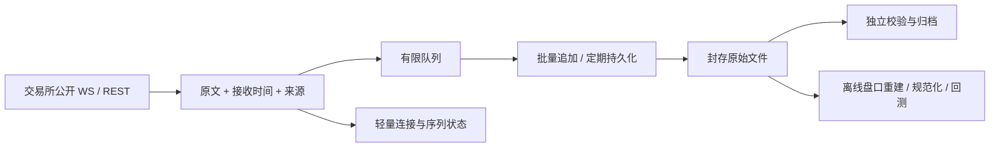

# Recorder：制定新 milestone 前的研究

日期：2026-10-26。状态：**制定计划前的研究快照**。研究之后，用户确认按十币设计、首批 BTC/ETH 上线、连续性 99.5%、暂不考虑突然断电；后续开发入口为 [生产 milestone plan](../../production_milestone_plan.md)。以下结论中的“尚未采纳”描述研究完成当时的状态，不是当前开发指令。

## 先说结论

现有项目确实有精简空间，尤其是运行期间的处理链和验收流程。但证据还不支持“所有问题都是 Python 慢”或“删掉防御代码就能稳定”。比较合适的方向是：**先可靠保存交易所原始消息，把重建、报表、规范化和完整审计尽量放到采集之外；错误按影响范围处理。**

Cryptofeed 是值得认真评估的采集组件候选，HftBacktest 的 Rust collector 是值得借鉴的轻量实现。当前没有同载荷的跨项目实测，不能宣布任一个比 Recorder 更快或更可靠。Python 版本和许可证不作为本轮技术筛选门槛，按项目所有者最新要求处理。

旧 `milestone_plan.md` 和兼容入口 `qualification_to_24h_plan.md` 已在本地工作区删除；历史引用指向不可变旧版本，已有数据和验收证据保留。没有新建替代计划，也没有改动生产采集代码或启动生产服务。

## 1. 已确定的首版范围

用途是保存完整的原始公开数据，供离线研究和回测。覆盖所选标的对应的现货、U 本位永续与交割、币本位永续与交割；期权暂缓。

本报告暂将“BTC 的现货”解释为 `baseAsset=BTC` 的可交易报价对，包括不同报价币；不自动扩张成所有以 BTC 为报价币的资产，如 ETHBTC。标的与合约的映射应来自交易所元数据，不能用字符串前缀猜测，尤其是带数量倍率的代币合约。

“10 币种”是产品设计起点。一个币种可能对应很多产品和频道，配置应同时显示币种数、产品数、订阅数、消息速率和日增量。10 币种不等于 10 条 WebSocket，也不等于当前 VPS 的容量承诺。

### 公开数据家族清单

以下是根据 Binance 当前 Agent Native 索引和所选官方文档整理的**范围清单**，并非已经实现或逐接口完成线上验证的覆盖证明。完整端点清单、权限、支持市场、更新频率和有效数据条件仍需在新计划采用前收敛。特别是标为 MARKET_DATA 的 REST 接口也要核对是否需要密钥；当前项目只允许公开、无需账户凭据的访问。

| 数据家族 | 现货 | U 本位 / 币本位合约 | 对 Recorder 的含义 |
| --- | --- | --- | --- |
| 市场与产品目录 | exchangeInfo、交易规则、状态 | 合约类型、到期日、交易状态、合约变更、适用交易时段 | 独立保存元数据；识别新合约、到期和下架；全局响应不按币重复请求 |
| 成交 | trade、aggTrade、独立的大宗成交及其历史接口 | 已发布的成交、聚合成交、历史成交接口；逐接口核对可用传输 | 聚合成交不能替代所有单笔信息；不凭第三方订阅名推断 Binance 支持的频道 |
| 盘口 | diff depth、REST snapshot、partial depth、bookTicker | 对应盘口源，以及独立 RPI 深度等可用源 | 原样留存快照与增量；标记断线、序列断裂和快照边界 |
| K 线与行情摘要 | 普通 / 时区 K 线、ticker、miniTicker、rolling window、avgPrice | 合约 / 连续合约 / 指数 / 标记价 K 线、ticker、bookTicker | 用户要交易所发布值，不能仅因可自行计算便删除原始频道 |
| 价格与定价规则 | referencePrice、计算配置、executionRules | markPrice、indexPrice、premiumIndex、指数成分 / composite index | 保存相关配置和原始响应，不能只保存最终价格 |
| 衍生品特有数据 | 不适用 | funding、OI 及历史、多空比例、主动买卖量、basis、清算推送、交割结算价 | 不同数据有不同发布周期和可回补范围 |
| 其他公开风险 / 资产信息 | 按实际适用性 | insurance、ADL 风险、assetIndex、交易时段等当前索引列出的适用接口 | 有些是全市场或按资产发布，单独采一次并建立关联 |

同一数据家族的等价传输可以选择一个权威入口，避免为“全”而重复采集；字段、采样规则或可见信息不同则不能当成等价。例如普通深度与 RPI 深度、聚合成交与单笔成交。低频轮询的周期应服从发布频率与请求权重。

“完整原始数据”应定义为：保存订阅接口实际交付的消息、原始响应与来源时间，并诚实记录不可知区间。交易所自身的聚合、采样、快照深度限制或断线期间的事件，不能被 Recorder 证明为全量市场事件。保存内容正确、采集连续性和交易所事件覆盖率必须分别报告。

官方来源的 URL、取得时间和响应 SHA-256 在 [binance-sources.json](binance-sources.json)，也登记在 [全项目来源索引](../../binance_sources.md)。首要入口为 [Binance 当前文档索引](https://developers.binance.com/en/docs/llms.txt)。

## 2. 成熟项目：具体借什么，哪里不能直接套用

全部评估都是固定提交的源码 / 文档检查，没有把 star 数或 README 宣传当成长跑证明。精确提交和文件 Git blob SHA 在 [open-source-sources.json](open-source-sources.json)。

| 项目 | 可借鉴或复用的具体做法 | 对我们有实际影响的不足 | 本轮判断 |
| --- | --- | --- | --- |
| [Cryptofeed](https://github.com/bmoscon/cryptofeed/tree/4679bff3e2041f14c2e8d92e9793e2a39e168b97) | `connection.py` 在将消息交给解析器前调用原始录制回调；`capture/recorder.py` 提供 PCAP 录制、轮换、压缩和回放相关设施；有 Binance 多市场适配 | 正常回调处理的是归一化数据；原始捕获回调在读取路径上被 await，仍需评估慢写盘影响；当前 receive 时间来自 `time.time()` 浮点值；我们的持久性、缺口、恢复和完整覆盖要求尚未验证 | **优先做组件替换候选**；最先借鉴“解析前原始录制 + 捕获文件回放”，不直接整仓迁移 |
| [HftBacktest collector](https://github.com/nkaz001/hftbacktest/tree/5f3ec40b2afb764e0fea112f941ed85523ef4e88/collector) | 独立 Rust collector；网络任务把接收时间、symbol、原始消息交给 writer；按日压缩存储；包含 Spot、USD-M、COIN-M 目录 | 当前 `unbounded_channel` 在慢盘时可能无限积压；文件 `create(true).write(true)` 未设 append，重启同日写入需要修正；样例 USD-M `@trade` / `@depth@0ms` 必须对照当前官方协议，不能照抄；频道清单远未涵盖本次范围 | **参考轻量 Rust 通路**；如果后续实测表明 Python 路径成为瓶颈，再对等实现和比较 |
| [Binance 官方 Python connector](https://github.com/binance/binance-connector-python/tree/d70e4dc58a1773cd129815157d2e1b44bb81392d) | 按 Spot / USD-M / COIN-M 划分产品 SDK；复用 REST 参数和模型维护、请求权重与连接生命周期实现 | 所查 WebSocket 通用层先 `json.loads` 后分发；普通模型回调不是原始字节保真的证明；它也不提供我们的磁盘归档与恢复系统 | **继续优先用于适合的 REST 接入**；是否用于原始 WS 录制取决于实际原文接入点 |
| [CCXT](https://github.com/ccxt/ccxt/tree/d3159f7036f93db086cd0414642132fba5401710) | 市场分类与能力表、symbol / contract 元数据、限流、错误分类；`watch_*` 接口的组织方式 | 所查 Binance Pro 实现会解析、归一化并进入 ArrayCache；面向交易消费者的缓存更新不能直接当作每条原始消息档案；我们也不需要多交易所大框架 | **借鉴市场目录和能力矩阵**；不把普通 `watch_*` 返回值作为 Raw 唯一来源 |
| [NautilusTrader](https://github.com/nautechsystems/nautilus_trader/tree/730f1b37bf80c54b90ddfdb9d0d2693f3db07d0e) | Binance 多产品身份建模、交易所时间与接收时间区分、Rust 核心与 Python 控制层分工、历史回放的数据接口 | 完整交易 / 回测引擎远超采集任务；适配器产出领域数据，并不自动满足我们原文档案与全部端点要求 | **借鉴产品身份与模块边界**；不引入整套交易引擎 |
| [Binance public-data](https://github.com/binance/binance-public-data/tree/d571690eb66760763b0bd6e27e8cd35603c7e244) | 官方日 / 月历史文件、校验文件、修订记录；可作为独立历史导入来源 | 不是所有实时盘口和辅助数据的档案；没有本机接收时间；不能填补任意实时缺口 | **直接复用适用历史源**，与实时采集分开标注来源 |
| [Cryptostore](https://github.com/bmoscon/cryptostore/tree/8a4310d6ca1d52f294e015c802863f1ff9da44e2) | 用配置组装 Cryptofeed 与存储后端，采集与消费者分工直观 | 仓库已归档，不能作为持续维护的主底座；为本项目引入多个数据库和队列没有必要 | **仅参考配置与部署组织方式** |
| [binance-microstructure-recorder](https://github.com/ccakirr/binance-microstructure-recorder/tree/ac0517efe717a27ddb0a8a1151dda880bdba8b07) | 小代码体量、批量写入、保存连接事件和元数据，展示了简单实现方式 | 新项目，缺少充分维护 / 长跑证据；范围有限；Parquet 列式结果不等于保存原始 WS 字节 | **简单实现参照，不列为成熟替代品** |

最值得拿来的不是全部依赖，而是五件事：原始消息先记录；产品目录显式建模；有限队列和批量写入；采集文件可回放；离线派生消费同一份 Raw。

## 3. 当前项目究竟哪里有问题

### 先分清代码和已有结果

| 对象 | 本次核对的版本 / 事实 |
| --- | --- |
| 本地工作区基础 | `9e8ec373a5e9e8bede36cd6f5ff9a21cd355fb3b`，含未提交改动；不等于最新远端 |
| 本轮审查的远端 main | `01d74212793e2bf1895f903a01868d6832b0b2cb`；领先本地基础 108 commits |
| 本次 VPS 基准真正执行的包 | `20e57f30682e88b4090cc2f0da34aa26fca4de2e`；124 个已安装 Python 源文件全部与该提交一致，见 [源文件匹配结果](baseline/source-match.json) |
| 原 N1，BTC 的 Spot + USD-M | 已有一次自己的 24h，45,893,093 条已保存记录通过完整核验，监控 2876/2880=99.861111% |
| 原 N2，BTC + ETH 的 Spot + USD-M | 实际运行 86400.144s，62,687,921 条已保存记录核验通过；监控 2861/2880=99.340278%，未过原定 99.5% 门槛 |
| 后来的 N2 重试 | 10 月 25 日有正式计时开始前的 warm 失败；不能把原 N2 的 24h 完成事实抹掉，也不能把重试当成已通过 |

N1/N2 的数据结论来自 [远端 N1 验收记录](https://github.com/tomohikoAmada/BinanceMarketDataRecorder/blob/01d74212793e2bf1895f903a01868d6832b0b2cb/docs/milestone_acceptance/R2-capacity-n1-btc-owner24h-20261020.md) 和 [N2 验收记录](https://github.com/tomohikoAmada/BinanceMarketDataRecorder/blob/01d74212793e2bf1895f903a01868d6832b0b2cb/docs/milestone_acceptance/R2-capacity-n2-btc-eth-owner24h-20261022.md)，不是这次重新打开生产 Raw 得出的结果。N2 的 19 个失败采样槽包括 17 个 bookTicker 断连槽和 2 个 OI 网络错误槽；尚不能据此认定“双币种超过 CPU 容量”。

旧日报在共享锁下写历史报告、影响采集的缺陷已经在后续版本通过独立报告进程修正，见 [ADR-0049](https://github.com/tomohikoAmada/BinanceMarketDataRecorder/blob/01d74212793e2bf1895f903a01868d6832b0b2cb/docs/adr/0049-isolate-daily-reports-from-capture.md)。不能把本地旧版本的已修问题继续当作当前 VPS 根因。

### 运行时耦合：按证据排序

| 优先级 | 当前具体情况 | 建议边界与仍须验证的内容 |
| --- | --- | --- |
| 高 | `ProductKey` / schema 仍主要限定 `spot` 和 `um_perpetual`；USD-M 检查 `st == 1`、`ps == symbol` | 扩大市场范围必须先修产品身份、路由与契约。COIN-M 和交割合约不能靠添加几个 symbol 冒充支持 |
| 高 | 每条消息仍进行 envelope 构造、快照、canonical CBOR、统计更新、单帧 `os.write`；现有线程移交已经批量，不能说“完全没有 batching” | 比较真正的批量编码 / 批量写系统调用和精简 envelope 的成本；保留可恢复边界与已承诺的落盘语义；不能未测就删除校验 |
| 高 | 连续性、盘口同步、单条数据处理和 collector readiness 存在联动；同一产品的会话包含多流与快照任务 | 网络断线应重连、盘口断序应重建、低频接口失败应单独标记；不要让辅助接口恢复成为 Raw 接收的常规前置条件 |
| 中 | 接收循环每条消息创建 recv、stop、server-shutdown 等 task 并等待 / 取消；各种观察与统计回调在高频链上 | 评估长寿命接收任务与外层取消、批量指标和低频快照；本轮尚未测出其独立 CPU 占比 |
| 中 | 订阅、REST、重建、Raw、指标和关闭逻辑集中在 Collector / stream 实现中 | 只拆出实际需要的 transport、raw writer、后台元数据任务；不先造多交易所插件框架 |
| 中 | 封存、SQLite 元数据和初始空分片生命周期在本次 profile 中明显 | 区分启动成本与稳态成本；合并合理事务、减少重复操作前先核对持久化恢复要求 |

Raw 保存可以早于完整解析，但不是“不检查任何事情”。接收时间、来源、连接、频道及必要序列要保留；不认识的新字段也要原样存下。格式坏消息可以保存并标记，不应自动导致整个产品停止。对于磁盘写失败、无法维持有界缓冲或磁盘即将满，仍必须明确停止受影响的采集并暴露缺口，不能安静丢消息。

### 流程耦合比代码复杂度更明显

现有历史流程包含大量前置证明、双重完整读取、独立重建、有限保护窗口和私有辅助脚本。它们曾发现真实问题，但也制造了自己的失败面：例如选定数据的审计因 Python spawn 入口重复执行而失败，不能因此判定数据采集本身失败。

新流程应把三件事分开：

1. 服务能否持续接收和保存数据：实时关注进程、队列、磁盘、写入延迟、断线恢复与覆盖缺口。
2. 已保存数据是否正确：由独立任务检查已封存文件；结果异常应定位文件与时间区间，而不是每次把全部长跑时间作废。
3. 这次验收是否满足既定指标：测试报告如实保留失败，不为了通过而事后改分母或隐藏错误。

旧证据和旧门槛继续作为历史事实保留。新的审计深度、频率和通过标准需要在替代计划中明确采用，不能借本次研究悄悄降低现行数据契约。未来应消除为一次测试不断新增私有 helper / receipt / review 的循环，把常用操作收敛成少量稳定命令。

## 4. 可复查的性能起点

实际 VPS 核心路径基准、火焰图、测量限制及复现方法在 [baseline/README.md](baseline/README.md)。固定输入的 1、2、10 币种测试已经执行，保存内容逐条与输入核对，同时验证 CRC 和文件摘要。没有替换生产 venv，没有访问历史 Raw，没有改 systemd 或启动生产采集。

目前可以说的是：当前核心路径存在值得优化的开销，主机可用 CPU 也在波动。不能说的是：已经找到了所有 CPU 消耗的精确百分比，已经确认主要瓶颈是语言，或者当前主机能稳定采集 10 个币种的全部市场。

## 5. 建议先达成的设计共识

建议把实时采集压缩为一条短通路：

这是讨论方向，不是已经落地的新架构。是否继续使用当前 Raw 格式、采用 Cryptofeed 的 transport 或 raw capture、以及是否局部使用 Rust，需要同输入下的正确性和成本证据。现阶段更合理的顺序是先精简边界和高频路径，再决定是否值得换语言。

用户确定的上线验证顺序保留为需求：从 1 币种开始，2h → 24h → 增加币种；错误明显增加时定位原因、减少币种留出余量，再做 48h 和 72h。增长期间同时记录消息量、覆盖产品数、CPU、steal、RSS、磁盘日增量、队列与错误分布。孤立的交易所网络故障不能直接被判定为容量上限，也不以“没有 ERROR 日志”代替数据检查。

在确定 milestone 前仍要收敛的事项：完整数据家族到实际端点的映射与去重；选定的组件组合；真实全功能负载与本次离线基准的对应关系；新的持续运行 / 已保存正确性指标。这里没有建立额外的大型故障注入或容量测试框架。

## 6. 本轮交付边界

- 完成：旧计划本地退役；区分本地、远端、已安装版本；源码级候选比较；范围清单；核心路径 VPS 基准和真实采样火焰图；精简与解耦建议。
- 未完成：候选项目同输入性能 A/B、全部新市场适配、所有接口的线上覆盖核验、真实全功能稳态 CPU 分解、生产容量上限与 48h/72h 长跑。
- 新 milestone 尚未采纳；本轮没有生产修复部署、提交或推送。
